# Application Programming Interface Description

# Table of Contents

- [1. Auth](#1-auth)
  - [1.1. Login](#11-login)
  - [1.2. Register](#12-register)
  - [1.3. Forgot Password](#13-forgot-password)
  - [1.4. Verify OTP](#14-verify-otp)
  - [1.5. Reset Password](#15-reset-password)
  - [1.6. Google Login](#16-google-login)
  - [1.7. Refresh Token](#17-refresh-token)
- [2. Store](#2-store)
  - [2.1. Create Store](#21-create-store)
  - [2.2. Update Store](#22-update-store)
  - [2.3. Delete Store](#23-delete-store)
  - [2.4. Restore Store](#24-restore-store)
  - [2.5. Get Stores](#25-get-stores)
  - [2.6. Get Store By Id](#26-get-store-by-id)
  - [2.7. Get Deleted Stores](#27-get-deleted-stores)
  - [2.8. Search stores](#28-search-stores)

## 1. Auth

### 1.1 Login

#### API Information

- **Method:** `POST`
- **URL:** `http://<host>:<port>/api/auth/login`
- **Content-Type:** `application/json`
- **Rate Limiting Policy:** `LoginPolicy`

The `<host>` and `<port>` depend on the deployment environment. For example, when running the backend locally, the URL may be `http://localhost:5070/api/auth/login`.

#### Description

This API authenticates a user using their email address and password. If the credentials are valid, the system generates an access token and a refresh token, stores the refresh token's hash in Redis with a configured expiration time, and returns the authentication information to the client.

The API does not allow users who are deleted or users who do not have a local password to log in using this method.

#### Request

The client sends a JSON object containing the user's email address and password.

**Request Body:**

| Field | Type | Required | Description |
|---|---|---|---|
| `Email` | String | Yes | The user's email address. Must be a valid email address and must not exceed 255 characters. |
| `Password` | String | Yes | The user's password. Must contain 6–15 non-whitespace characters, including at least one uppercase letter, one lowercase letter, one digit, and one special character. Spaces are not allowed. |

**Example Request:**

```json
{
  "email": "user@example.com",
  "password": "Password@123"
}
```

#### Response

The API returns a standardized `ApiResponse<T>` JSON object. The response includes the operation status, response code, message, HTTP status code, and response data.

**1. Successful Login — HTTP 200 OK**

Returned when the user exists, is not deleted, has a local password, and provides the correct password.

```json
{
  "isSuccess": true,
  "responseCode": "S002",
  "message": "Successful!",
  "httpStatus": 200,
  "data": {
    "userId": "00000000-0000-0000-0000-000000000000",
    "accessToken": "<access-token>",
    "refreshToken": "<refresh-token>"
  }
}
```

The `userId` is the user's unique identifier. The `accessToken` is used to authenticate subsequent requests, while the `refreshToken` is used to obtain a new access token according to the refresh-token workflow.

**2. Invalid Request — HTTP 400 Bad Request**

Returned when the request fails model validation, such as when the email is missing or invalid, or the password does not satisfy the validation rules.

```json
{
  "isSuccess": false,
  "responseCode": "E001",
  "message": "Request is invalid!",
  "httpStatus": 400,
  "data": [
    "The Password field must contain at least one uppercase letter."
  ]
}
```

The `data` array contains validation error messages. The exact messages depend on the validation errors encountered.

**3. User Not Found or Deleted — HTTP 404 Not Found**

Returned when the email does not correspond to an existing user or the user has been deleted.

```json
{
  "isSuccess": false,
  "responseCode": "E005",
  "message": "Not found data!",
  "httpStatus": 404,
  "data": null
}
```

**4. Login Failed — HTTP 400 Bad Request**

Returned when the password is incorrect or the user does not have a local password, such as an account registered through an external authentication provider.

```json
{
  "isSuccess": false,
  "responseCode": "E006",
  "message": "Login Failed!",
  "httpStatus": 400,
  "data": null
}
```

**5. Too Many Requests — HTTP 429 Too Many Requests**

Returned when the client exceeds the request limit configured by `LoginPolicy`.

```json
{
  "status": 429,
  "message": "Too many requests. Please try again later."
}
```

This response is generated by the ASP.NET Core Rate Limiting middleware and has a different structure from the standard `ApiResponse<T>` format.

**6. Internal Server Error — HTTP 500 Internal Server Error**

Returned when an unexpected server-side exception occurs, such as an unhandled infrastructure or service error.

```json
{
  "isSuccess": false,
  "responseCode": "E002",
  "message": "Internal server error!",
  "httpStatus": 500,
  "data": null
}
```

#### Sequence Diagram

The following sequence diagram illustrates the login workflow, including request validation, rate limiting, user verification, password verification, token generation, and refresh-token storage in Redis.

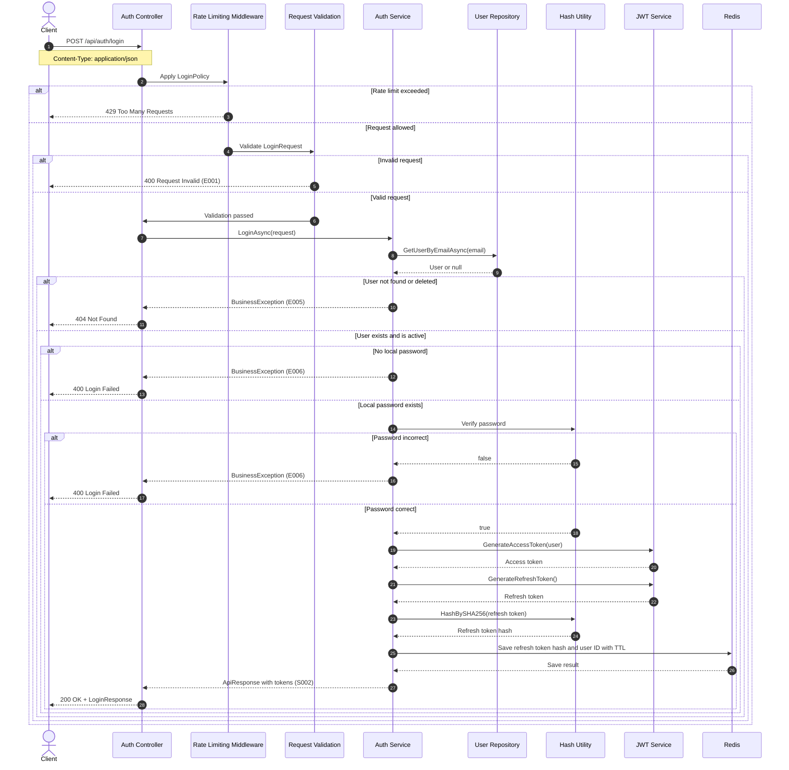

#### Notes

- The refresh token is stored in Redis using the key format `refresh_token:{refreshTokenHash}`. The raw refresh token is returned to the client, while its hash is used as the Redis key and stored value.
- The Redis entry expires after the number of days configured by `RefreshTokenExpirationDays`.
- The `LoginPolicy` rate limit is enforced before the login action executes. When the limit is exceeded, the client receives HTTP 429.
- The exception-handling middleware maps `BusinessException` instances to their corresponding `ErrorRecord` responses and maps unexpected exceptions to HTTP 500.
- The HTTP status codes and response bodies documented above reflect the supplied implementation. The exact limits, expiration values, and validation messages depend on the application configuration and validation rules.

### 1.2. Register

#### API Information

- **Method:** `POST`
- **URL:** `http://<host>:<port>/api/auth/register`
- **Content-Type:** `application/json`
- **Rate Limiting Policy:** `OtpPolicy`

The `<host>` and `<port>` depend on the deployment environment. For example, when running the backend locally, the URL may be `http://localhost:5070/api/auth/register`.

The `OtpPolicy` rate limiting policy controls the number of registration requests a client can send within a configured period. If the request limit is exceeded, the API returns HTTP `429 Too Many Requests`.

#### Description

This API initiates the user registration process by accepting the user's full name, email address, and password. It checks whether the email address is already registered, generates a six-digit One-Time Password (OTP), hashes the password, and temporarily stores the registration information in Redis.

The API then publishes an OTP email message to the Kafka topic `send-otp-email` for asynchronous email delivery. The client receives the OTP expiration duration and must complete the OTP verification process to continue registration.

**Note:** This API initiates registration but does not create the user account directly. The registration information is temporarily stored in Redis until it expires or is processed by the subsequent verification workflow.

#### Request

The client sends a JSON object containing the user's full name, email address, and password.

**Request Body:**

| Field | Type | Required | Description |
|---|---|---|---|
| `FullName` | String | Yes | The user's full name. Must not exceed 255 characters. |
| `Email` | String | Yes | The user's email address. Must be a valid email address and must not exceed 255 characters. |
| `Password` | String | Yes | The user's password. Must contain 6–15 non-whitespace characters, including at least one uppercase letter, one lowercase letter, one digit, and one special character. Spaces are not allowed. |

**Example Request:**

```json
{
  "fullName": "Nguyen Van A",
  "email": "user@example.com",
  "password": "Password@123"
}
```

#### Response

The API returns a standardized `ApiResponse<T>` JSON object for successful operations and application-level errors. The response includes `IsSuccess`, `ResponseCode`, `Message`, `HttpStatus`, and `Data`, except for the rate-limiting response, which uses a different format.

**1. Registration Initiated Successfully — HTTP 200 OK**

Returned when the email address is not already registered, the pending registration information is saved in Redis, and the OTP email message is successfully published to Kafka.

```json
{
  "isSuccess": true,
  "responseCode": "S001",
  "message": "Register is successfully!",
  "httpStatus": 200,
  "data": {
    "otpExpirySeconds": 120
  }
}
```

The `otpExpirySeconds` field specifies how long the OTP remains valid, in seconds. The example uses `120` seconds; the actual value depends on the `OtpExpirySeconds` configuration.

**2. Invalid Request — HTTP 400 Bad Request**

Returned when the request fails model validation, such as when a required field is missing, the email address is invalid, a field exceeds its maximum length, or the password does not satisfy the specified requirements.

```json
{
  "isSuccess": false,
  "responseCode": "E001",
  "message": "Request is invalid!",
  "httpStatus": 400,
  "data": [
    "The Email field is required."
  ]
}
```

The `data` array contains validation error messages. The exact messages depend on the validation errors encountered.

**3. Email Already Registered — HTTP 409 Conflict**

Returned when the supplied email address already belongs to an existing user.

```json
{
  "isSuccess": false,
  "responseCode": "E004",
  "message": "User is exists!",
  "httpStatus": 409,
  "data": null
}
```

**4. Too Many Requests — HTTP 429 Too Many Requests**

Returned when the client exceeds the request limit configured by `OtpPolicy`.

```json
{
  "status": 429,
  "message": "Too many requests. Please try again later."
}
```

This response is generated by the ASP.NET Core Rate Limiting middleware and does not follow the standard `ApiResponse<T>` structure.

**5. Internal Server Error — HTTP 500 Internal Server Error**

Returned when an unexpected exception occurs during registration, such as a Redis failure, a Kafka publishing failure, or another unhandled server-side error.

```json
{
  "isSuccess": false,
  "responseCode": "E002",
  "message": "Internal server error!",
  "httpStatus": 500,
  "data": null
}
```

The API's exception-handling middleware maps unexpected exceptions to this response. The exact cause should be investigated using server-side logs.

#### Sequence Diagram

The following sequence diagram illustrates the registration workflow, including rate limiting, request validation, checking for an existing user, OTP generation, password hashing, temporary storage in Redis, and publishing the OTP email message to Kafka.

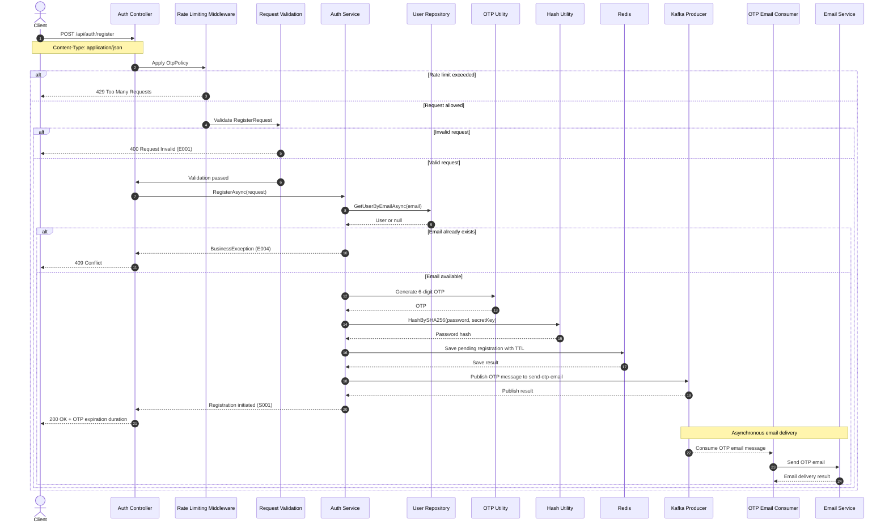

#### Notes

- The OTP is generated using `OtpUtility.Generate(len: 6)`.
- The password is hashed using SHA-256 with the configured secret key before it is stored in the pending registration model.
- Pending registration information is stored in Redis using the key format `pending-registration:{email}` and expires after `OtpExpirySeconds`.
- The OTP email message is published to the Kafka topic `send-otp-email`. An email consumer processes the message asynchronously, so email delivery does not need to occur within the registration HTTP request.
- The rate limit is enforced by `OtpPolicy`. The exact request limit and time window depend on the rate-limiting configuration.
- The documented success response is returned only after the service completes the Redis save and Kafka publish operations without throwing an exception.
- If Redis or Kafka throws an exception, the exception-handling middleware maps the unexpected exception to HTTP 500. However, if Redis succeeds and Kafka publishing subsequently fails, pending registration data may remain in Redis until its TTL expires.
- The sample response values and validation messages are illustrative. Actual values depend on the application configuration and validation framework.

### 1.3. Forgot Password

#### API Information

- **Method:** `POST`
- **URL:** `http://<host>:<port>/api/auth/forgot-password`
- **Content-Type:** `application/json`
- **Rate Limiting Policy:** `OtpPolicy`

The `<host>` and `<port>` depend on the deployment environment. For example, when running the backend locally, the URL may be `http://localhost:5070/api/auth/forgot-password`.

The `OtpPolicy` rate limiting policy limits the number of requests a client can send within a configured time window. If the request limit is exceeded, the API returns HTTP `429 Too Many Requests`.

#### Description

This API initiates the password recovery process for an existing user with a local authentication account. It verifies that the user exists and has not been deleted, generates a six-digit One-Time Password (OTP), and temporarily stores the OTP and user ID in Redis.

The API then publishes an OTP email message to the Kafka topic `send-otp-email` for asynchronous delivery. Upon successful processing, the client receives the OTP expiration duration and can use the OTP in the subsequent password-reset verification workflow.

Users who authenticate through an external provider, such as Google, cannot use this local password recovery process.

#### Request

The client sends a JSON object containing the email address associated with the account.

**Request Body:**

| Field | Type | Required | Description |
|---|---|---|---|
| `Email` | String | Yes | The user's email address. Must be a valid email address and must not exceed 255 characters. |

**Example Request:**

```json
{
  "email": "user@example.com"
}
```

#### Response

The API returns a standardized `ApiResponse<T>` JSON object for successful operations and application-level errors. The response includes `IsSuccess`, `ResponseCode`, `Message`, `HttpStatus`, and `Data`, except for the rate-limiting response, which uses a different format.

**1. Forgot Password Request Successful — HTTP 200 OK**

Returned when the user exists, is not deleted, uses local authentication, and the pending password-recovery information is saved in Redis and the OTP email message is successfully published to Kafka.

```json
{
  "isSuccess": true,
  "responseCode": "S002",
  "message": "Successful!",
  "httpStatus": 200,
  "data": {
    "otpExpirySeconds": 120
  }
}
```

The `otpExpirySeconds` field specifies how long the OTP remains valid, in seconds. The example uses `120` seconds; the actual value depends on the `OtpExpirySeconds` configuration.

**2. Invalid Request — HTTP 400 Bad Request**

Returned when the request fails model validation, such as when the email is missing, has an invalid format, or exceeds 255 characters.

```json
{
  "isSuccess": false,
  "responseCode": "E001",
  "message": "Request is invalid!",
  "httpStatus": 400,
  "data": [
    "Invalid email format"
  ]
}
```

The `data` array contains validation error messages. The exact messages depend on the validation errors encountered.

**3. User Not Found or Deleted — HTTP 404 Not Found**

Returned when the email address does not correspond to an existing user or the user has been deleted.

```json
{
  "isSuccess": false,
  "responseCode": "E005",
  "message": "Not found data!",
  "httpStatus": 404,
  "data": null
}
```

**4. User Does Not Use Local Authentication — HTTP 403 Forbidden**

Returned when the account uses an authentication provider other than `Local`, such as Google authentication.

```json
{
  "isSuccess": false,
  "responseCode": "E010",
  "message": "User not log in locally",
  "httpStatus": 403,
  "data": null
}
```

**5. Too Many Requests — HTTP 429 Too Many Requests**

Returned when the client exceeds the request limit configured by `OtpPolicy`.

```json
{
  "status": 429,
  "message": "Too many requests. Please try again later."
}
```

This response is generated by the ASP.NET Core Rate Limiting middleware and does not follow the standard `ApiResponse<T>` structure.

**6. Internal Server Error — HTTP 500 Internal Server Error**

Returned when an unexpected exception occurs during password recovery, such as a Redis failure, a Kafka publishing failure, or another unhandled server-side error.

```json
{
  "isSuccess": false,
  "responseCode": "E002",
  "message": "Internal server error!",
  "httpStatus": 500,
  "data": null
}
```

The exception-handling middleware logs the exception and maps unexpected errors to this response. The underlying cause should be investigated using server-side logs.

#### Sequence Diagram

The following sequence diagram illustrates the password recovery workflow, including rate limiting, request validation, user verification, authentication-provider checking, OTP generation, temporary storage in Redis, and asynchronous email delivery through Kafka.

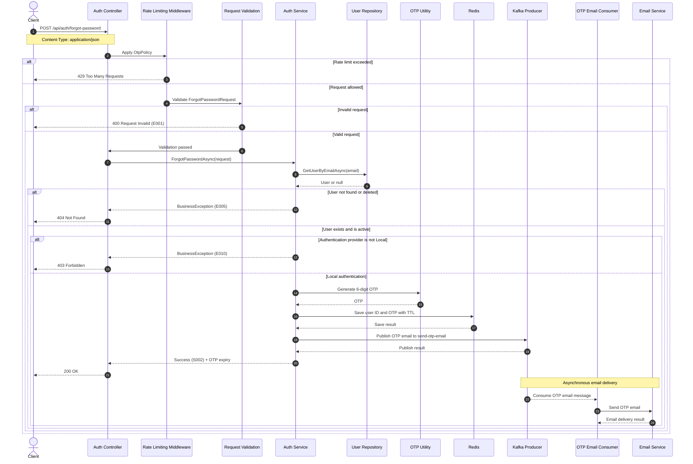

#### Notes

- The OTP is generated using `OtpUtility.Generate(len: 6)`.
- Pending password-recovery information is stored in Redis using the key format `pending-forgot-password:{email}`.
- The Redis entry contains the user's ID and OTP and expires after `OtpExpirySeconds`.
- The OTP email message is published to the Kafka topic `send-otp-email`. The email consumer processes the message asynchronously.
- The rate limit is enforced by `OtpPolicy`. The exact request limit and time window depend on the rate-limiting configuration.
- The API initiates password recovery but does not change the user's password. The client must complete the subsequent OTP verification and password-reset steps.
- If Redis or Kafka throws an exception, the exception-handling middleware maps an unexpected exception to HTTP 500. If the Redis save succeeds but Kafka publishing fails, the pending recovery record may remain until it expires.
- The documented status codes and response structures reflect the supplied implementation. Actual OTP expiration values and validation messages depend on the application configuration and validation framework.

### 1.4. Verify OTP

#### API Information

- **Method:** `POST`
- **URL:** `http://<host>:<port>/api/auth/verify`
- **Content-Type:** `application/json`
- **Rate Limiting Policy:** `OtpPolicy`

The `<host>` and `<port>` depend on the deployment environment. For example, when running the backend locally, the URL may be `http://localhost:5070/api/auth/verify`.

The `OtpPolicy` rate limiting policy limits the number of requests a client can send within a configured time window. If the request limit is exceeded, the API returns HTTP `429 Too Many Requests`.

#### Description

This API verifies a six-digit One-Time Password (OTP) submitted by the client. It supports two workflows: completing a new user registration and verifying a password recovery request.

The service first checks whether the submitted email address belongs to an existing user:

- **Registration verification:** If the user does not exist, the service retrieves the pending registration information from Redis, validates the OTP, creates the user account, and deletes the pending registration data.
- **Forgot password verification:** If the user already exists, the service retrieves the pending password recovery information from Redis, validates the OTP, generates a reset password key, stores the reset information in Redis, and deletes the pending recovery data.

The response identifies the next action through the `Action` field. For password recovery, the client uses the returned `ResetPasswordKey` in the subsequent password-reset workflow.

#### Request

The client sends a JSON object containing the email address and OTP.

**Request Body:**

| Field | Type | Required | Description |
|---|---|---|---|
| `Email` | String | Yes | The email address associated with the registration or password recovery request. Must be a valid email address and must not exceed 255 characters. |
| `Otp` | String | Yes | The OTP to verify. Must contain exactly six numeric digits. |

**Example Request:**

```json
{
  "email": "user@example.com",
  "otp": "123456"
}
```

#### Response

The API returns a standardized `ApiResponse<T>` JSON object for successful operations and application-level errors. The response includes `IsSuccess`, `ResponseCode`, `Message`, `HttpStatus`, and `Data`.

**1. Registration Verified Successfully — HTTP 200 OK**

Returned when the OTP matches the pending registration OTP and the new user account is successfully created.

```json
{
  "isSuccess": true,
  "responseCode": "S002",
  "message": "Successful!",
  "httpStatus": 200,
  "data": null
}
```

The `Data` field is `null` because the registration verification workflow returns a successful response without additional data.

**2. Password Recovery OTP Verified Successfully — HTTP 200 OK**

Returned when the OTP matches the pending password recovery OTP. The service generates a reset password key, stores the associated user ID and key in Redis, and removes the pending password recovery record.

```json
{
  "isSuccess": true,
  "responseCode": "S002",
  "message": "Successful!",
  "httpStatus": 200,
  "data": {
    "resetPasswordKey": "00000000-0000-0000-0000-000000000000",
    "action": "ForgotPassword"
  }
}
```

- `resetPasswordKey`: A newly generated GUID used to authorize the subsequent password-reset operation.
- `action`: Identifies the next workflow. For password recovery, the value is `ForgotPassword`. The exact JSON representation depends on the `AuthAction` enum serialization configuration.

The reset password key expires after the configured `ResetPasswordExpiryMinutes` duration.

**3. Invalid Request — HTTP 400 Bad Request**

Returned when the request fails model validation, such as when the email is missing or invalid, or the OTP does not contain exactly six digits.

```json
{
  "isSuccess": false,
  "responseCode": "E001",
  "message": "Request is invalid!",
  "httpStatus": 400,
  "data": [
    "OTP must be exactly 6 digits."
  ]
}
```

The `data` array contains validation error messages. The exact messages depend on the validation errors encountered.

**4. OTP Expired or Not Found — HTTP 403 Forbidden**

Returned when the corresponding pending registration or password recovery record cannot be found in Redis, typically because the OTP has expired or the pending record no longer exists.

```json
{
  "isSuccess": false,
  "responseCode": "E007",
  "message": "OTP has expired!",
  "httpStatus": 403,
  "data": null
}
```

**5. Invalid OTP or Registration Failure — HTTP 400 Bad Request**

Returned when the submitted OTP does not match the stored OTP. The same error is also returned when creating the user account fails in the registration workflow.

```json
{
  "isSuccess": false,
  "responseCode": "E008",
  "message": "Failed!",
  "httpStatus": 400,
  "data": null
}
```

**6. Too Many Requests — HTTP 429 Too Many Requests**

Returned when the client exceeds the request limit configured by `OtpPolicy`.

```json
{
  "status": 429,
  "message": "Too many requests. Please try again later."
}
```

This response is generated by the ASP.NET Core Rate Limiting middleware and does not follow the standard `ApiResponse<T>` structure.

**7. Internal Server Error — HTTP 500 Internal Server Error**

Returned when an unexpected exception occurs during OTP verification, such as a Redis or database failure.

```json
{
  "isSuccess": false,
  "responseCode": "E002",
  "message": "Internal server error!",
  "httpStatus": 500,
  "data": null
}
```

The exception-handling middleware logs unexpected exceptions and maps them to this response.

#### Sequence Diagram

The following sequence diagram illustrates both OTP verification workflows: registration verification and password recovery verification.

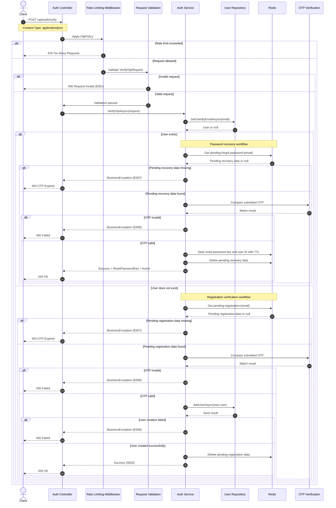

#### Notes

- The API uses `OtpPolicy` for rate limiting. The exact request limit and time window depend on the rate-limiting configuration.
- The service selects the verification workflow based on whether `GetUserByEmailAsync` returns an existing user.
- Registration pending data is stored under `pending-registration:{email}`. Password recovery data is stored under `pending-forgot-password:{email}`.
- A missing pending record is treated as an expired OTP and returns error code `E007`.
- An incorrect OTP returns error code `E008`.
- On successful registration verification, the user is created using the full name, email, and password hash stored in Redis. The pending registration record is then deleted.
- On successful password recovery verification, a reset password key is generated and stored in Redis under `reset-password:{resetPasswordKey}`. The stored record contains the reset key and user ID and expires after `ResetPasswordExpiryMinutes`.
- The API does not change the password directly. Password recovery continues through the subsequent password-reset endpoint.
- The documented status codes and response bodies reflect the supplied implementation. Actual enum serialization and validation error messages depend on the application configuration.

### 1.5. Reset Password

#### API Information

- **API URL:** `http://<host>:<port>/api/auth/reset-password`
- **HTTP Method:** `PATCH`
- **Content-Type:** `application/json`
- **Rate Limiting Policy:** Global Rate Limiter (default policy)

#### Description

This API allows users to reset their password using a valid `ResetPasswordKey` obtained from the password recovery process. The API validates the reset key, verifies that it has not expired, checks whether the associated user exists and is not deleted, and ensures that the user's authentication provider is `Local`.

If all checks pass, the API hashes the new password using SHA-256 with the configured security secret key, updates the user's password in the database, and deletes the reset key from Redis to prevent it from being reused.

#### Request

**Request Body:**

| Field | Data Type | Required | Description |
|---|---|---|---|
| `ResetPasswordKey` | `Guid` | Yes | The reset password key obtained from the password recovery process. |
| `NewPassword` | `string` | Yes | The new password that must satisfy the password complexity requirements. |

**Password Requirements:**

- Must contain between 6 and 15 characters.
- Must contain at least one uppercase letter (`A–Z`).
- Must contain at least one lowercase letter (`a–z`).
- Must contain at least one digit (`0–9`).
- Must contain at least one special character.
- Must not contain whitespace.

**Example Request:**

```json
{
  "ResetPasswordKey": "550e8400-e29b-41d4-a716-446655440000",
  "NewPassword": "NewPass@123"
}
```

#### Response

**1. Successful Password Reset — HTTP 200 OK**

Returned when the reset key is valid, the key has not expired, the user meets all requirements, and the password is successfully updated.

```json
{
  "IsSuccess": true,
  "ResponseCode": "S002",
  "Message": "Successful!",
  "HttpStatus": 200,
  "Data": null
}
```

**2. Invalid Request — HTTP 400 Bad Request**

Returned when the request body fails model validation, such as when `ResetPasswordKey` is missing or `NewPassword` does not satisfy the password requirements.

```json
{
  "IsSuccess": false,
  "ResponseCode": "E001",
  "Message": "Request is invalid!",
  "HttpStatus": 400,
  "Data": [
    "The password must be between 6 and 15 characters long, contain at least one uppercase letter, one lowercase letter, one digit, and one special character, and must not contain any spaces."
  ]
}
```

The `Data` array contains the applicable validation error messages. The example above illustrates a password validation failure.

**3. Password Reset Failed — HTTP 400 Bad Request**

Returned when the reset key does not match the key stored in the retrieved reset model, or when the password update operation fails.

```json
{
  "IsSuccess": false,
  "ResponseCode": "E008",
  "Message": "Failed!",
  "HttpStatus": 400,
  "Data": null
}
```

**4. User Not Found — HTTP 404 Not Found**

Returned when the user associated with the reset key does not exist or has been deleted.

```json
{
  "IsSuccess": false,
  "ResponseCode": "E005",
  "Message": "Not found data!",
  "HttpStatus": 404,
  "Data": null
}
```

**5. Reset Password Key Expired or Invalidated — HTTP 403 Forbidden**

Returned when the reset password key cannot be found in Redis, typically because it has expired or has already been deleted.

```json
{
  "IsSuccess": false,
  "ResponseCode": "E011",
  "Message": "Your time to change the password has expired!",
  "HttpStatus": 403,
  "Data": null
}
```

**6. User Does Not Use Local Authentication — HTTP 403 Forbidden**

Returned when the associated user's authentication provider is not `Local`. Users authenticated through external providers cannot reset their password through this API.

```json
{
  "IsSuccess": false,
  "ResponseCode": "E010",
  "Message": "User not log in locally",
  "HttpStatus": 403,
  "Data": null
}
```

**7. Internal Server Error — HTTP 500 Internal Server Error**

Returned when an unexpected exception occurs during request processing, such as an unhandled database or Redis error.

```json
{
  "IsSuccess": false,
  "ResponseCode": "E002",
  "Message": "Internal server error!",
  "HttpStatus": 500,
  "Data": null
}
```

**8. Rate Limit Exceeded — HTTP 429 Too Many Requests**

Returned when the client exceeds the configured global rate limit. The client should wait before sending additional requests.

```json
{
  "status": 429,
  "message": "Too many requests. Please try again later."
}
```

**Notes:**

- Responses for business errors and unexpected exceptions follow the `ApiResponse<T>` format.
- Validation failures use `ValidationErrorResponse`, which returns the validation messages in the `Data` array.
- Rate-limit responses use the configured rate-limiting rejection format and may differ from the standard `ApiResponse<T>` structure.
- The exact request threshold and time window depend on the global rate-limiting configuration.

#### Sequence Diagram

The following sequence diagram illustrates the password reset workflow, including request validation, reset-key verification, user verification, password updating, and possible error responses.

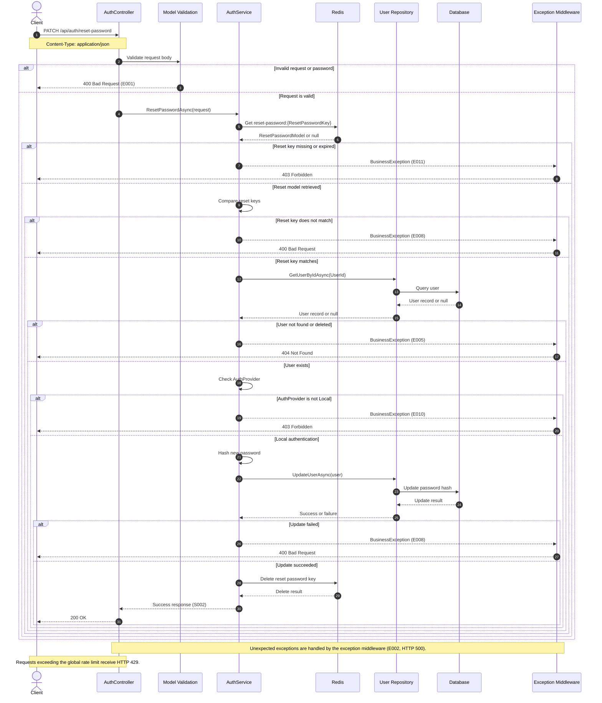

### 1.6. Google Login

#### API Information

- **API URL:** `http://<host>:<port>/api/auth/google-sign-in?idToken=<google-id-token>`
- **HTTP Method:** `POST`
- **Content-Type:** `application/json`
- **Rate Limiting Policy:** `LoginPolicy`

#### Description

This API allows users to authenticate using their Google account. The API verifies the Google ID token, retrieves the user's information from Google, and checks whether the user can sign in.

If the user does not exist in the system, the API automatically creates a new account using the Google account information. If the user already exists and is eligible to sign in, the API generates an access token and a refresh token. The refresh token is stored in Redis as a hashed value with a configured expiration period.

The API returns the user's ID, access token, and refresh token upon successful authentication.

#### Request

**Request Parameter:**

| Parameter | Data Type | Required | Description |
|---|---|---|---|
| `idToken` | `string` | Yes | The Google ID token obtained from the Google authentication process. It is passed as a query parameter. |

**Example Request:**

```http
POST /api/auth/google-sign-in?idToken=<google-id-token> HTTP/1.1
Host: <host>:<port>
Content-Type: application/json
```

**Notes:**
- Replace `<google-id-token>` with a valid Google ID token.
- The `idToken` is supplied through the URL query string, not the request body.
- No JSON request body is required.
- Although the endpoint specifies `application/json`, the request does not contain a JSON body because the input is supplied through the query string.

#### Response

**1. Successful Google Login — HTTP 200 OK**

Returned when the Google ID token is valid and the user is successfully authenticated. If the user does not already exist, a new Google account is created before the tokens are generated.

```json
{
  "IsSuccess": true,
  "ResponseCode": "S002",
  "Message": "Successful!",
  "HttpStatus": 200,
  "Data": {
    "UserId": "550e8400-e29b-41d4-a716-446655440000",
    "AccessToken": "<access-token>",
    "RefreshToken": "<refresh-token>"
  }
}
```

The `Data` object contains:

- `UserId`: The unique identifier of the authenticated user.
- `AccessToken`: The JWT access token used to access protected APIs.
- `RefreshToken`: The refresh token used to obtain a new access token according to the refresh-token workflow.

**2. Google Authentication Failed — HTTP 400 Bad Request**

Returned when the Google ID token is invalid, the user account has been deleted, the user already has a local authentication account, or the user creation operation fails.

```json
{
  "IsSuccess": false,
  "ResponseCode": "E008",
  "Message": "Failed!",
  "HttpStatus": 400,
  "Data": null
}
```

All these cases use the `ErrorRecord.Failed` error response in the current service implementation.

**3. Invalid Request — HTTP 400 Bad Request**

Returned when the request cannot be bound or validated correctly, such as when the required `idToken` parameter is missing and the application's model-binding or validation configuration rejects the request.

```json
{
  "IsSuccess": false,
  "ResponseCode": "E001",
  "Message": "Request is invalid!",
  "HttpStatus": 400,
  "Data": [
    "Invalid request!."
  ]
}
```

The `Data` array contains the applicable validation error messages. The example is illustrative; the actual message depends on the model-binding and validation configuration.

**4. Internal Server Error — HTTP 500 Internal Server Error**

Returned when an unexpected exception occurs during Google token verification, database operations, token generation, or Redis operations.

```json
{
  "IsSuccess": false,
  "ResponseCode": "E002",
  "Message": "Internal server error!",
  "HttpStatus": 500,
  "Data": null
}
```

**5. Rate Limit Exceeded — HTTP 429 Too Many Requests**

Returned when the client exceeds the request limit configured by `LoginPolicy`.

```json
{
  "status": 429,
  "message": "Too many requests. Please try again later."
}
```

The client should wait before retrying the request. The exact request threshold and time window depend on the `LoginPolicy` configuration.

#### Sequence Diagram

The following sequence diagram illustrates the Google login workflow, including token verification, account lookup or creation, authentication checks, token generation, and possible error responses.

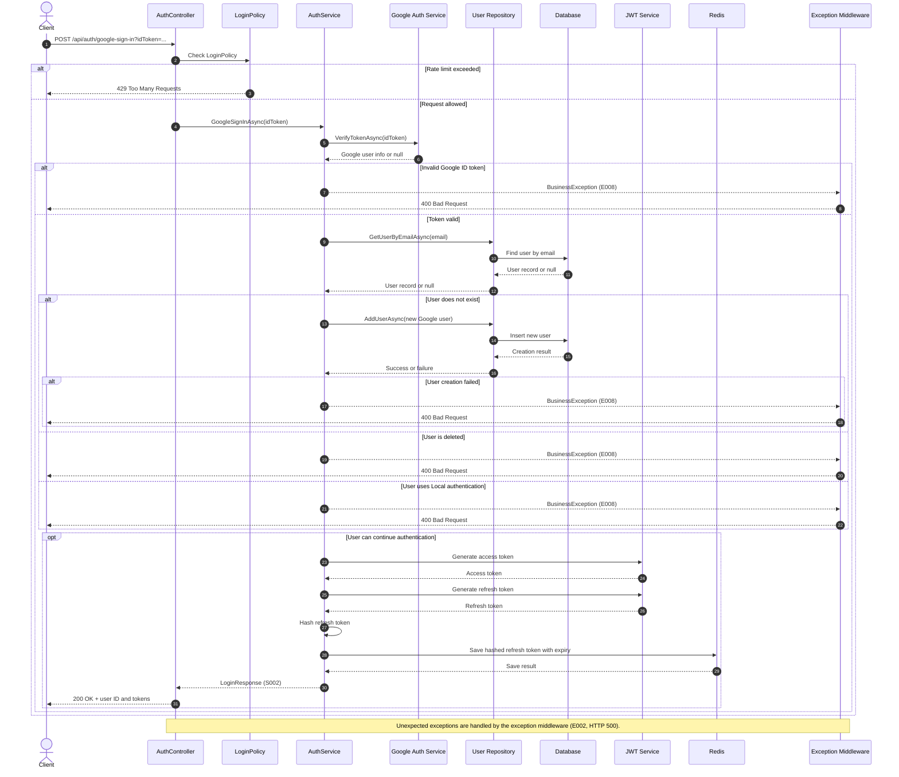

### 1.7. Refresh Token

#### API Information

- **API URL:** `http://<host>:<port>/api/auth/refresh-token`
- **HTTP Method:** `POST`
- **Content-Type:** `application/json`
- **Rate Limiting Policy:** `LoginPolicy`

#### Description

This API allows authenticated users to obtain a new access token and refresh token using a valid refresh token. It verifies the submitted refresh token by hashing it with the configured security secret key and checking the corresponding record in Redis.

If the refresh token is valid and has not expired, the API deletes the old refresh token record, verifies that the associated user exists and is not deleted, generates a new access token and refresh token, and stores the hash of the new refresh token in Redis with the configured expiration period.

This process implements **refresh token rotation**, meaning the old refresh token is invalidated when it is exchanged for a new pair of tokens.

#### Request

**Request Body:**

| Field | Data Type | Required | Description |
|---|---|---|---|
| `RefreshToken` | `string` | Yes | The refresh token previously issued by the authentication API. It is used to obtain a new access token and refresh token. |

**Example Request:**

```http
POST /api/auth/refresh-token HTTP/1.1
Host: <host>:<port>
Content-Type: application/json
```

```json
{
  "RefreshToken": "<refresh-token>"
}
```

**Validation Rules:**

- `RefreshToken` is required.
- The submitted refresh token must correspond to a valid, unexpired refresh token record in Redis.
- The associated user must exist and must not be deleted.

#### Response

**1. Successful Token Refresh — HTTP 200 OK**

Returned when the refresh token is valid and the associated user exists and is not deleted. The API invalidates the old refresh token and returns a new access token and refresh token.

```json
{
  "IsSuccess": true,
  "ResponseCode": "S002",
  "Message": "Successful!",
  "HttpStatus": 200,
  "Data": {
    "UserId": "550e8400-e29b-41d4-a716-446655440000",
    "AccessToken": "<new-access-token>",
    "RefreshToken": "<new-refresh-token>"
  }
}
```

The `Data` object contains:

- `UserId`: The unique identifier of the user.
- `AccessToken`: The newly generated JWT access token.
- `RefreshToken`: The newly generated refresh token, which replaces the previous one.

**2. Invalid Request — HTTP 400 Bad Request**

Returned when the request fails model validation, such as when the required `RefreshToken` field is missing or empty.

```json
{
  "IsSuccess": false,
  "ResponseCode": "E001",
  "Message": "Request is invalid!",
  "HttpStatus": 400,
  "Data": [
    "Refresh token is required!"
  ]
}
```

The `Data` array contains the applicable validation error messages.

**3. Refresh Token Invalid — HTTP 400 Bad Request**

Returned when a refresh token record is retrieved from Redis, but its stored hash does not match the hash calculated from the submitted token.

```json
{
  "IsSuccess": false,
  "ResponseCode": "E008",
  "Message": "Failed!",
  "HttpStatus": 400,
  "Data": null
}
```

**4. Refresh Token Expired or Not Found — HTTP 403 Forbidden**

Returned when the refresh token cannot be found in Redis. This typically occurs because the token has expired, has already been used, or has been invalidated.

```json
{
  "IsSuccess": false,
  "ResponseCode": "E009",
  "Message": "RefreshToken has expired!",
  "HttpStatus": 403,
  "Data": null
}
```

**5. User Not Found or Deleted — HTTP 400 Bad Request**

Returned when the refresh token record exists, but the associated user cannot be found or has been deleted.

```json
{
  "IsSuccess": false,
  "ResponseCode": "E008",
  "Message": "Failed!",
  "HttpStatus": 400,
  "Data": null
}
```

**6. Internal Server Error — HTTP 500 Internal Server Error**

Returned when an unexpected exception occurs during Redis operations, database access, or token generation.

```json
{
  "IsSuccess": false,
  "ResponseCode": "E002",
  "Message": "Internal server error!",
  "HttpStatus": 500,
  "Data": null
}
```

**7. Rate Limit Exceeded — HTTP 429 Too Many Requests**

Returned when the client exceeds the request limit configured by `LoginPolicy`.

```json
{
  "status": 429,
  "message": "Too many requests. Please try again later."
}
```

The client should wait before retrying. The exact request threshold and time window depend on the `LoginPolicy` configuration.

#### Important Notes

- The old refresh token is deleted from Redis before the user is retrieved from the database. Consequently, if the user is missing or deleted, or a later operation fails, the old token may already be invalidated.
- Each successful refresh generates a new token pair. Clients should replace both stored tokens with the newly returned values.
- Refresh tokens should be stored securely and should not be exposed in URLs or logs.
- The endpoint uses `LoginPolicy` because its controller action is decorated with `[EnableRateLimiting("LoginPolicy")]`.

#### Sequence Diagram

The following sequence diagram illustrates the refresh-token workflow, including request validation, token verification, user lookup, token rotation, and error handling.

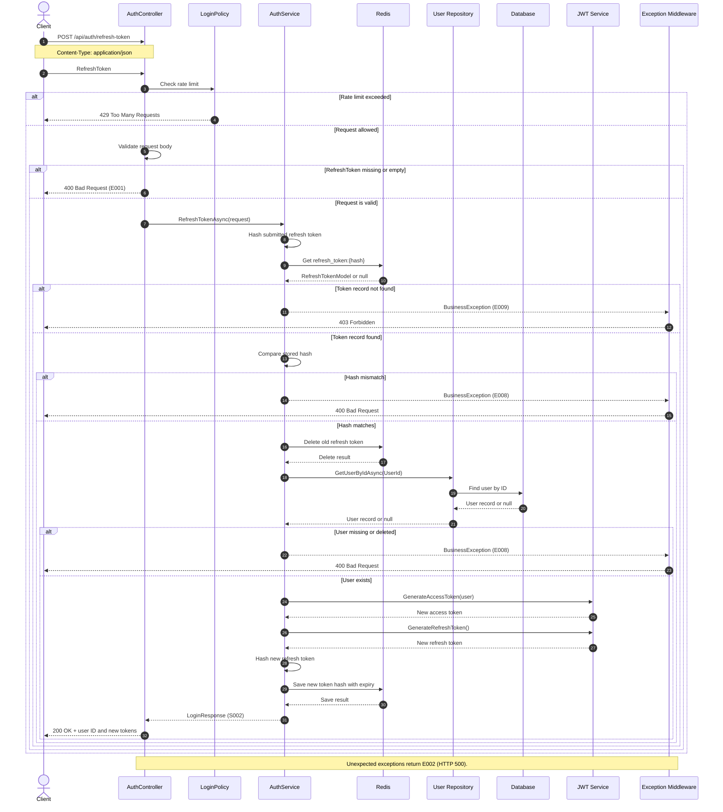

## 2. Store
### 2.1 Create Store

#### 2.1.1 API Information

| Property | Description |
|---|---|
| API Name | Create Store |
| Method | `POST` |
| URL | `http://<host>:<port>/api/store` |
| Authentication | Bearer Token (JWT) |
| Authorization | Admin role required |
| Content-Type | `application/json` |
| Rate Limiting Policy | Global Rate Limiter (default) |

**API URL Configuration**

Replace `<host>` and `<port>` with the server's hostname or IP address and the port on which the API is running.

Example:

```http
POST http://localhost:5070/api/store
```

**Request Headers**

| Header | Value | Required | Description |
|---|---|---|---|
| `Authorization` | `Bearer <access_token>` | Yes | A valid JWT access token belonging to a user with the `Admin` role. |
| `Content-Type` | `application/json` | Yes | Indicates that the request body contains JSON data. |

#### 2.1.2 Rate Limiting Policy

This API uses the **Global Rate Limiter** by default because no endpoint-specific rate-limiting policy is explicitly configured on the controller action.

- Requests are subject to the globally configured request limit.
- If the request limit is exceeded, the API returns HTTP `429 Too Many Requests`.
- The client should wait before retrying the request.

**Rate Limit Exceeded Response**

HTTP Status Code: `429 Too Many Requests`

```json
{
  "status": 429,
  "message": "Too many requests. Please try again later."
}
```

*Note: The response above follows the rate-limiting response format provided in the current configuration. Unlike the standard `ApiResponse<T>` structure, it uses the `status` and `message` properties.*

#### 2.1.3 Description

The Create Store API creates a new store in the system.

The API accepts store information in JSON format, validates the request, maps the request DTO to a `StoreEntity`, and saves the new store through the store repository.

If the operation succeeds, the API returns HTTP `201 Created` with the newly created store's information.

**Authorization Requirement:** Only authenticated users with the `Admin` role are authorized to create a store.

#### 2.1.4 Request Parameters

The API receives a JSON request body containing the store's information.

**Request Body**

```json
{
  "name": "Central Store",
  "address": "123 Main Street, Ho Chi Minh City",
  "phoneNumber": "0901234567"
}
```

**Request Fields**

| Field | Data Type | Required | Constraints | Description |
|---|---|---|---|---|
| `name` | String | Yes | Maximum 500 characters | The name of the store. |
| `address` | String | Yes | Maximum 500 characters | The store's address. |
| `phoneNumber` | String | No* | Maximum 11 characters | The store's contact phone number. |

*Note: `PhoneNumber` has no `[Required]` attribute, so it is not required by the declared Data Annotations. Its default value is an empty string. The request model does not explicitly validate phone-number format or a minimum length.*

**Validation Rules**

- `Name` must not be null and must not exceed 500 characters.
- `Address` must not be null and must not exceed 500 characters.
- `PhoneNumber` must not exceed 11 characters.
- Invalid request data results in HTTP `400 Bad Request` when model validation fails.

The property names in the JSON request are shown in camelCase, following the default JSON naming conventions commonly used by ASP.NET Core.

#### 2.1.5 Response Results

The API returns an `ApiResponse<T>` object for successful operations and errors handled by the application's response and exception-handling mechanisms. The HTTP status code is set using the response's `HttpStatus` property.

**1. Store Created Successfully**

HTTP Status Code: `201 Created`

The store is saved successfully, and the response contains the created store's information.

```json
{
  "isSuccess": true,
  "responseCode": "S003",
  "message": "Successfully created!",
  "httpStatus": 201,
  "data": {
    "id": "7d1a3b2c-4e5f-6789-abcd-0123456789ab",
    "name": "Central Store",
    "address": "123 Main Street, Ho Chi Minh City",
    "phoneNumber": "0901234567",
    "createdAt": "2026-10-31T10:00:00Z",
    "updatedAt": null,
    "isDeleted": false
  }
}
```

The values above are illustrative. The actual ID and timestamps are generated or populated by the application.

**2. Invalid Request**

HTTP Status Code: `400 Bad Request`

Returned when request model validation fails, such as when the store name or address is missing or exceeds the maximum permitted length.

```json
{
  "isSuccess": false,
  "responseCode": "E001",
  "message": "Request is invalid!",
  "httpStatus": 400,
  "data": [
    "Name is required!"
  ]
}
```

The `data` array contains the validation error messages. The example shows one possible validation error; actual messages depend on the submitted request.

**3. Store Creation Failed**

HTTP Status Code: `400 Bad Request`

If the repository indicates that the store could not be created, the service throws a `BusinessException` containing `ErrorRecord.Failed`.

```json
{
  "isSuccess": false,
  "responseCode": "E008",
  "message": "Failed!",
  "httpStatus": 400,
  "data": null
}
```

**4. Unauthorized Request**

HTTP Status Code: `401 Unauthorized`

Returned when the request does not contain a valid authentication token or authentication fails.

The exact response body depends on the ASP.NET Core authentication configuration.

**5. Forbidden Request**

HTTP Status Code: `403 Forbidden`

Returned when the authenticated user does not have the required `Admin` role.

The exact response body depends on the ASP.NET Core authorization configuration.

**6. Rate Limit Exceeded**

HTTP Status Code: `429 Too Many Requests`

Returned when the client exceeds the configured global request limit.

```json
{
  "status": 429,
  "message": "Too many requests. Please try again later."
}
```

**7. Internal Server Error**

HTTP Status Code: `500 Internal Server Error`

Returned when an unexpected exception occurs and is handled by the exception-handling middleware.

```json
{
  "isSuccess": false,
  "responseCode": "E002",
  "message": "Internal server error!",
  "httpStatus": 500,
  "data": null
}
```

The response body follows the `ApiResponse<T>` structure used by the exception-handling middleware.

**Response Summary**

| HTTP Status Code | Response Code | Description |
|---|---|---|
| `201 Created` | `S003` | Store created successfully. |
| `400 Bad Request` | `E001` | Request validation failed. |
| `400 Bad Request` | `E008` | Store creation failed. |
| `401 Unauthorized` | Authentication-dependent | Authentication is missing or invalid. |
| `403 Forbidden` | Authorization-dependent | The authenticated user lacks the required `Admin` role. |
| `429 Too Many Requests` | Rate-limiter-dependent | The global request limit has been exceeded. |
| `500 Internal Server Error` | `E002` | An unexpected server-side error occurred. |

*Note: The status codes and response codes above reflect the supplied implementation. Authentication, authorization, and rate-limiting response bodies may differ from `ApiResponse<T>` because those responses can be generated outside the service and exception-handling middleware.*

#### 2.1.6 Sequence Diagram

The following sequence diagram illustrates the request flow, including authentication, authorization, rate limiting, model validation, store creation, and the possible response paths.

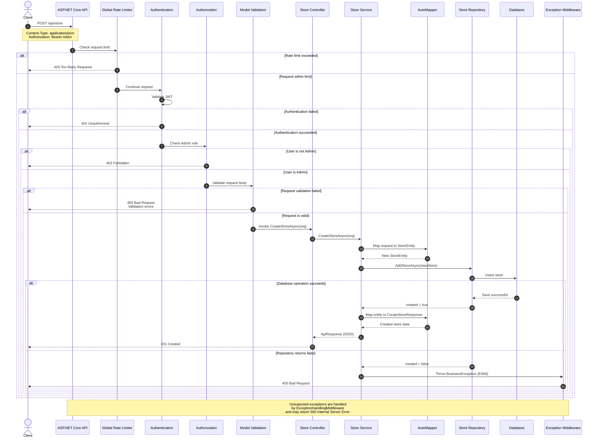

*Implementation note: The diagram presents the intended request-processing flow. The actual middleware execution order depends on the application's middleware registration in `Program.cs`. The `ExceptionHandlingMiddleware` catches exceptions that propagate through its downstream pipeline; it does not necessarily intercept every authentication, authorization, or rate-limiting response.*

### 2.2. Update Store

#### 2.2.1. API Information

| Property | Description |
|---|---|
| API Name | Update Store |
| HTTP Method | `PUT` |
| API URL | `http://<host>:<port>/api/store` |
| Content-Type | `application/json` |
| Authentication | Bearer Token (JWT) |
| Authorization | Admin role required |
| Rate Limiting Policy | Global Rate Limiter (default) |

**API URL Configuration**

Replace `<host>` and `<port>` with the hostname or IP address and port where the API is running.

Example:

```http
PUT http://localhost:5070/api/store
```

**Request Headers**

| Header | Value | Required | Description |
|---|---|---|---|
| `Authorization` | `Bearer <access_token>` | Yes | A valid JWT access token belonging to a user with the `Admin` role. |
| `Content-Type` | `application/json` | Yes | Indicates that the request body contains JSON data. |

#### 2.2.2. Rate Limiting Policy

The Update Store API uses the **Global Rate Limiter** by default because no endpoint-specific rate-limiting policy is explicitly configured on the controller action.

- Requests are subject to the globally configured request limit.
- Requests exceeding the configured limit are rejected with HTTP `429 Too Many Requests`.
- Clients should wait before retrying the request.

**Rate Limit Exceeded Response**

HTTP Status Code: `429 Too Many Requests`

```json
{
  "status": 429,
  "message": "Too many requests. Please try again later."
}
```

*Note: This response follows the rate-limiting response format provided in the current configuration and differs from the standard `ApiResponse<T>` structure.*

#### 2.2.3. Description

The Update Store API updates the information of an existing store.

The API receives the store ID and the updated store information in a JSON request body. It retrieves the store by ID and checks whether the store exists and is not marked as deleted.

If the store exists and is active, the API maps the request fields onto the existing entity and saves the changes through the store repository.

If the update succeeds, the API returns HTTP `200 OK` with the updated store information.

**Authorization Requirement:** Only authenticated users with the `Admin` role can update store information.

**Business Rules:**
- The store must exist in the database.
- The store must not be marked as deleted (`IsDeleted = false`).
- If the store does not exist or has been deleted, the API returns HTTP `404 Not Found`.
- If the repository reports that the update failed, the API returns HTTP `400 Bad Request`.

#### 2.2.4. Request Parameters

The API receives a JSON request body containing the store ID and the store's updated information.

**Request Body**

```json
{
  "storeId": "7d1a3b2c-4e5f-6789-abcd-0123456789ab",
  "name": "Updated Central Store",
  "address": "456 Nguyen Hue Street, Ho Chi Minh City",
  "phoneNumber": "0909876543"
}
```

The values above are illustrative. Replace the store ID with the ID of the store you want to update.

**Request Fields**

| Field | Data Type | Required | Constraints | Description |
|---|---|---|---|---|
| `storeId` | GUID | Yes | Must be a valid GUID value | Identifies the store to update. |
| `name` | String | Yes | Maximum 500 characters | The updated name of the store. |
| `address` | String | Yes | Maximum 500 characters | The updated address of the store. |
| `phoneNumber` | String | No* | Maximum 11 characters | The updated contact phone number. |

*Note: `PhoneNumber` does not have a `[Required]` attribute, so it is optional under the declared Data Annotations. Its default value is an empty string.*

**Validation Rules**

- `StoreId` must be supplied as a valid GUID value.
- `Name` must not be null and must not exceed 500 characters.
- `Address` must not be null and must not exceed 500 characters.
- `PhoneNumber` must not exceed 11 characters.
- If request model validation fails, the API returns HTTP `400 Bad Request` with the validation error messages.

**Important:** The `[Required]` attribute on a non-nullable `Guid` does not reject `Guid.Empty` (`00000000-0000-0000-0000-000000000000`). If the application must reject an empty GUID, add an explicit validation rule.

#### 2.2.5. Response Results

The API returns an `ApiResponse<T>` object for successful operations and errors handled by the application's response and exception-handling mechanisms. The HTTP status code is set using the response's `HttpStatus` property.

**1. Store Updated Successfully**

HTTP Status Code: `200 OK`

Returned when the store exists, is not deleted, and the repository successfully updates its information.

The success response uses `MessageRecord.Success`, with response code `S002` and message `Successful!`.

```json
{
  "isSuccess": true,
  "responseCode": "S002",
  "message": "Successful!",
  "httpStatus": 200,
  "data": {
    "id": "7d1a3b2c-4e5f-6789-abcd-0123456789ab",
    "name": "Updated Central Store",
    "address": "456 Nguyen Hue Street, Ho Chi Minh City",
    "phoneNumber": "0909876543",
    "createdAt": "2026-10-30T08:00:00Z",
    "updatedAt": "2026-10-31T10:00:00Z",
    "isDeleted": false
  }
}
```

The values above are illustrative. The actual timestamps and store information depend on the database and application implementation.

**2. Invalid Request**

HTTP Status Code: `400 Bad Request`

Returned when the request fails model validation, such as when the store name or address is missing or exceeds the maximum permitted length.

```json
{
  "isSuccess": false,
  "responseCode": "E001",
  "message": "Request is invalid!",
  "httpStatus": 400,
  "data": [
    "Name is required!"
  ]
}
```

The `data` array contains the validation error messages. The example illustrates one possible validation error.

**3. Store Not Found or Deleted**

HTTP Status Code: `404 Not Found`

Returned when the specified store does not exist or has been marked as deleted (`IsDeleted = true`).

The service throws `BusinessException(ErrorRecord.NotFound)`, which maps to response code `E005`.

```json
{
  "isSuccess": false,
  "responseCode": "E005",
  "message": "Not found data!",
  "httpStatus": 404,
  "data": null
}
```

**4. Store Update Failed**

HTTP Status Code: `400 Bad Request`

Returned when the repository reports that the update operation failed.

The service throws `BusinessException(ErrorRecord.Failed)`, which maps to response code `E008`.

```json
{
  "isSuccess": false,
  "responseCode": "E008",
  "message": "Failed!",
  "httpStatus": 400,
  "data": null
}
```

**5. Unauthorized Request**

HTTP Status Code: `401 Unauthorized`

Returned when the request does not contain a valid authentication token or authentication fails.

The response body depends on the ASP.NET Core authentication configuration.

**6. Forbidden Request**

HTTP Status Code: `403 Forbidden`

Returned when the user is authenticated but does not have the required `Admin` role.

The response body depends on the ASP.NET Core authorization configuration.

**7. Rate Limit Exceeded**

HTTP Status Code: `429 Too Many Requests`

Returned when the client exceeds the configured global request limit.

```json
{
  "status": 429,
  "message": "Too many requests. Please try again later."
}
```

**8. Internal Server Error**

HTTP Status Code: `500 Internal Server Error`

Returned when an unexpected exception occurs and is handled by `ExceptionHandlingMiddleware`.

```json
{
  "isSuccess": false,
  "responseCode": "E002",
  "message": "Internal server error!",
  "httpStatus": 500,
  "data": null
}
```

**Response Summary**

| HTTP Status Code | Response Code | Description |
|---|---|---|
| `200 OK` | `S002` | Store updated successfully. |
| `400 Bad Request` | `E001` | Request validation failed. |
| `400 Bad Request` | `E008` | Store update failed. |
| `401 Unauthorized` | Authentication-dependent | Authentication is missing or invalid. |
| `403 Forbidden` | Authorization-dependent | The authenticated user lacks the required `Admin` role. |
| `404 Not Found` | `E005` | Store does not exist or has been deleted. |
| `429 Too Many Requests` | Rate-limiter-dependent | The global request limit has been exceeded. |
| `500 Internal Server Error` | `E002` | An unexpected server-side error occurred. |

*Note: Authentication, authorization, and rate-limiting responses may be generated outside the service and exception-handling middleware. Their response bodies may therefore differ from the standard `ApiResponse<T>` format.*

#### 2.2.6. Sequence Diagram

The following Mermaid sequence diagram illustrates the Update Store API workflow, including rate limiting, authentication, authorization, request validation, store lookup, update processing, and possible error responses.

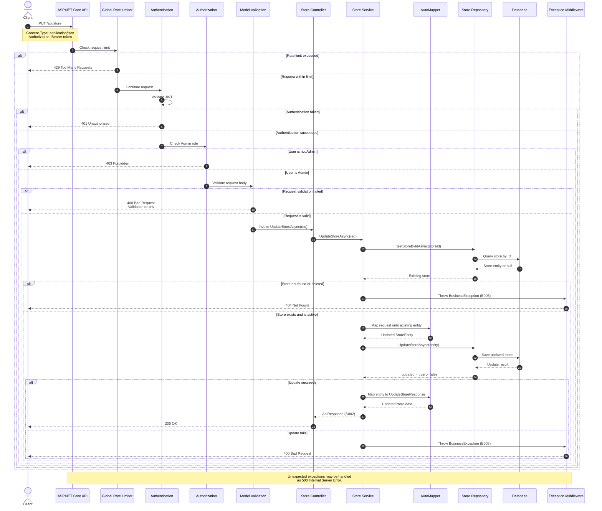

*Implementation note: The sequence diagram represents the intended processing flow. The actual middleware order depends on the configuration in `Program.cs`. The exception-handling middleware catches exceptions that propagate through its downstream pipeline.*

### 2.3. Delete Store

#### 2.3.1. API Information

| Property | Description |
|---|---|
| API Name | Delete Store |
| HTTP Method | `DELETE` |
| API URL | `http://<host>:<port>/api/store?Id=<store_id>` |
| Content-Type | Not required |
| Authentication | Bearer Token (JWT) |
| Authorization | Admin role required |
| Rate Limiting Policy | Global Rate Limiter (default) |

**API URL Configuration**

Replace `<host>` and `<port>` with the hostname or IP address and port where the API is running. Replace `<store_id>` with the GUID of the store to delete.

Example:

```http
DELETE http://localhost:5070/api/store?Id=7d1a3b2c-4e5f-6789-abcd-0123456789ab
```

**Request Headers**

| Header | Value | Required | Description |
|---|---|---|---|
| `Authorization` | `Bearer <access_token>` | Yes | A valid JWT access token belonging to a user with the `Admin` role. |

Because the store ID is supplied through the query string and the request does not contain a body, the `Content-Type: application/json` header is not required.

#### 2.3.2. Rate Limiting Policy

The Delete Store API uses the **Global Rate Limiter** by default because no endpoint-specific rate-limiting policy is explicitly configured on the controller action.

- Requests are subject to the globally configured request limit.
- Requests exceeding the configured limit are rejected with HTTP `429 Too Many Requests`.
- Clients should wait before retrying the request.

**Rate Limit Exceeded Response**

HTTP Status Code: `429 Too Many Requests`

```json
{
  "status": 429,
  "message": "Too many requests. Please try again later."
}
```

*Note: This response follows the rate-limiting response format provided in the current configuration and differs from the standard `ApiResponse<T>` structure.*

#### 2.3.3. Description

The Delete Store API performs a **soft delete** on an existing store.

Instead of permanently removing the store's database record, the API marks the store as deleted, typically by setting `IsDeleted = true`.

The API receives the store ID through the `Id` query parameter and checks whether the store exists and is not already deleted.

- If the store exists and is active, the API attempts to mark it as deleted.
- If the store does not exist or has already been deleted, the API returns HTTP `404 Not Found`.
- If the soft-delete operation succeeds, the API returns HTTP `200 OK`.
- If the repository reports that the operation failed, the API returns HTTP `400 Bad Request`.

**Authorization Requirement:** Only authenticated users with the `Admin` role can delete a store.

**Important:** The actual database update depends on the implementation of `_storeRepository.SoftDeleteByIdAsync(storeId)`. The service code indicates a soft-delete operation but does not show the repository implementation itself.

#### 2.3.4. Request Parameters

The API does not require a request body. The store ID must be supplied as a query parameter.

**Request Example**

```http
DELETE /api/store?Id=7d1a3b2c-4e5f-6789-abcd-0123456789ab
```

**Query Parameters**

| Parameter | Data Type | Required | Description |
|---|---|---|---|
| `Id` | GUID | Yes | Identifies the store to be soft-deleted. |

The parameter name is `Id`, as explicitly specified by `[FromQuery(Name = "Id")]` in the controller.

**Validation and Business Rules**

- The `Id` query parameter must contain a valid GUID representation.
- The specified store must exist in the database.
- The store must not already be marked as deleted.
- If the store is missing or already deleted, the API returns `404 Not Found`.
- If the repository reports that the soft-delete operation failed, the API returns `400 Bad Request`.

If `Id` is missing or contains an invalid GUID value, ASP.NET Core model binding may add a model-state error. The exact response depends on the application's API behavior and validation configuration.

#### 2.3.5. Response Results

The API returns an `ApiResponse<T>` object for successful operations and errors handled by the application's response and exception-handling mechanisms.

**1. Store Deleted Successfully**

HTTP Status Code: `200 OK`

Returned when the store exists, is not already deleted, and the repository successfully performs the soft-delete operation.

The service returns `MessageRecord.Success`, which has response code `S002` and message `Successful!`.

Because the service does not pass a `data` argument to `ApiResponse<object?>.Response`, the response's `data` property is `null`.

```json
{
  "isSuccess": true,
  "responseCode": "S002",
  "message": "Successful!",
  "httpStatus": 200,
  "data": null
}
```

**2. Store Not Found or Already Deleted**

HTTP Status Code: `404 Not Found`

Returned when the store does not exist or has already been marked as deleted.

The service throws `BusinessException(ErrorRecord.NotFound)`, which maps to response code `E005`.

```json
{
  "isSuccess": false,
  "responseCode": "E005",
  "message": "Not found data!",
  "httpStatus": 404,
  "data": null
}
```

**3. Soft Delete Failed**

HTTP Status Code: `400 Bad Request`

Returned when the repository reports that the soft-delete operation failed.

The service throws `BusinessException(ErrorRecord.Failed)`, which maps to response code `E008`.

```json
{
  "isSuccess": false,
  "responseCode": "E008",
  "message": "Failed!",
  "httpStatus": 400,
  "data": null
}
```

**4. Invalid Request**

HTTP Status Code: `400 Bad Request`

Returned when the request contains an invalid query parameter, such as a malformed GUID, if the application's model-validation pipeline handles the binding error as a bad request.

The standard validation response uses `ErrorRecord.RequestInvalid`, with response code `E001`.

```json
{
  "isSuccess": false,
  "responseCode": "E001",
  "message": "Request is invalid!",
  "httpStatus": 400,
  "data": [
    "The value 'invalid-guid' is not valid."
  ]
}
```

The exact validation message depends on the model-binding error and the application's validation configuration.

**5. Unauthorized Request**

HTTP Status Code: `401 Unauthorized`

Returned when the request does not contain a valid authentication token or authentication fails.

The response body depends on the ASP.NET Core authentication configuration.

**6. Forbidden Request**

HTTP Status Code: `403 Forbidden`

Returned when the user is authenticated but does not have the required `Admin` role.

The response body depends on the ASP.NET Core authorization configuration.

**7. Rate Limit Exceeded**

HTTP Status Code: `429 Too Many Requests`

Returned when the client exceeds the configured global request limit.

```json
{
  "status": 429,
  "message": "Too many requests. Please try again later."
}
```

**8. Internal Server Error**

HTTP Status Code: `500 Internal Server Error`

Returned when an unexpected exception occurs and is handled by `ExceptionHandlingMiddleware`.

```json
{
  "isSuccess": false,
  "responseCode": "E002",
  "message": "Internal server error!",
  "httpStatus": 500,
  "data": null
}
```

**Response Summary**

| HTTP Status Code | Response Code | Description |
|---|---|---|
| `200 OK` | `S002` | Store soft-deleted successfully. |
| `400 Bad Request` | `E001` | Invalid request or query parameter, when handled by model validation. |
| `400 Bad Request` | `E008` | Soft-delete operation failed. |
| `401 Unauthorized` | Authentication-dependent | Authentication is missing or invalid. |
| `403 Forbidden` | Authorization-dependent | The authenticated user lacks the required `Admin` role. |
| `404 Not Found` | `E005` | Store does not exist or has already been deleted. |
| `429 Too Many Requests` | Rate-limiter-dependent | The global request limit has been exceeded. |
| `500 Internal Server Error` | `E002` | An unexpected server-side error occurred. |

*Note: Authentication, authorization, model-binding, and rate-limiting responses may be generated outside the service and exception-handling middleware. Their response bodies may therefore differ from the standard `ApiResponse<T>` structure.*

#### 2.3.6. Sequence Diagram

The following Mermaid sequence diagram illustrates the Delete Store API workflow, including rate limiting, authentication, authorization, query-parameter validation, store lookup, soft deletion, and possible error responses.

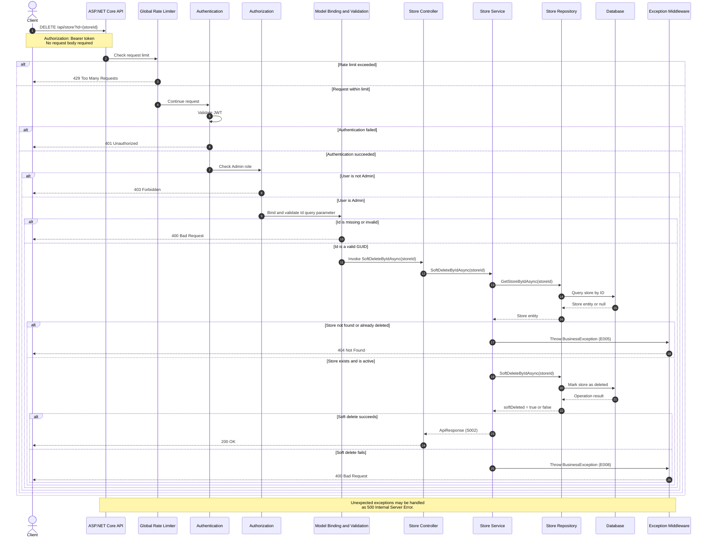

*Implementation note: The diagram represents the intended request-processing flow. Actual middleware ordering depends on the configuration in `Program.cs`. The exception-handling middleware catches exceptions that propagate through its downstream pipeline.*

### 2.4. Restore Store

#### API Information

| Property | Description |
|---|---|
| **Method** | `PATCH` |
| **API URL** | `http://<host>:<port>/api/store?Id={storeId}` |
| **Content-Type** | `application/json` |
| **Authorization** | Bearer Token |
| **Required Role** | `Admin` |
| **Rate Limiting Policy** | Global Rate Limiter (default) |

**URL Configuration:**
- `<host>`: The API server hostname or IP address.
- `<port>`: The API server port.
- `storeId`: The unique identifier (GUID) of the store to restore.

**Example:**
```http
PATCH http://localhost:5070/api/store?Id=550e8400-e29b-41d4-a716-446655440000
```

#### Description

This API restores a previously soft-deleted store by setting its deletion status to active.

Only authenticated users with the `Admin` role are authorized to perform this operation. The store must exist and currently be marked as deleted. If the store does not exist or is already active, the API returns a `404 Not Found` response.

#### Request

**Query Parameters**

| Parameter | Type | Required | Description |
|---|---|---|---|
| `Id` | `Guid` | Yes | The unique identifier of the store to restore. |

**Request Body:** None.

**Request Headers:**

```http
Authorization: Bearer <access_token>
Content-Type: application/json
```

#### Response

The API returns an `ApiResponse<object?>` object containing the operation status, response code, message, HTTP status code, and optional data.

**1. Success — Store Restored**

**HTTP Status:** `200 OK`

The store exists, is currently soft-deleted, and is successfully restored.

```json
{
  "isSuccess": true,
  "responseCode": "S002",
  "message": "Successful!",
  "httpStatus": 200,
  "data": null
}
```

**2. Store Not Found or Already Active**

**HTTP Status:** `404 Not Found`

Returned when the specified store does not exist or is not marked as deleted.

```json
{
  "isSuccess": false,
  "responseCode": "E005",
  "message": "Data not found!",
  "httpStatus": 404,
  "data": null
}
```

**3. Restoration Failed**

**HTTP Status:** `400 Bad Request`

Returned when the repository fails to restore the store.

```json
{
  "isSuccess": false,
  "responseCode": "E008",
  "message": "Operation failed!",
  "httpStatus": 400,
  "data": null
}
```

**4. Invalid Request**

**HTTP Status:** `400 Bad Request`

Returned when the request contains an invalid parameter, such as a malformed GUID, provided the request reaches the application's exception-handling logic.

```json
{
  "isSuccess": false,
  "responseCode": "E001",
  "message": "Request is invalid!",
  "httpStatus": 400,
  "data": null
}
```

If model validation fails before the controller executes, the API may instead return a validation response containing a list of error messages in `data`.

**5. Unauthorized Access**

**HTTP Status:** `401 Unauthorized`

Returned when the request does not contain a valid authentication token.

The response body depends on the application's authentication configuration and may not follow the standard `ApiResponse<T>` format.

**6. Forbidden Access**

**HTTP Status:** `403 Forbidden`

Returned when the authenticated user does not have the required `Admin` role.

The response body depends on the application's authorization configuration and may not follow the standard `ApiResponse<T>` format.

**7. Rate Limit Exceeded**

**HTTP Status:** `429 Too Many Requests`

Returned when the request exceeds the configured global rate limit.

```json
{
  "status": 429,
  "message": "Too many requests. Please try again later."
}
```

**8. Internal Server Error**

**HTTP Status:** `500 Internal Server Error`

Returned when an unexpected exception occurs during request processing.

```json
{
  "isSuccess": false,
  "responseCode": "E002",
  "message": "Internal server error!",
  "httpStatus": 500,
  "data": null
}
```

#### Sequence Diagram

The following diagram illustrates the request flow from authentication and rate limiting through store validation and restoration.

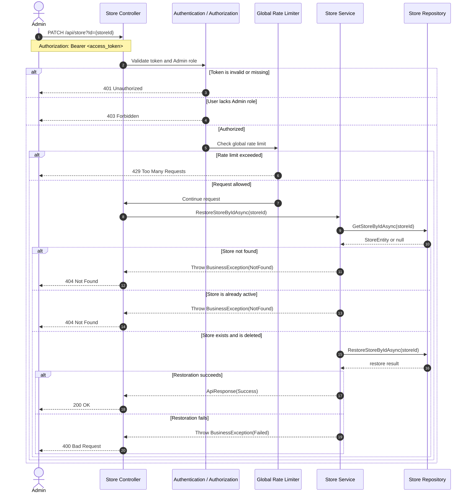

**Notes:**
- The API uses the global rate limiter by default because no endpoint-specific rate-limiting policy is configured on the controller action.
- The `PATCH` request does not require a request body; the store identifier is supplied through the `Id` query parameter.
- The service checks that the store exists and is soft-deleted before attempting restoration.
- Unexpected exceptions are handled by `ExceptionHandlingMiddleware` and mapped to the standard internal server error response.

### 2.5. Get Stores

#### API Information

| Property | Description |
|---|---|
| **Method** | `GET` |
| **API URL** | `http://<host>:<port>/api/store` |
| **Content-Type** | `application/json` |
| **Authorization** | No authorization attribute is explicitly defined on this endpoint. |
| **Rate Limiting Policy** | Global Rate Limiter (default) |

**URL Configuration:**
- `<host>`: The API server hostname or IP address.
- `<port>`: The API server port.

**Example:**
```http
GET http://localhost:5070/api/store?pageNumber=1&pageSize=10
```

#### Description

This API retrieves a paginated list of stores from the database.

The response contains a list of stores and pagination metadata, including the current page, page size, total number of stores, and total number of pages.

Each store includes its ID, name, address, phone number, creation and update timestamps, and deletion status.

If no stores are found, the API returns a `404 Not Found` response.

#### Request

**Query Parameters**

| Parameter | Type | Required | Default Value | Description |
|---|---|---|---|---|
| `pageNumber` | `int` | No | `1` | The page number to retrieve. |
| `pageSize` | `int` | No | `10` | The number of stores to return per page. |

**Request Body:** None.

**Request Headers:**

```http
Accept: application/json
```

The `Content-Type` header is unnecessary because this endpoint does not accept a request body.

**Example Request:**

```http
GET /api/store?pageNumber=1&pageSize=10 HTTP/1.1
Host: localhost:5070
Accept: application/json
```

#### Response

The API returns an `ApiResponse<object?>` object. The `data` field contains a `PaginationResponse<StoreResponse>` object when the request succeeds.

##### 1. Success — Stores Retrieved Successfully

**HTTP Status:** `200 OK`

Returned when the requested page contains stores and the total number of stores is greater than zero.

**Example Response:**

```json
{
  "isSuccess": true,
  "responseCode": "S002",
  "message": "Successful!",
  "httpStatus": 200,
  "data": {
    "items": [
      {
        "id": "550e8400-e29b-41d4-a716-446655440000",
        "name": "Store A",
        "address": "123 Main Street",
        "phoneNumber": "0123456789",
        "createdAt": "2026-10-01T08:00:00Z",
        "updatedAt": null,
        "isDeleted": false
      },
      {
        "id": "660e8400-e29b-41d4-a716-446655440000",
        "name": "Store B",
        "address": "456 Second Street",
        "phoneNumber": "0987654321",
        "createdAt": "2026-10-05T09:30:00Z",
        "updatedAt": "2026-10-10T10:00:00Z",
        "isDeleted": false
      }
    ],
    "currentPage": 1,
    "pageSize": 10,
    "totalItems": 25,
    "totalPages": 3
  }
}
```

**Pagination Fields:**

| Field | Type | Description |
|---|---|---|
| `items` | `array` | The list of stores returned for the requested page. |
| `currentPage` | `int` | The current page number. |
| `pageSize` | `int` | The maximum number of stores requested per page. |
| `totalItems` | `int` | The total number of stores matching the repository query. |
| `totalPages` | `int` | The total number of pages, calculated by dividing `totalItems` by `pageSize` and rounding up. |

**Store Fields:**

| Field | Type | Description |
|---|---|---|
| `id` | `Guid` | The unique identifier of the store. |
| `name` | `string` | The name of the store. |
| `address` | `string` | The store's address. |
| `phoneNumber` | `string` | The store's contact phone number. |
| `createdAt` | `DateTime` | The date and time the store was created. |
| `updatedAt` | `DateTime?` | The date and time the store was last updated, or `null` if it has not been updated. |
| `isDeleted` | `bool` | Indicates whether the store has been soft-deleted. |

**Note:** The example values above are illustrative. The actual response depends on the database contents and the repository's filtering logic.

##### 2. No Stores Found

**HTTP Status:** `404 Not Found`

Returned when:
- The database contains no stores matching the repository query.
- The requested page contains no stores, even if other pages contain stores.

The service throws `BusinessException(ErrorRecord.NotFound)` when either `totalItems == 0` or `stores.Count == 0`.

**Example Response:**

```json
{
  "isSuccess": false,
  "responseCode": "E005",
  "message": "Data not found!",
  "httpStatus": 404,
  "data": null
}
```

##### 3. Invalid Request

**HTTP Status:** `400 Bad Request`

Returned when the request contains invalid query parameter values that fail model binding or validation.

For example, `pageNumber=abc` cannot be converted to an integer.

If automatic model validation is configured to use `ValidationErrorResponse`, the response may contain a list of validation messages in the `data` field.

**Example Response:**

```json
{
  "isSuccess": false,
  "responseCode": "E001",
  "message": "Request is invalid!",
  "httpStatus": 400,
  "data": [
    "The value 'abc' is not valid."
  ]
}
```

The exact validation message depends on ASP.NET Core model binding and validation configuration.

**Important:** The supplied service does not explicitly validate that `pageNumber` and `pageSize` are positive. Therefore, values such as `pageNumber=0` or `pageSize=-1` are not guaranteed to return `400 Bad Request`. Their behavior depends on the repository implementation and any additional validation rules.

##### 4. Rate Limit Exceeded

**HTTP Status:** `429 Too Many Requests`

Returned when the request exceeds the configured global rate limit.

**Example Response:**

```json
{
  "status": 429,
  "message": "Too many requests. Please try again later."
}
```

This response follows the configured rate-limiting handler and does not use the standard `ApiResponse<T>` structure.

##### 5. Internal Server Error

**HTTP Status:** `500 Internal Server Error`

Returned when an unexpected exception occurs during request processing, such as an unhandled database error.

**Example Response:**

```json
{
  "isSuccess": false,
  "responseCode": "E002",
  "message": "Internal server error!",
  "httpStatus": 500,
  "data": null
}
```

The response is generated by `ExceptionHandlingMiddleware`.

#### Sequence Diagram

The following sequence diagram illustrates the request flow, pagination processing, and possible outcomes.

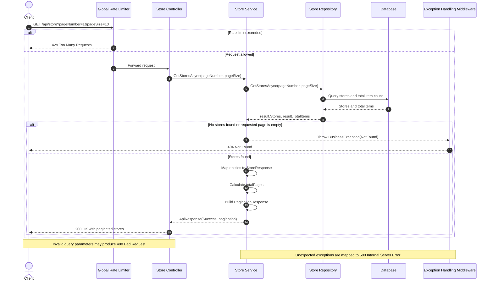

#### Additional Notes

- **Pagination:** The default request retrieves page `1` with up to `10` stores. Clients can specify other values using query parameters.
- **Empty pages:** If the requested page has no stores, the service returns `404 Not Found`, even when other pages contain stores.
- **Authorization:** The controller action does not declare an `[Authorize]` attribute. Authentication may still be required if authorization is enforced globally.
- **Rate limiting:** The endpoint uses the global rate limiter by default because no endpoint-specific rate-limiting policy is declared.
- **Soft deletion:** Whether deleted stores appear in the results depends on the filtering logic implemented in `_storeRepository.GetStoresAsync()`.

### 2.6. Get Store By Id

#### API Information

| Property | Description |
|---|---|
| **Method** | `GET` |
| **API URL** | `http://<host>:<port>/api/store/{Id}` |
| **Content-Type** | `application/json` |
| **Authorization** | No authorization attribute is explicitly defined on this endpoint. |
| **Rate Limiting Policy** | Global Rate Limiter (default) |

**URL Configuration:**
- `<host>`: The API server hostname or IP address.
- `<port>`: The API server port.
- `{Id}`: The unique identifier (GUID) of the store to retrieve.

**Example:**

```http
GET http://localhost:5070/api/store/550e8400-e29b-41d4-a716-446655440000
```

#### Description

This API retrieves the details of a specific store using its unique identifier (`Id`).

The API returns the store's information if the store exists and is not soft-deleted. If the store does not exist or has been soft-deleted, the API returns a `404 Not Found` response.

#### Request

**Route Parameters**

| Parameter | Type | Required | Description |
|---|---|---|---|
| `Id` | `Guid` | Yes | The unique identifier of the store to retrieve. |

**Request Body:** None.

**Request Headers:**

```http
Accept: application/json
```

The `Content-Type` header is unnecessary because this endpoint does not accept a request body. The API returns JSON responses.

**Example Request:**

```http
GET /api/store/550e8400-e29b-41d4-a716-446655440000 HTTP/1.1
Host: localhost:5070
Accept: application/json
```

#### Response

The API returns an `ApiResponse<object?>` object containing the operation status, response code, message, HTTP status code, and response data.

##### 1. Success — Store Retrieved Successfully

**HTTP Status:** `200 OK`

Returned when the specified store exists and is not soft-deleted.

**Example Response:**

```json
{
  "isSuccess": true,
  "responseCode": "S002",
  "message": "Successful!",
  "httpStatus": 200,
  "data": {
    "id": "550e8400-e29b-41d4-a716-446655440000",
    "name": "Store A",
    "address": "123 Main Street",
    "phoneNumber": "0123456789",
    "createdAt": "2026-10-01T08:00:00Z",
    "updatedAt": null,
    "isDeleted": false
  }
}
```

**Response Fields:**

| Field | Type | Description |
|---|---|---|
| `id` | `Guid` | The unique identifier of the store. |
| `name` | `string` | The name of the store. |
| `address` | `string` | The store's address. |
| `phoneNumber` | `string` | The store's contact phone number. |
| `createdAt` | `DateTime` | The date and time the store was created. |
| `updatedAt` | `DateTime?` | The date and time the store was last updated, or `null` if it has not been updated. |
| `isDeleted` | `bool` | Indicates whether the store has been soft-deleted. This endpoint returns `false` for a successfully retrieved store. |

##### 2. Store Not Found or Soft-Deleted

**HTTP Status:** `404 Not Found`

Returned when:
- The specified store ID does not exist in the database.
- The specified store has been soft-deleted (`IsDeleted = true`).

**Example Response:**

```json
{
  "isSuccess": false,
  "responseCode": "E005",
  "message": "Data not found!",
  "httpStatus": 404,
  "data": null
}
```

##### 3. Invalid Request

**HTTP Status:** `400 Bad Request`

Returned when the request contains an invalid route parameter, such as a malformed GUID, that does not satisfy the route constraint or model binding requirements.

For example:

```http
GET /api/store/invalid-guid
```

**Important:** Because the route uses the `{Id:guid}` constraint, a malformed GUID does not match this endpoint's route. Depending on the application's routing configuration, the result may be `404 Not Found` rather than `400 Bad Request`. The `400` response applies only if the request reaches validation or exception-handling logic that classifies the input as invalid.

**Example Validation Response, if applicable:**

```json
{
  "isSuccess": false,
  "responseCode": "E001",
  "message": "Request is invalid!",
  "httpStatus": 400,
  "data": null
}
```

##### 4. Rate Limit Exceeded

**HTTP Status:** `429 Too Many Requests`

Returned when the request exceeds the configured global rate limit.

**Example Response:**

```json
{
  "status": 429,
  "message": "Too many requests. Please try again later."
}
```

This response follows the configured rate-limiting handler and does not use the standard `ApiResponse<T>` structure.

##### 5. Internal Server Error

**HTTP Status:** `500 Internal Server Error`

Returned when an unexpected exception occurs during request processing, such as an unhandled database error.

**Example Response:**

```json
{
  "isSuccess": false,
  "responseCode": "E002",
  "message": "Internal server error!",
  "httpStatus": 500,
  "data": null
}
```

This response is generated by `ExceptionHandlingMiddleware`.

##### 6. Unauthorized or Forbidden Access

These responses apply only if authentication or authorization is enforced by global filters or middleware.

- **`401 Unauthorized`**: The request is not authenticated when authentication is required.
- **`403 Forbidden`**: The authenticated user does not have the necessary permissions when authorization is required.

The controller action does not explicitly declare an `[Authorize]` attribute. Therefore, these outcomes depend on the application's global security configuration and are not guaranteed responses for this endpoint.

#### Sequence Diagram

The following sequence diagram illustrates the request flow from the client through the global rate limiter, controller, service, repository, and database.

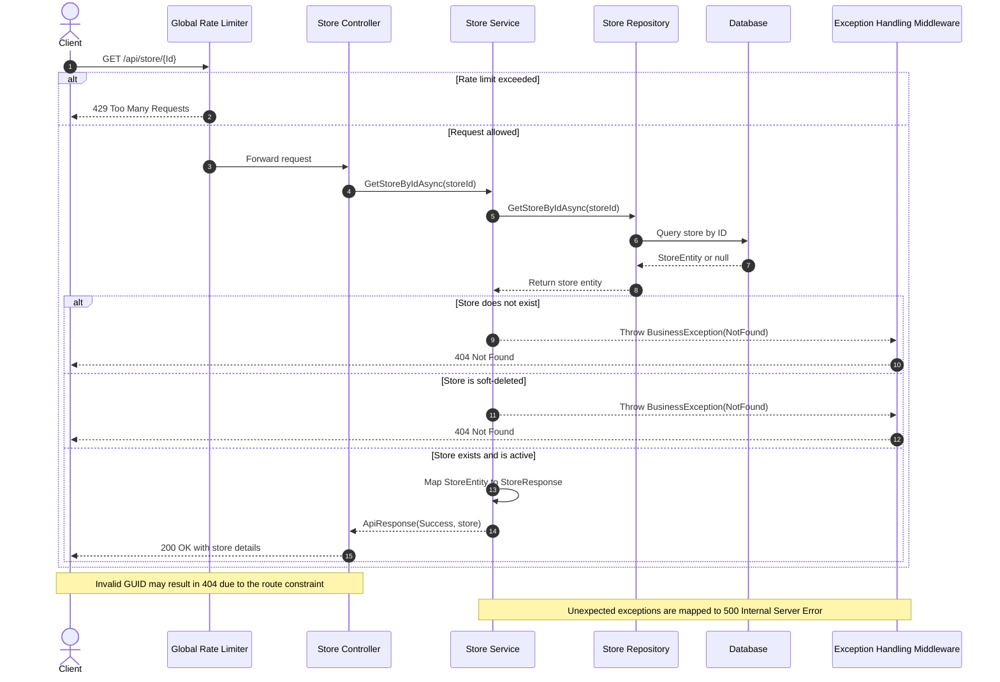

#### Additional Notes

- **Route constraint:** The `{Id:guid}` constraint ensures that the route matches only when the supplied ID has a valid GUID format.
- **Soft deletion:** Stores with `IsDeleted = true` are treated as not found and are not returned by this endpoint.
- **Authorization:** No endpoint-specific authorization attribute is declared. Global authentication or authorization policies may still apply.
- **Rate limiting:** The endpoint uses the global rate limiter by default because no endpoint-specific rate-limiting policy is configured.
- **Response format:** Successful requests and exceptions handled by `ExceptionHandlingMiddleware` use the standard `ApiResponse<T>` structure. Rate-limiting and authentication responses may use different formats depending on their respective configurations.

### 2.7. Get Deleted Stores

#### API Information

| Property | Description |
|---|---|
| **Method** | `GET` |
| **API URL** | `http://<host>:<port>/api/store/deleted` |
| **Content-Type** | `application/json` |
| **Authorization** | Bearer Token |
| **Required Role** | `Admin` |
| **Rate Limiting Policy** | Global Rate Limiter (default) |

**URL Configuration:**
- `<host>`: The API server hostname or IP address.
- `<port>`: The API server port.

**Example:**

```http
GET http://localhost:5070/api/store/deleted?pageNumber=1&pageSize=10
```

#### Description

This API retrieves a paginated list of soft-deleted stores from the database.

Only authenticated users with the `Admin` role are authorized to access this endpoint.

The response contains the deleted stores and pagination metadata, including the current page, page size, total number of deleted stores, and total number of pages.

If no deleted stores are found, or the requested page contains no stores, the API returns a `404 Not Found` response.

#### Request

**Query Parameters**

| Parameter | Type | Required | Default Value | Description |
|---|---|---|---|---|
| `pageNumber` | `int` | No | `1` | The page number to retrieve. |
| `pageSize` | `int` | No | `10` | The maximum number of stores to return per page. |

**Request Body:** None.

**Request Headers:**

```http
Authorization: Bearer <access_token>
Accept: application/json
```

The `Content-Type` header is unnecessary because this endpoint does not accept a request body.

**Example Request:**

```http
GET /api/store/deleted?pageNumber=1&pageSize=10 HTTP/1.1
Host: localhost:5070
Authorization: Bearer <access_token>
Accept: application/json
```

#### Response

The API returns an `ApiResponse<object?>` object. When successful, the `data` field contains a `PaginationResponse<StoreResponse>` object.

##### 1. Success — Deleted Stores Retrieved Successfully

**HTTP Status:** `200 OK`

Returned when deleted stores exist and the requested page contains at least one store.

**Example Response:**

```json
{
  "isSuccess": true,
  "responseCode": "S002",
  "message": "Successful!",
  "httpStatus": 200,
  "data": {
    "items": [
      {
        "id": "550e8400-e29b-41d4-a716-446655440000",
        "name": "Deleted Store A",
        "address": "123 Main Street",
        "phoneNumber": "0123456789",
        "createdAt": "2026-10-01T08:00:00Z",
        "updatedAt": "2026-10-20T10:00:00Z",
        "isDeleted": true
      },
      {
        "id": "660e8400-e29b-41d4-a716-446655440000",
        "name": "Deleted Store B",
        "address": "456 Second Street",
        "phoneNumber": "0987654321",
        "createdAt": "2026-10-05T09:30:00Z",
        "updatedAt": null,
        "isDeleted": true
      }
    ],
    "currentPage": 1,
    "pageSize": 10,
    "totalItems": 15,
    "totalPages": 2
  }
}
```

**Pagination Fields**

| Field | Type | Description |
|---|---|---|
| `items` | `array` | The list of deleted stores returned for the requested page. |
| `currentPage` | `int` | The current page number. |
| `pageSize` | `int` | The requested maximum number of stores per page. |
| `totalItems` | `int` | The total number of deleted stores matching the repository query. |
| `totalPages` | `int` | The total number of pages, calculated by dividing `totalItems` by `pageSize` and rounding up. |

**Store Fields**

| Field | Type | Description |
|---|---|---|
| `id` | `Guid` | The unique identifier of the store. |
| `name` | `string` | The name of the store. |
| `address` | `string` | The store's address. |
| `phoneNumber` | `string` | The store's contact phone number. |
| `createdAt` | `DateTime` | The date and time the store was created. |
| `updatedAt` | `DateTime?` | The date and time the store was last updated, or `null` if it has not been updated. |
| `isDeleted` | `bool` | Indicates whether the store has been soft-deleted. This endpoint is expected to return stores with `isDeleted = true`. |

##### 2. No Deleted Stores Found

**HTTP Status:** `404 Not Found`

Returned when:
- No soft-deleted stores exist in the database.
- The requested page contains no deleted stores, even if deleted stores exist on other pages.

The service throws `BusinessException(ErrorRecord.NotFound)` when `totalItems == 0` or `stores.Count == 0`.

**Example Response:**

```json
{
  "isSuccess": false,
  "responseCode": "E005",
  "message": "Data not found!",
  "httpStatus": 404,
  "data": null
}
```

##### 3. Invalid Request

**HTTP Status:** `400 Bad Request`

Returned when query parameters contain invalid values that fail model binding or configured validation.

For example:

```http
GET /api/store/deleted?pageNumber=abc&pageSize=10
```

**Example Response:**

```json
{
  "isSuccess": false,
  "responseCode": "E001",
  "message": "Request is invalid!",
  "httpStatus": 400,
  "data": [
    "The value 'abc' is not valid."
  ]
}
```

The exact validation response depends on the application's model-binding and validation configuration.

**Note:** The supplied service does not explicitly validate that `pageNumber` and `pageSize` are positive. Values such as `pageNumber=0` or `pageSize=-1` may therefore produce different results depending on repository behavior and additional validation rules.

##### 4. Unauthorized Access

**HTTP Status:** `401 Unauthorized`

Returned when the request does not contain a valid authentication token.

The response body depends on the application's authentication configuration and may not follow the standard `ApiResponse<T>` structure.

##### 5. Forbidden Access

**HTTP Status:** `403 Forbidden`

Returned when the authenticated user does not have the required `Admin` role.

The response body depends on the application's authorization configuration and may not follow the standard `ApiResponse<T>` structure.

##### 6. Rate Limit Exceeded

**HTTP Status:** `429 Too Many Requests`

Returned when the request exceeds the configured global rate limit.

**Example Response:**

```json
{
  "status": 429,
  "message": "Too many requests. Please try again later."
}
```

This response follows the configured rate-limiting handler and does not use the standard `ApiResponse<T>` structure.

##### 7. Internal Server Error

**HTTP Status:** `500 Internal Server Error`

Returned when an unexpected exception occurs during request processing, such as an unhandled database error.

**Example Response:**

```json
{
  "isSuccess": false,
  "responseCode": "E002",
  "message": "Internal server error!",
  "httpStatus": 500,
  "data": null
}
```

This response is generated by `ExceptionHandlingMiddleware`.

#### Sequence Diagram

The following diagram illustrates the request flow, authorization checks, rate limiting, pagination, and possible outcomes.

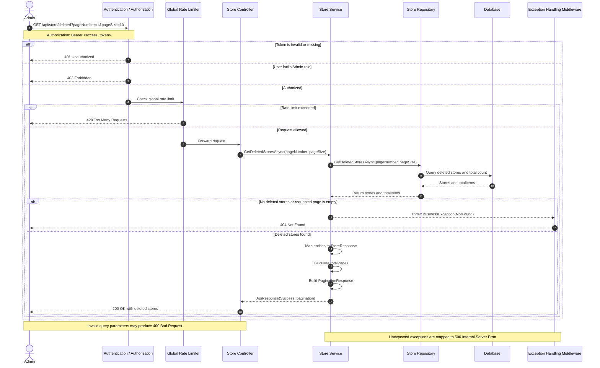

#### Additional Notes

- **Pagination:** The default request retrieves page `1` with up to `10` deleted stores.
- **Soft deletion:** The repository is expected to filter stores where `IsDeleted = true`. Confirm this behavior in `_storeRepository.GetDeletedStoresAsync()`.
- **Authorization:** The endpoint requires an authenticated user with the `Admin` role through `[Authorize(Roles = "Admin")]`.
- **Rate limiting:** The endpoint uses the global rate limiter by default because no endpoint-specific rate-limiting policy is declared.
- **Empty pages:** The current implementation returns `404 Not Found` when the requested page contains no stores, even if deleted stores exist on other pages.
- **Response format:** Successful requests and exceptions handled by `ExceptionHandlingMiddleware` use the standard `ApiResponse<T>` structure. Authentication, authorization, and rate-limiting responses may use different formats depending on their respective configurations.

  
### 2.8. Search Stores

#### API Configuration

- **API URL:** `http://<host>:<port>/api/store/search`
- **HTTP Method:** `GET`
- **Content-Type:** `application/json`
- **Rate Limiting Policy:** Global rate limiter (default policy).
- **Authorization:** No explicit `[Authorize]` attribute is defined on this endpoint in the provided controller code.

#### Description

Searches for stores using an optional keyword and a deletion-status filter. The API supports pagination and returns matching stores with pagination metadata.

The keyword is used to search store information according to the repository's search implementation. The `isDeleted` parameter determines whether to search active or deleted stores.

#### Request

**Query Parameters**

| Parameter | Type | Required | Default | Description |
|---|---|---|---|---|
| `key` | `string` | No | `null` | Optional keyword used to search stores. The exact fields searched depend on the repository implementation. |
| `isDeleted` | `bool` | No | `true` | Filters stores by deletion status. `true` searches deleted stores; `false` searches active stores. |
| `pageNumber` | `int` | No | `1` | The page number to retrieve. |
| `pageSize` | `int` | No | `10` | The number of stores per page. |

**Example Request**

```http
GET /api/store/search?key=book&isDeleted=false&pageNumber=1&pageSize=10 HTTP/1.1
Host: <host>:<port>
Accept: application/json
```

A request body is not required. The `Content-Type` header can be omitted because this GET request does not send a body; `Accept: application/json` indicates that the client expects a JSON response.

#### Response

**1. 200 OK — Search Successful**

Returned when matching stores are found for the requested page.

```json
{
  "isSuccess": true,
  "responseCode": "S002",
  "message": "Successful!",
  "httpStatus": 200,
  "data": {
    "items": [
      {
        "id": "11111111-1111-1111-1111-111111111111",
        "name": "Book Store",
        "address": "123 Example Street",
        "phoneNumber": "0123456789",
        "createdAt": "2026-10-31T10:00:00",
        "updatedAt": null,
        "isDeleted": false
      }
    ],
    "currentPage": 1,
    "pageSize": 10,
    "totalItems": 1,
    "totalPages": 1
  }
}
```

The store data above is an illustrative example. Actual values depend on the database.

**Response Fields**

| Field | Type | Description |
|---|---|---|
| `isSuccess` | `bool` | Indicates whether the request succeeded. |
| `responseCode` | `string` | Response code. `S002` indicates success. |
| `message` | `string` | Response message. |
| `httpStatus` | `int` | HTTP status code. |
| `data.items` | `array` | List of matching stores. |
| `data.currentPage` | `int` | Current page number. |
| `data.pageSize` | `int` | Number of items per page. |
| `data.totalItems` | `int` | Total number of matching stores, according to the repository query. |
| `data.totalPages` | `int` | Total number of pages. |

Each item in `data.items` contains the following fields:

| Field | Type | Description |
|---|---|---|
| `id` | `Guid` | Unique store identifier. |
| `name` | `string` | Store name. |
| `address` | `string` | Store address. |
| `phoneNumber` | `string` | Store phone number. |
| `createdAt` | `DateTime` | Store creation timestamp. |
| `updatedAt` | `DateTime?` | Last update timestamp; may be `null`. |
| `isDeleted` | `bool` | Indicates whether the store is deleted. |

**2. 400 Bad Request — Invalid Request**

Returned when request validation fails or an `ArgumentException` is handled by the exception middleware.

```json
{
  "isSuccess": false,
  "responseCode": "E001",
  "message": "Request is invalid!",
  "httpStatus": 400,
  "data": [
    "Invalid request parameter."
  ]
}
```

The example error message is illustrative. The actual validation messages depend on the validation configuration. The response may contain a list of validation errors in `data`.

**3. 404 Not Found — No Matching Stores**

Returned when the repository returns no matching stores or the requested page contains no stores. The service throws `BusinessException(ErrorRecord.NotFound)` in this case.

```json
{
  "isSuccess": false,
  "responseCode": "E005",
  "message": "Data not found!",
  "httpStatus": 404,
  "data": null
}
```

**4. 429 Too Many Requests — Rate Limit Exceeded**

Returned when the request exceeds the configured global rate limit.

```json
{
  "status": 429,
  "message": "Too many requests. Please try again later."
}
```

**5. 500 Internal Server Error — Unexpected Error**

Returned when an unexpected exception occurs and is handled by the exception middleware.

```json
{
  "isSuccess": false,
  "responseCode": "E002",
  "message": "Internal server error!",
  "httpStatus": 500,
  "data": null
}
```

#### Sequence Diagram

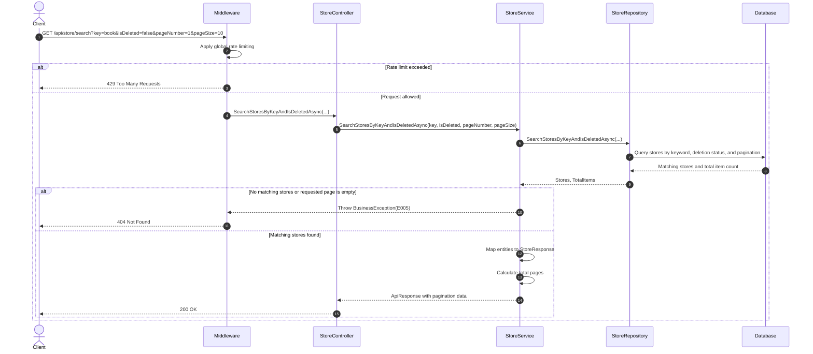

#### Notes

- The keyword search fields and matching rules depend on the implementation of `StoreRepository.SearchStoresByKeyAndIsDeletedAsync`.
- The default value of `isDeleted` is `true`; therefore, omitting this parameter searches deleted stores by default.
- The service code shown does not explicitly validate that `pageNumber` and `pageSize` are positive. Invalid pagination values may therefore depend on repository behavior or other validation.
- The controller code provided does not show an explicit authorization attribute for this endpoint. Actual access may still be affected by global authorization configuration.
- A `401 Unauthorized` or `403 Forbidden` response is possible if applicable authorization policies are configured elsewhere; these outcomes are not established by the supplied endpoint code.
- The example response bodies for errors should be verified against the application's actual middleware and validation configuration.

