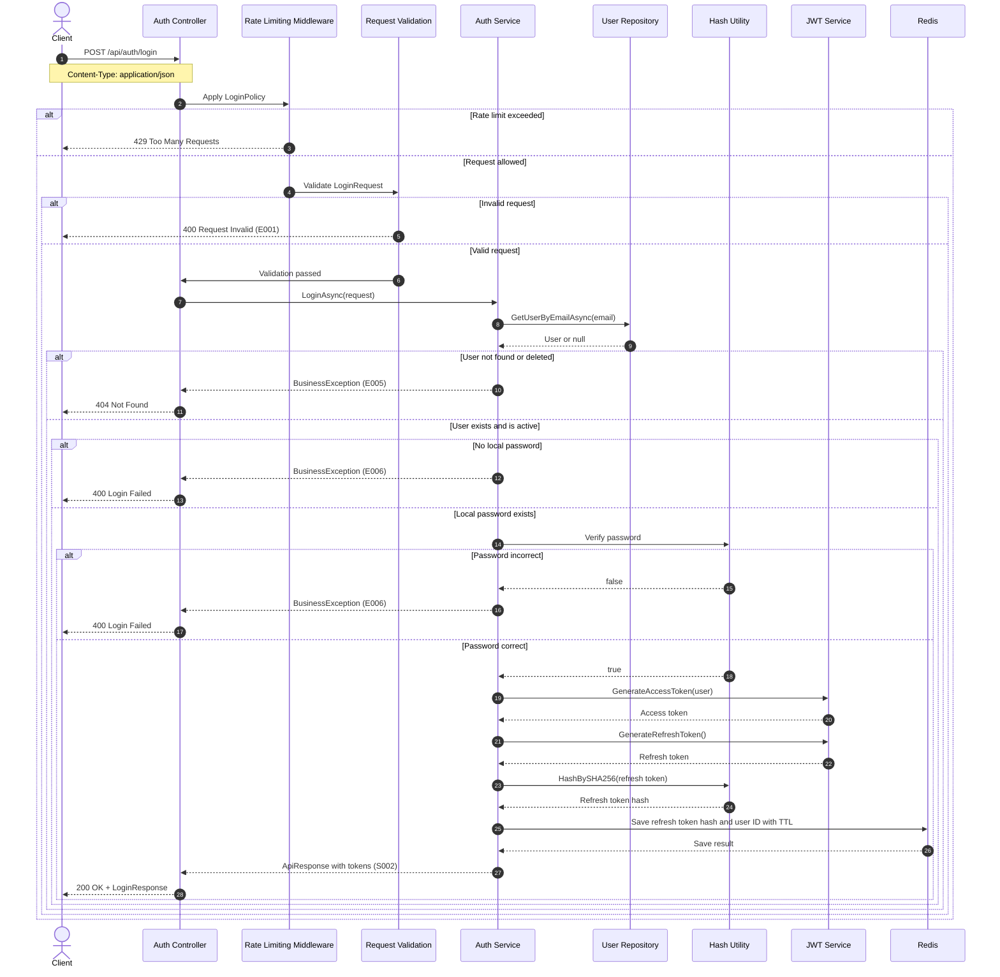
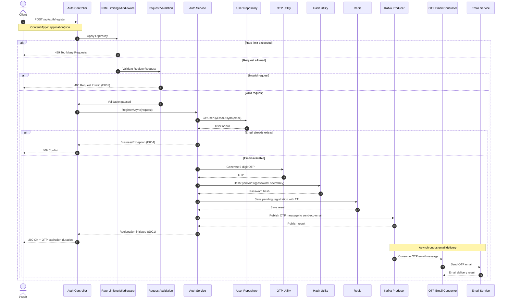
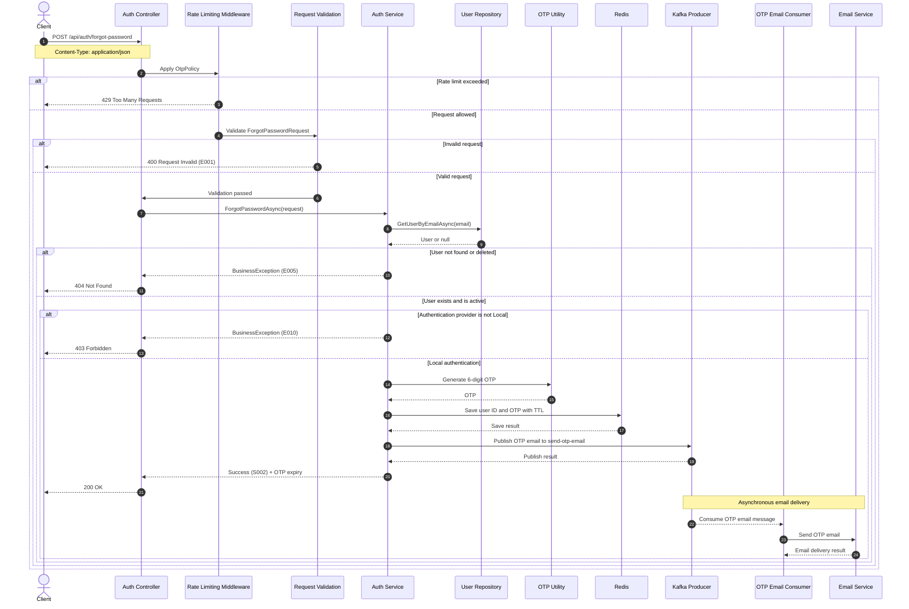
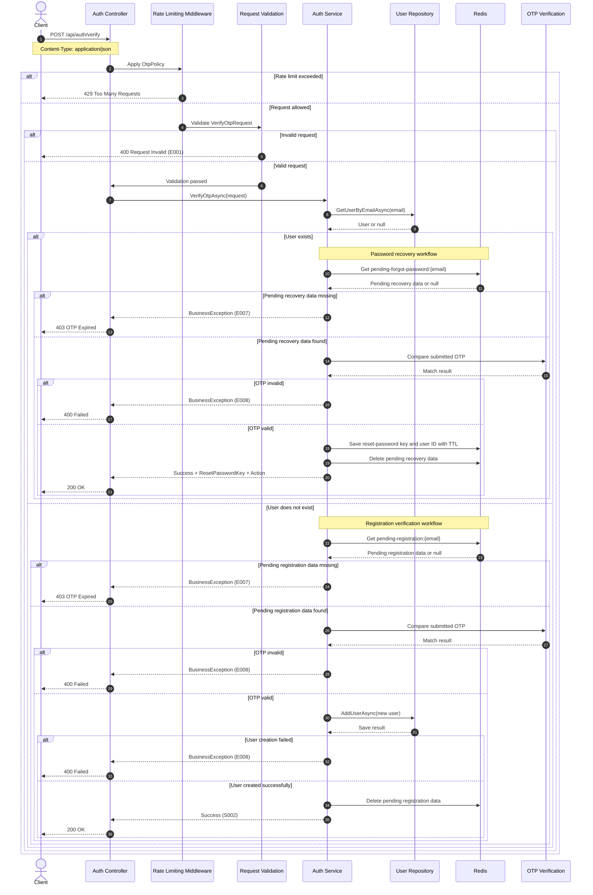
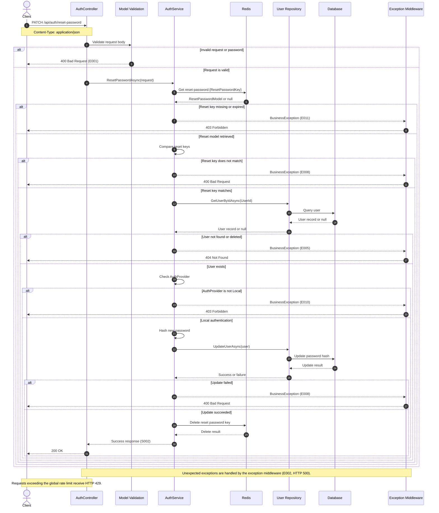
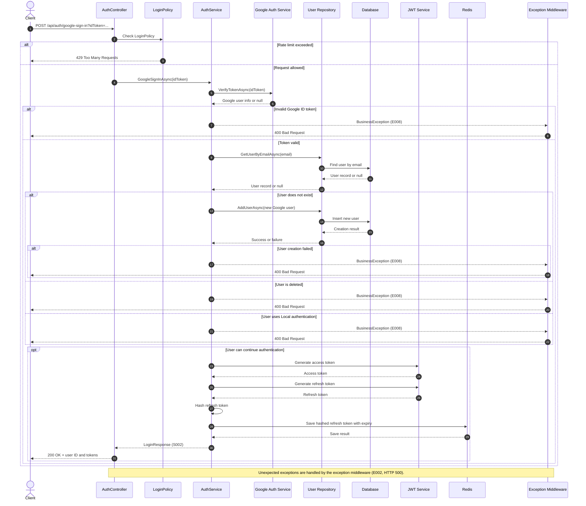
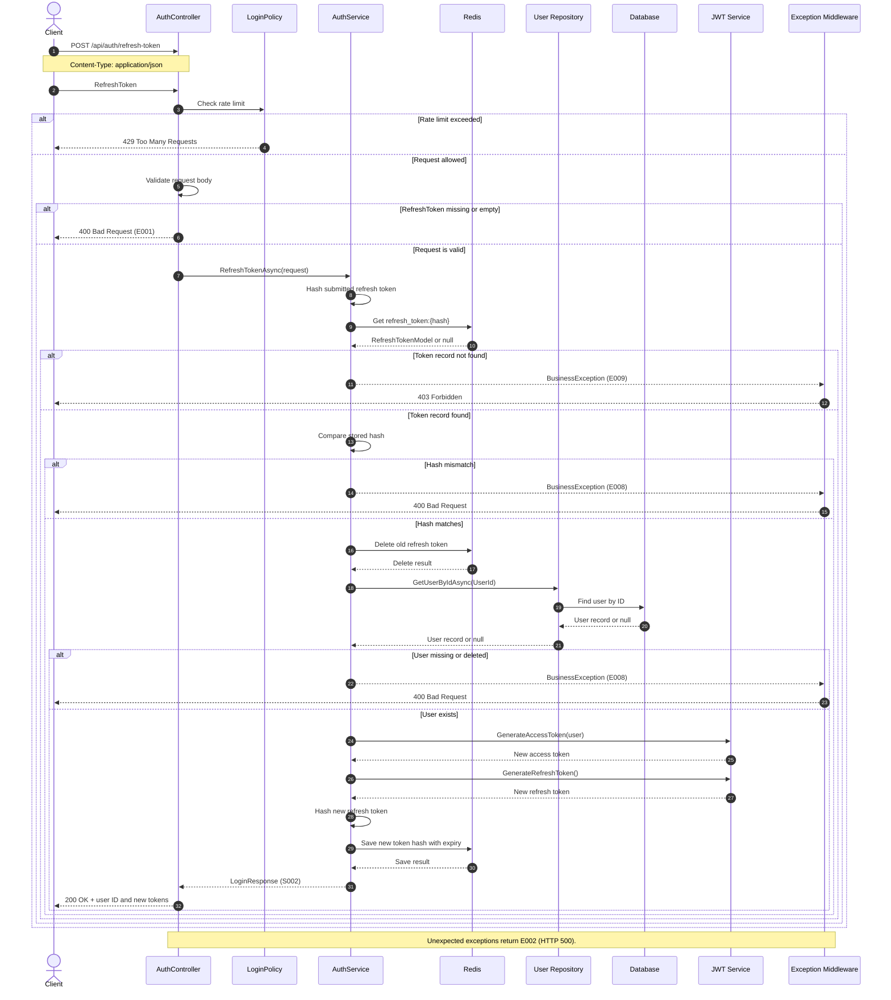

# Application Programming Interface Description

# Table of Contents

- [1. Auth](#1-auth)
  - [1.1. Login](#11-login)
  - [1.2. Register](#12-register)
  - [1.3. Forgot Password](#13-forgot-password)
  - [1.4. Verify OTP](#14-verify-otp)
  - [1.5. Reset Password](#15-reset-password)
  - [1.6. Google Login](#16-google-login)
  - [1.7. Refresh Token](#17-refresh-token)

## 1. Auth

### 1.1 Login

#### API Information

- **Method:** `POST`
- **URL:** `http://<host>:<port>/api/auth/login`
- **Content-Type:** `application/json`
- **Rate Limiting Policy:** `LoginPolicy`

The `<host>` and `<port>` depend on the deployment environment. For example, when running the backend locally, the URL may be `http://localhost:5070/api/auth/login`.

#### Description

This API authenticates a user using their email address and password. If the credentials are valid, the system generates an access token and a refresh token, stores the refresh token's hash in Redis with a configured expiration time, and returns the authentication information to the client.

The API does not allow users who are deleted or users who do not have a local password to log in using this method.

#### Request

The client sends a JSON object containing the user's email address and password.

**Request Body:**

| Field | Type | Required | Description |
|---|---|---|---|
| `Email` | String | Yes | The user's email address. Must be a valid email address and must not exceed 255 characters. |
| `Password` | String | Yes | The user's password. Must contain 6–15 non-whitespace characters, including at least one uppercase letter, one lowercase letter, one digit, and one special character. Spaces are not allowed. |

**Example Request:**

```json
{
  "email": "user@example.com",
  "password": "Password@123"
}
```

#### Response

The API returns a standardized `ApiResponse<T>` JSON object. The response includes the operation status, response code, message, HTTP status code, and response data.

**1. Successful Login — HTTP 200 OK**

Returned when the user exists, is not deleted, has a local password, and provides the correct password.

```json
{
  "isSuccess": true,
  "responseCode": "S002",
  "message": "Successful!",
  "httpStatus": 200,
  "data": {
    "userId": "00000000-0000-0000-0000-000000000000",
    "accessToken": "<access-token>",
    "refreshToken": "<refresh-token>"
  }
}
```

The `userId` is the user's unique identifier. The `accessToken` is used to authenticate subsequent requests, while the `refreshToken` is used to obtain a new access token according to the refresh-token workflow.

**2. Invalid Request — HTTP 400 Bad Request**

Returned when the request fails model validation, such as when the email is missing or invalid, or the password does not satisfy the validation rules.

```json
{
  "isSuccess": false,
  "responseCode": "E001",
  "message": "Request is invalid!",
  "httpStatus": 400,
  "data": [
    "The Password field must contain at least one uppercase letter."
  ]
}
```

The `data` array contains validation error messages. The exact messages depend on the validation errors encountered.

**3. User Not Found or Deleted — HTTP 404 Not Found**

Returned when the email does not correspond to an existing user or the user has been deleted.

```json
{
  "isSuccess": false,
  "responseCode": "E005",
  "message": "Not found data!",
  "httpStatus": 404,
  "data": null
}
```

**4. Login Failed — HTTP 400 Bad Request**

Returned when the password is incorrect or the user does not have a local password, such as an account registered through an external authentication provider.

```json
{
  "isSuccess": false,
  "responseCode": "E006",
  "message": "Login Failed!",
  "httpStatus": 400,
  "data": null
}
```

**5. Too Many Requests — HTTP 429 Too Many Requests**

Returned when the client exceeds the request limit configured by `LoginPolicy`.

```json
{
  "status": 429,
  "message": "Too many requests. Please try again later."
}
```

This response is generated by the ASP.NET Core Rate Limiting middleware and has a different structure from the standard `ApiResponse<T>` format.

**6. Internal Server Error — HTTP 500 Internal Server Error**

Returned when an unexpected server-side exception occurs, such as an unhandled infrastructure or service error.

```json
{
  "isSuccess": false,
  "responseCode": "E002",
  "message": "Internal server error!",
  "httpStatus": 500,
  "data": null
}
```

#### Sequence Diagram

The following sequence diagram illustrates the login workflow, including request validation, rate limiting, user verification, password verification, token generation, and refresh-token storage in Redis.



#### Notes

- The refresh token is stored in Redis using the key format `refresh_token:{refreshTokenHash}`. The raw refresh token is returned to the client, while its hash is used as the Redis key and stored value.
- The Redis entry expires after the number of days configured by `RefreshTokenExpirationDays`.
- The `LoginPolicy` rate limit is enforced before the login action executes. When the limit is exceeded, the client receives HTTP 429.
- The exception-handling middleware maps `BusinessException` instances to their corresponding `ErrorRecord` responses and maps unexpected exceptions to HTTP 500.
- The HTTP status codes and response bodies documented above reflect the supplied implementation. The exact limits, expiration values, and validation messages depend on the application configuration and validation rules.

### 1.2. Register

#### API Information

- **Method:** `POST`
- **URL:** `http://<host>:<port>/api/auth/register`
- **Content-Type:** `application/json`
- **Rate Limiting Policy:** `OtpPolicy`

The `<host>` and `<port>` depend on the deployment environment. For example, when running the backend locally, the URL may be `http://localhost:5070/api/auth/register`.

The `OtpPolicy` rate limiting policy controls the number of registration requests a client can send within a configured period. If the request limit is exceeded, the API returns HTTP `429 Too Many Requests`.

#### Description

This API initiates the user registration process by accepting the user's full name, email address, and password. It checks whether the email address is already registered, generates a six-digit One-Time Password (OTP), hashes the password, and temporarily stores the registration information in Redis.

The API then publishes an OTP email message to the Kafka topic `send-otp-email` for asynchronous email delivery. The client receives the OTP expiration duration and must complete the OTP verification process to continue registration.

**Note:** This API initiates registration but does not create the user account directly. The registration information is temporarily stored in Redis until it expires or is processed by the subsequent verification workflow.

#### Request

The client sends a JSON object containing the user's full name, email address, and password.

**Request Body:**

| Field | Type | Required | Description |
|---|---|---|---|
| `FullName` | String | Yes | The user's full name. Must not exceed 255 characters. |
| `Email` | String | Yes | The user's email address. Must be a valid email address and must not exceed 255 characters. |
| `Password` | String | Yes | The user's password. Must contain 6–15 non-whitespace characters, including at least one uppercase letter, one lowercase letter, one digit, and one special character. Spaces are not allowed. |

**Example Request:**

```json
{
  "fullName": "Nguyen Van A",
  "email": "user@example.com",
  "password": "Password@123"
}
```

#### Response

The API returns a standardized `ApiResponse<T>` JSON object for successful operations and application-level errors. The response includes `IsSuccess`, `ResponseCode`, `Message`, `HttpStatus`, and `Data`, except for the rate-limiting response, which uses a different format.

**1. Registration Initiated Successfully — HTTP 200 OK**

Returned when the email address is not already registered, the pending registration information is saved in Redis, and the OTP email message is successfully published to Kafka.

```json
{
  "isSuccess": true,
  "responseCode": "S001",
  "message": "Register is successfully!",
  "httpStatus": 200,
  "data": {
    "otpExpirySeconds": 120
  }
}
```

The `otpExpirySeconds` field specifies how long the OTP remains valid, in seconds. The example uses `120` seconds; the actual value depends on the `OtpExpirySeconds` configuration.

**2. Invalid Request — HTTP 400 Bad Request**

Returned when the request fails model validation, such as when a required field is missing, the email address is invalid, a field exceeds its maximum length, or the password does not satisfy the specified requirements.

```json
{
  "isSuccess": false,
  "responseCode": "E001",
  "message": "Request is invalid!",
  "httpStatus": 400,
  "data": [
    "The Email field is required."
  ]
}
```

The `data` array contains validation error messages. The exact messages depend on the validation errors encountered.

**3. Email Already Registered — HTTP 409 Conflict**

Returned when the supplied email address already belongs to an existing user.

```json
{
  "isSuccess": false,
  "responseCode": "E004",
  "message": "User is exists!",
  "httpStatus": 409,
  "data": null
}
```

**4. Too Many Requests — HTTP 429 Too Many Requests**

Returned when the client exceeds the request limit configured by `OtpPolicy`.

```json
{
  "status": 429,
  "message": "Too many requests. Please try again later."
}
```

This response is generated by the ASP.NET Core Rate Limiting middleware and does not follow the standard `ApiResponse<T>` structure.

**5. Internal Server Error — HTTP 500 Internal Server Error**

Returned when an unexpected exception occurs during registration, such as a Redis failure, a Kafka publishing failure, or another unhandled server-side error.

```json
{
  "isSuccess": false,
  "responseCode": "E002",
  "message": "Internal server error!",
  "httpStatus": 500,
  "data": null
}
```

The API's exception-handling middleware maps unexpected exceptions to this response. The exact cause should be investigated using server-side logs.

#### Sequence Diagram

The following sequence diagram illustrates the registration workflow, including rate limiting, request validation, checking for an existing user, OTP generation, password hashing, temporary storage in Redis, and publishing the OTP email message to Kafka.



#### Notes

- The OTP is generated using `OtpUtility.Generate(len: 6)`.
- The password is hashed using SHA-256 with the configured secret key before it is stored in the pending registration model.
- Pending registration information is stored in Redis using the key format `pending-registration:{email}` and expires after `OtpExpirySeconds`.
- The OTP email message is published to the Kafka topic `send-otp-email`. An email consumer processes the message asynchronously, so email delivery does not need to occur within the registration HTTP request.
- The rate limit is enforced by `OtpPolicy`. The exact request limit and time window depend on the rate-limiting configuration.
- The documented success response is returned only after the service completes the Redis save and Kafka publish operations without throwing an exception.
- If Redis or Kafka throws an exception, the exception-handling middleware maps the unexpected exception to HTTP 500. However, if Redis succeeds and Kafka publishing subsequently fails, pending registration data may remain in Redis until its TTL expires.
- The sample response values and validation messages are illustrative. Actual values depend on the application configuration and validation framework.

### 1.3. Forgot Password

#### API Information

- **Method:** `POST`
- **URL:** `http://<host>:<port>/api/auth/forgot-password`
- **Content-Type:** `application/json`
- **Rate Limiting Policy:** `OtpPolicy`

The `<host>` and `<port>` depend on the deployment environment. For example, when running the backend locally, the URL may be `http://localhost:5070/api/auth/forgot-password`.

The `OtpPolicy` rate limiting policy limits the number of requests a client can send within a configured time window. If the request limit is exceeded, the API returns HTTP `429 Too Many Requests`.

#### Description

This API initiates the password recovery process for an existing user with a local authentication account. It verifies that the user exists and has not been deleted, generates a six-digit One-Time Password (OTP), and temporarily stores the OTP and user ID in Redis.

The API then publishes an OTP email message to the Kafka topic `send-otp-email` for asynchronous delivery. Upon successful processing, the client receives the OTP expiration duration and can use the OTP in the subsequent password-reset verification workflow.

Users who authenticate through an external provider, such as Google, cannot use this local password recovery process.

#### Request

The client sends a JSON object containing the email address associated with the account.

**Request Body:**

| Field | Type | Required | Description |
|---|---|---|---|
| `Email` | String | Yes | The user's email address. Must be a valid email address and must not exceed 255 characters. |

**Example Request:**

```json
{
  "email": "user@example.com"
}
```

#### Response

The API returns a standardized `ApiResponse<T>` JSON object for successful operations and application-level errors. The response includes `IsSuccess`, `ResponseCode`, `Message`, `HttpStatus`, and `Data`, except for the rate-limiting response, which uses a different format.

**1. Forgot Password Request Successful — HTTP 200 OK**

Returned when the user exists, is not deleted, uses local authentication, and the pending password-recovery information is saved in Redis and the OTP email message is successfully published to Kafka.

```json
{
  "isSuccess": true,
  "responseCode": "S002",
  "message": "Successful!",
  "httpStatus": 200,
  "data": {
    "otpExpirySeconds": 120
  }
}
```

The `otpExpirySeconds` field specifies how long the OTP remains valid, in seconds. The example uses `120` seconds; the actual value depends on the `OtpExpirySeconds` configuration.

**2. Invalid Request — HTTP 400 Bad Request**

Returned when the request fails model validation, such as when the email is missing, has an invalid format, or exceeds 255 characters.

```json
{
  "isSuccess": false,
  "responseCode": "E001",
  "message": "Request is invalid!",
  "httpStatus": 400,
  "data": [
    "Invalid email format"
  ]
}
```

The `data` array contains validation error messages. The exact messages depend on the validation errors encountered.

**3. User Not Found or Deleted — HTTP 404 Not Found**

Returned when the email address does not correspond to an existing user or the user has been deleted.

```json
{
  "isSuccess": false,
  "responseCode": "E005",
  "message": "Not found data!",
  "httpStatus": 404,
  "data": null
}
```

**4. User Does Not Use Local Authentication — HTTP 403 Forbidden**

Returned when the account uses an authentication provider other than `Local`, such as Google authentication.

```json
{
  "isSuccess": false,
  "responseCode": "E010",
  "message": "User not log in locally",
  "httpStatus": 403,
  "data": null
}
```

**5. Too Many Requests — HTTP 429 Too Many Requests**

Returned when the client exceeds the request limit configured by `OtpPolicy`.

```json
{
  "status": 429,
  "message": "Too many requests. Please try again later."
}
```

This response is generated by the ASP.NET Core Rate Limiting middleware and does not follow the standard `ApiResponse<T>` structure.

**6. Internal Server Error — HTTP 500 Internal Server Error**

Returned when an unexpected exception occurs during password recovery, such as a Redis failure, a Kafka publishing failure, or another unhandled server-side error.

```json
{
  "isSuccess": false,
  "responseCode": "E002",
  "message": "Internal server error!",
  "httpStatus": 500,
  "data": null
}
```

The exception-handling middleware logs the exception and maps unexpected errors to this response. The underlying cause should be investigated using server-side logs.

#### Sequence Diagram

The following sequence diagram illustrates the password recovery workflow, including rate limiting, request validation, user verification, authentication-provider checking, OTP generation, temporary storage in Redis, and asynchronous email delivery through Kafka.



#### Notes

- The OTP is generated using `OtpUtility.Generate(len: 6)`.
- Pending password-recovery information is stored in Redis using the key format `pending-forgot-password:{email}`.
- The Redis entry contains the user's ID and OTP and expires after `OtpExpirySeconds`.
- The OTP email message is published to the Kafka topic `send-otp-email`. The email consumer processes the message asynchronously.
- The rate limit is enforced by `OtpPolicy`. The exact request limit and time window depend on the rate-limiting configuration.
- The API initiates password recovery but does not change the user's password. The client must complete the subsequent OTP verification and password-reset steps.
- If Redis or Kafka throws an exception, the exception-handling middleware maps an unexpected exception to HTTP 500. If the Redis save succeeds but Kafka publishing fails, the pending recovery record may remain until it expires.
- The documented status codes and response structures reflect the supplied implementation. Actual OTP expiration values and validation messages depend on the application configuration and validation framework.

### 1.4. Verify OTP

#### API Information

- **Method:** `POST`
- **URL:** `http://<host>:<port>/api/auth/verify`
- **Content-Type:** `application/json`
- **Rate Limiting Policy:** `OtpPolicy`

The `<host>` and `<port>` depend on the deployment environment. For example, when running the backend locally, the URL may be `http://localhost:5070/api/auth/verify`.

The `OtpPolicy` rate limiting policy limits the number of requests a client can send within a configured time window. If the request limit is exceeded, the API returns HTTP `429 Too Many Requests`.

#### Description

This API verifies a six-digit One-Time Password (OTP) submitted by the client. It supports two workflows: completing a new user registration and verifying a password recovery request.

The service first checks whether the submitted email address belongs to an existing user:

- **Registration verification:** If the user does not exist, the service retrieves the pending registration information from Redis, validates the OTP, creates the user account, and deletes the pending registration data.
- **Forgot password verification:** If the user already exists, the service retrieves the pending password recovery information from Redis, validates the OTP, generates a reset password key, stores the reset information in Redis, and deletes the pending recovery data.

The response identifies the next action through the `Action` field. For password recovery, the client uses the returned `ResetPasswordKey` in the subsequent password-reset workflow.

#### Request

The client sends a JSON object containing the email address and OTP.

**Request Body:**

| Field | Type | Required | Description |
|---|---|---|---|
| `Email` | String | Yes | The email address associated with the registration or password recovery request. Must be a valid email address and must not exceed 255 characters. |
| `Otp` | String | Yes | The OTP to verify. Must contain exactly six numeric digits. |

**Example Request:**

```json
{
  "email": "user@example.com",
  "otp": "123456"
}
```

#### Response

The API returns a standardized `ApiResponse<T>` JSON object for successful operations and application-level errors. The response includes `IsSuccess`, `ResponseCode`, `Message`, `HttpStatus`, and `Data`.

**1. Registration Verified Successfully — HTTP 200 OK**

Returned when the OTP matches the pending registration OTP and the new user account is successfully created.

```json
{
  "isSuccess": true,
  "responseCode": "S002",
  "message": "Successful!",
  "httpStatus": 200,
  "data": null
}
```

The `Data` field is `null` because the registration verification workflow returns a successful response without additional data.

**2. Password Recovery OTP Verified Successfully — HTTP 200 OK**

Returned when the OTP matches the pending password recovery OTP. The service generates a reset password key, stores the associated user ID and key in Redis, and removes the pending password recovery record.

```json
{
  "isSuccess": true,
  "responseCode": "S002",
  "message": "Successful!",
  "httpStatus": 200,
  "data": {
    "resetPasswordKey": "00000000-0000-0000-0000-000000000000",
    "action": "ForgotPassword"
  }
}
```

- `resetPasswordKey`: A newly generated GUID used to authorize the subsequent password-reset operation.
- `action`: Identifies the next workflow. For password recovery, the value is `ForgotPassword`. The exact JSON representation depends on the `AuthAction` enum serialization configuration.

The reset password key expires after the configured `ResetPasswordExpiryMinutes` duration.

**3. Invalid Request — HTTP 400 Bad Request**

Returned when the request fails model validation, such as when the email is missing or invalid, or the OTP does not contain exactly six digits.

```json
{
  "isSuccess": false,
  "responseCode": "E001",
  "message": "Request is invalid!",
  "httpStatus": 400,
  "data": [
    "OTP must be exactly 6 digits."
  ]
}
```

The `data` array contains validation error messages. The exact messages depend on the validation errors encountered.

**4. OTP Expired or Not Found — HTTP 403 Forbidden**

Returned when the corresponding pending registration or password recovery record cannot be found in Redis, typically because the OTP has expired or the pending record no longer exists.

```json
{
  "isSuccess": false,
  "responseCode": "E007",
  "message": "OTP has expired!",
  "httpStatus": 403,
  "data": null
}
```

**5. Invalid OTP or Registration Failure — HTTP 400 Bad Request**

Returned when the submitted OTP does not match the stored OTP. The same error is also returned when creating the user account fails in the registration workflow.

```json
{
  "isSuccess": false,
  "responseCode": "E008",
  "message": "Failed!",
  "httpStatus": 400,
  "data": null
}
```

**6. Too Many Requests — HTTP 429 Too Many Requests**

Returned when the client exceeds the request limit configured by `OtpPolicy`.

```json
{
  "status": 429,
  "message": "Too many requests. Please try again later."
}
```

This response is generated by the ASP.NET Core Rate Limiting middleware and does not follow the standard `ApiResponse<T>` structure.

**7. Internal Server Error — HTTP 500 Internal Server Error**

Returned when an unexpected exception occurs during OTP verification, such as a Redis or database failure.

```json
{
  "isSuccess": false,
  "responseCode": "E002",
  "message": "Internal server error!",
  "httpStatus": 500,
  "data": null
}
```

The exception-handling middleware logs unexpected exceptions and maps them to this response.

#### Sequence Diagram

The following sequence diagram illustrates both OTP verification workflows: registration verification and password recovery verification.



#### Notes

- The API uses `OtpPolicy` for rate limiting. The exact request limit and time window depend on the rate-limiting configuration.
- The service selects the verification workflow based on whether `GetUserByEmailAsync` returns an existing user.
- Registration pending data is stored under `pending-registration:{email}`. Password recovery data is stored under `pending-forgot-password:{email}`.
- A missing pending record is treated as an expired OTP and returns error code `E007`.
- An incorrect OTP returns error code `E008`.
- On successful registration verification, the user is created using the full name, email, and password hash stored in Redis. The pending registration record is then deleted.
- On successful password recovery verification, a reset password key is generated and stored in Redis under `reset-password:{resetPasswordKey}`. The stored record contains the reset key and user ID and expires after `ResetPasswordExpiryMinutes`.
- The API does not change the password directly. Password recovery continues through the subsequent password-reset endpoint.
- The documented status codes and response bodies reflect the supplied implementation. Actual enum serialization and validation error messages depend on the application configuration.

### 1.5. Reset Password

#### API Information

- **API URL:** `http://<host>:<port>/api/auth/reset-password`
- **HTTP Method:** `PATCH`
- **Content-Type:** `application/json`
- **Rate Limiting Policy:** Global Rate Limiter (default policy)

#### Description

This API allows users to reset their password using a valid `ResetPasswordKey` obtained from the password recovery process. The API validates the reset key, verifies that it has not expired, checks whether the associated user exists and is not deleted, and ensures that the user's authentication provider is `Local`.

If all checks pass, the API hashes the new password using SHA-256 with the configured security secret key, updates the user's password in the database, and deletes the reset key from Redis to prevent it from being reused.

#### Request

**Request Body:**

| Field | Data Type | Required | Description |
|---|---|---|---|
| `ResetPasswordKey` | `Guid` | Yes | The reset password key obtained from the password recovery process. |
| `NewPassword` | `string` | Yes | The new password that must satisfy the password complexity requirements. |

**Password Requirements:**

- Must contain between 6 and 15 characters.
- Must contain at least one uppercase letter (`A–Z`).
- Must contain at least one lowercase letter (`a–z`).
- Must contain at least one digit (`0–9`).
- Must contain at least one special character.
- Must not contain whitespace.

**Example Request:**

```json
{
  "ResetPasswordKey": "550e8400-e29b-41d4-a716-446655440000",
  "NewPassword": "NewPass@123"
}
```

#### Response

**1. Successful Password Reset — HTTP 200 OK**

Returned when the reset key is valid, the key has not expired, the user meets all requirements, and the password is successfully updated.

```json
{
  "IsSuccess": true,
  "ResponseCode": "S002",
  "Message": "Successful!",
  "HttpStatus": 200,
  "Data": null
}
```

**2. Invalid Request — HTTP 400 Bad Request**

Returned when the request body fails model validation, such as when `ResetPasswordKey` is missing or `NewPassword` does not satisfy the password requirements.

```json
{
  "IsSuccess": false,
  "ResponseCode": "E001",
  "Message": "Request is invalid!",
  "HttpStatus": 400,
  "Data": [
    "The password must be between 6 and 15 characters long, contain at least one uppercase letter, one lowercase letter, one digit, and one special character, and must not contain any spaces."
  ]
}
```

The `Data` array contains the applicable validation error messages. The example above illustrates a password validation failure.

**3. Password Reset Failed — HTTP 400 Bad Request**

Returned when the reset key does not match the key stored in the retrieved reset model, or when the password update operation fails.

```json
{
  "IsSuccess": false,
  "ResponseCode": "E008",
  "Message": "Failed!",
  "HttpStatus": 400,
  "Data": null
}
```

**4. User Not Found — HTTP 404 Not Found**

Returned when the user associated with the reset key does not exist or has been deleted.

```json
{
  "IsSuccess": false,
  "ResponseCode": "E005",
  "Message": "Not found data!",
  "HttpStatus": 404,
  "Data": null
}
```

**5. Reset Password Key Expired or Invalidated — HTTP 403 Forbidden**

Returned when the reset password key cannot be found in Redis, typically because it has expired or has already been deleted.

```json
{
  "IsSuccess": false,
  "ResponseCode": "E011",
  "Message": "Your time to change the password has expired!",
  "HttpStatus": 403,
  "Data": null
}
```

**6. User Does Not Use Local Authentication — HTTP 403 Forbidden**

Returned when the associated user's authentication provider is not `Local`. Users authenticated through external providers cannot reset their password through this API.

```json
{
  "IsSuccess": false,
  "ResponseCode": "E010",
  "Message": "User not log in locally",
  "HttpStatus": 403,
  "Data": null
}
```

**7. Internal Server Error — HTTP 500 Internal Server Error**

Returned when an unexpected exception occurs during request processing, such as an unhandled database or Redis error.

```json
{
  "IsSuccess": false,
  "ResponseCode": "E002",
  "Message": "Internal server error!",
  "HttpStatus": 500,
  "Data": null
}
```

**8. Rate Limit Exceeded — HTTP 429 Too Many Requests**

Returned when the client exceeds the configured global rate limit. The client should wait before sending additional requests.

```json
{
  "status": 429,
  "message": "Too many requests. Please try again later."
}
```

**Notes:**

- Responses for business errors and unexpected exceptions follow the `ApiResponse<T>` format.
- Validation failures use `ValidationErrorResponse`, which returns the validation messages in the `Data` array.
- Rate-limit responses use the configured rate-limiting rejection format and may differ from the standard `ApiResponse<T>` structure.
- The exact request threshold and time window depend on the global rate-limiting configuration.

#### Sequence Diagram

The following sequence diagram illustrates the password reset workflow, including request validation, reset-key verification, user verification, password updating, and possible error responses.



### 1.6. Google Login

#### API Information

- **API URL:** `http://<host>:<port>/api/auth/google-sign-in?idToken=<google-id-token>`
- **HTTP Method:** `POST`
- **Content-Type:** `application/json`
- **Rate Limiting Policy:** `LoginPolicy`

#### Description

This API allows users to authenticate using their Google account. The API verifies the Google ID token, retrieves the user's information from Google, and checks whether the user can sign in.

If the user does not exist in the system, the API automatically creates a new account using the Google account information. If the user already exists and is eligible to sign in, the API generates an access token and a refresh token. The refresh token is stored in Redis as a hashed value with a configured expiration period.

The API returns the user's ID, access token, and refresh token upon successful authentication.

#### Request

**Request Parameter:**

| Parameter | Data Type | Required | Description |
|---|---|---|---|
| `idToken` | `string` | Yes | The Google ID token obtained from the Google authentication process. It is passed as a query parameter. |

**Example Request:**

```http
POST /api/auth/google-sign-in?idToken=<google-id-token> HTTP/1.1
Host: <host>:<port>
Content-Type: application/json
```

**Notes:**
- Replace `<google-id-token>` with a valid Google ID token.
- The `idToken` is supplied through the URL query string, not the request body.
- No JSON request body is required.
- Although the endpoint specifies `application/json`, the request does not contain a JSON body because the input is supplied through the query string.

#### Response

**1. Successful Google Login — HTTP 200 OK**

Returned when the Google ID token is valid and the user is successfully authenticated. If the user does not already exist, a new Google account is created before the tokens are generated.

```json
{
  "IsSuccess": true,
  "ResponseCode": "S002",
  "Message": "Successful!",
  "HttpStatus": 200,
  "Data": {
    "UserId": "550e8400-e29b-41d4-a716-446655440000",
    "AccessToken": "<access-token>",
    "RefreshToken": "<refresh-token>"
  }
}
```

The `Data` object contains:

- `UserId`: The unique identifier of the authenticated user.
- `AccessToken`: The JWT access token used to access protected APIs.
- `RefreshToken`: The refresh token used to obtain a new access token according to the refresh-token workflow.

**2. Google Authentication Failed — HTTP 400 Bad Request**

Returned when the Google ID token is invalid, the user account has been deleted, the user already has a local authentication account, or the user creation operation fails.

```json
{
  "IsSuccess": false,
  "ResponseCode": "E008",
  "Message": "Failed!",
  "HttpStatus": 400,
  "Data": null
}
```

All these cases use the `ErrorRecord.Failed` error response in the current service implementation.

**3. Invalid Request — HTTP 400 Bad Request**

Returned when the request cannot be bound or validated correctly, such as when the required `idToken` parameter is missing and the application's model-binding or validation configuration rejects the request.

```json
{
  "IsSuccess": false,
  "ResponseCode": "E001",
  "Message": "Request is invalid!",
  "HttpStatus": 400,
  "Data": [
    "Invalid request!."
  ]
}
```

The `Data` array contains the applicable validation error messages. The example is illustrative; the actual message depends on the model-binding and validation configuration.

**4. Internal Server Error — HTTP 500 Internal Server Error**

Returned when an unexpected exception occurs during Google token verification, database operations, token generation, or Redis operations.

```json
{
  "IsSuccess": false,
  "ResponseCode": "E002",
  "Message": "Internal server error!",
  "HttpStatus": 500,
  "Data": null
}
```

**5. Rate Limit Exceeded — HTTP 429 Too Many Requests**

Returned when the client exceeds the request limit configured by `LoginPolicy`.

```json
{
  "status": 429,
  "message": "Too many requests. Please try again later."
}
```

The client should wait before retrying the request. The exact request threshold and time window depend on the `LoginPolicy` configuration.

#### Sequence Diagram

The following sequence diagram illustrates the Google login workflow, including token verification, account lookup or creation, authentication checks, token generation, and possible error responses.



### 1.7. Refresh Token

#### API Information

- **API URL:** `http://<host>:<port>/api/auth/refresh-token`
- **HTTP Method:** `POST`
- **Content-Type:** `application/json`
- **Rate Limiting Policy:** `LoginPolicy`

#### Description

This API allows authenticated users to obtain a new access token and refresh token using a valid refresh token. It verifies the submitted refresh token by hashing it with the configured security secret key and checking the corresponding record in Redis.

If the refresh token is valid and has not expired, the API deletes the old refresh token record, verifies that the associated user exists and is not deleted, generates a new access token and refresh token, and stores the hash of the new refresh token in Redis with the configured expiration period.

This process implements **refresh token rotation**, meaning the old refresh token is invalidated when it is exchanged for a new pair of tokens.

#### Request

**Request Body:**

| Field | Data Type | Required | Description |
|---|---|---|---|
| `RefreshToken` | `string` | Yes | The refresh token previously issued by the authentication API. It is used to obtain a new access token and refresh token. |

**Example Request:**

```http
POST /api/auth/refresh-token HTTP/1.1
Host: <host>:<port>
Content-Type: application/json
```

```json
{
  "RefreshToken": "<refresh-token>"
}
```

**Validation Rules:**

- `RefreshToken` is required.
- The submitted refresh token must correspond to a valid, unexpired refresh token record in Redis.
- The associated user must exist and must not be deleted.

#### Response

**1. Successful Token Refresh — HTTP 200 OK**

Returned when the refresh token is valid and the associated user exists and is not deleted. The API invalidates the old refresh token and returns a new access token and refresh token.

```json
{
  "IsSuccess": true,
  "ResponseCode": "S002",
  "Message": "Successful!",
  "HttpStatus": 200,
  "Data": {
    "UserId": "550e8400-e29b-41d4-a716-446655440000",
    "AccessToken": "<new-access-token>",
    "RefreshToken": "<new-refresh-token>"
  }
}
```

The `Data` object contains:

- `UserId`: The unique identifier of the user.
- `AccessToken`: The newly generated JWT access token.
- `RefreshToken`: The newly generated refresh token, which replaces the previous one.

**2. Invalid Request — HTTP 400 Bad Request**

Returned when the request fails model validation, such as when the required `RefreshToken` field is missing or empty.

```json
{
  "IsSuccess": false,
  "ResponseCode": "E001",
  "Message": "Request is invalid!",
  "HttpStatus": 400,
  "Data": [
    "Refresh token is required!"
  ]
}
```

The `Data` array contains the applicable validation error messages.

**3. Refresh Token Invalid — HTTP 400 Bad Request**

Returned when a refresh token record is retrieved from Redis, but its stored hash does not match the hash calculated from the submitted token.

```json
{
  "IsSuccess": false,
  "ResponseCode": "E008",
  "Message": "Failed!",
  "HttpStatus": 400,
  "Data": null
}
```

**4. Refresh Token Expired or Not Found — HTTP 403 Forbidden**

Returned when the refresh token cannot be found in Redis. This typically occurs because the token has expired, has already been used, or has been invalidated.

```json
{
  "IsSuccess": false,
  "ResponseCode": "E009",
  "Message": "RefreshToken has expired!",
  "HttpStatus": 403,
  "Data": null
}
```

**5. User Not Found or Deleted — HTTP 400 Bad Request**

Returned when the refresh token record exists, but the associated user cannot be found or has been deleted.

```json
{
  "IsSuccess": false,
  "ResponseCode": "E008",
  "Message": "Failed!",
  "HttpStatus": 400,
  "Data": null
}
```

**6. Internal Server Error — HTTP 500 Internal Server Error**

Returned when an unexpected exception occurs during Redis operations, database access, or token generation.

```json
{
  "IsSuccess": false,
  "ResponseCode": "E002",
  "Message": "Internal server error!",
  "HttpStatus": 500,
  "Data": null
}
```

**7. Rate Limit Exceeded — HTTP 429 Too Many Requests**

Returned when the client exceeds the request limit configured by `LoginPolicy`.

```json
{
  "status": 429,
  "message": "Too many requests. Please try again later."
}
```

The client should wait before retrying. The exact request threshold and time window depend on the `LoginPolicy` configuration.

#### Important Notes

- The old refresh token is deleted from Redis before the user is retrieved from the database. Consequently, if the user is missing or deleted, or a later operation fails, the old token may already be invalidated.
- Each successful refresh generates a new token pair. Clients should replace both stored tokens with the newly returned values.
- Refresh tokens should be stored securely and should not be exposed in URLs or logs.
- The endpoint uses `LoginPolicy` because its controller action is decorated with `[EnableRateLimiting("LoginPolicy")]`.

#### Sequence Diagram

The following sequence diagram illustrates the refresh-token workflow, including request validation, token verification, user lookup, token rotation, and error handling.



