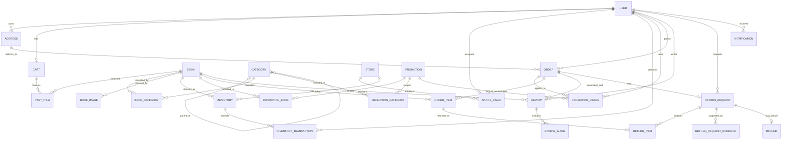

# Book Shop ERP and E-commerce System Description

This document describes the data model and core business areas implemented by the current Book Shop backend. It is based on the Entity Framework Core entities, model configuration, and enums in `back-end/`. It documents the implemented model rather than proposed or planned features.

The system supports a multi-store book business with customer shopping and order workflows, inventory management, promotions, returns, reviews, notifications, and administrative reporting.

## 1. System scope

The current backend includes these business areas:

- User accounts, roles, authentication providers, and delivery addresses.
- Book catalog, hierarchical categories, and book images.
- Stores, store staff assignments, inventory, and inventory transactions.
- Customer carts and cart items.
- Promotions, promotion targets, and promotion usage records.
- Orders, order items, payment and fulfillment statuses.
- Customer reviews and review images.
- Order return requests, returned items, evidence, and refunds.
- User notifications.
- Revenue, merchandise, order-summary, and customer reports.

The backend also integrates with supporting services such as Redis, Kafka, Elasticsearch, email, Google authentication, and file storage. These integrations are application infrastructure and are not relational entities in the data model below.

## 2. Data conventions

- Entity identifiers are `Guid` values. The entities initialize IDs with version 7 GUIDs.
- C# `string`, `int`, `long`, `decimal`, `bool`, and `DateTime` properties are used for text, integer, monetary, flag, and date/time values.
- Enum properties are stored as enum values and represent the integer-backed statuses listed in this document.
- Entities implementing `IAuditable` have `CreatedAt`, nullable `UpdatedAt`, and `IsDeleted` fields. `SaveChangesAsync` sets `CreatedAt` and clears `IsDeleted` for added entities, and updates `UpdatedAt` for modified entities.
- Image/link entities and return/refund entities do not implement `IAuditable`; they therefore do not have the common soft-delete fields.
- Unless stated otherwise, relationships are configured by Entity Framework Core foreign keys. No database cascade behavior is assumed here beyond the explicit configuration in `DatabaseContext`.

## 3. Entity relationship diagram



The diagram shows entity navigation and configured relationship shape. It does not imply that every relationship is mandatory in application workflows. In particular, database constraints do not enforce all business rules described by service behavior.

## 4. Accounts and delivery addresses

### 4.1 User

`UserEntity` stores account identity, authentication details, and authorization role.

| Field | Type | Notes |
| --- | --- | --- |
| `Id` | `Guid` | Primary key |
| `Email` | `string` | Required, maximum 255 characters, unique index |
| `PasswordHash` | nullable `string` | Maximum 255 characters; may be empty for external authentication |
| `FullName` | `string` | Required, maximum 255 characters |
| `Role` | `RoleUser` | Defaults to `Customer` |
| `PhoneNumber` | nullable `string` | Mapped to `varchar(11)` |
| `AuthProvider` | `AuthProvider` | Defaults to `Local` |
| `AvatarUrl` | nullable `string` | Avatar location |
| `Enabled` | `bool` | Defaults to `true` |
| `CreatedAt`, `UpdatedAt`, `IsDeleted` | audit fields | Soft-delete and timestamps |

Roles are `Admin = 1`, `Manager = 2`, `Employee = 3`, and `Customer = 4`. Authentication providers are `Local = 1` and `Google = 2`.

A user may have multiple addresses, orders, reviews, promotion usage records, return requests, inventory transactions, and notifications. A user has at most one cart. The model configures a one-to-one store-staff relationship and a unique index on `StoreStaff.UserId`, so an assigned staff user can be linked to at most one store.

### 4.2 Address

`AddressEntity` stores a user's delivery contact and location details.

| Field | Type | Notes |
| --- | --- | --- |
| `Id` | `Guid` | Primary key |
| `UserId` | `Guid` | Required foreign key to `User` |
| `RecipientName` | `string` | Required, maximum 255 characters |
| `PhoneNumber` | `string` | Required, `varchar(11)` |
| `AddressDetail` | `string` | Required, maximum 500 characters |
| `Ward`, `District`, `Province`, `City` | nullable `string` | Each has maximum length 50 |
| `IsDefault` | `bool` | Required; defaults to `true` |
| `CreatedAt`, `UpdatedAt`, `IsDeleted` | audit fields | Soft-delete and timestamps |

Each address belongs to one user. Orders reference an address. The schema does not itself enforce that a user has only one default address.

## 5. Catalog

### 5.1 Book

`BookEntity` is the catalog product record.

| Field | Type | Notes |
| --- | --- | --- |
| `Id` | `Guid` | Primary key |
| `Name` | `string` | Required, maximum 500 characters |
| `Author`, `Publisher` | nullable `string` | Maximum 255 characters each |
| `Description` | nullable `string` | Book description |
| `Price` | `decimal` | Defaults to zero |
| `Status` | `BookStatus` | Defaults to `Available` |
| `Rank` | `long` | Defaults to `-1`; ordering/ranking value |
| `CreatedAt`, `UpdatedAt`, `IsDeleted` | audit fields | Soft-delete and timestamps |

Book statuses: `Draft = 1`, `Available = 2`, `OutOfStock = 3`, `Suspended = 4`, and `Archived = 5`.

Books may have multiple images, categories, inventory records, cart items, promotion-book links, order items, and reviews.

### 5.2 Book image

`BookImageEntity` contains `Id` (primary key), required `BookId` (foreign key), and required `ImageUrl`. It does not have audit fields. The model does not define a unique constraint for a book's image URL.

### 5.3 Category

`CategoryEntity` stores a category and optional parent category.

| Field | Type | Notes |
| --- | --- | --- |
| `Id` | `Guid` | Primary key |
| `Name` | `string` | Required, maximum 150 characters |
| `ParentId` | nullable `Guid` | Self-referencing parent category |
| `IsActive` | `bool` | Required; defaults to `true` |
| `IsDefault` | `bool` | Defaults to `true` |
| `CreatedAt`, `UpdatedAt`, `IsDeleted` | audit fields | Soft-delete and timestamps |

The parent relationship uses `DeleteBehavior.Restrict`. A category can have child categories and can be linked to books and promotions.

### 5.4 Book-category link

`BookCategoryEntity` joins books and categories. The composite primary key is `(BookId, CategoryId)`. It also has the common audit fields. The relationship is many-to-many; the model does not include a separate category membership identifier.

## 6. Stores and inventory

### 6.1 Store

`StoreEntity` currently contains:

| Field | Type | Notes |
| --- | --- | --- |
| `Id` | `Guid` | Primary key |
| `StoreCode` | `string` | Required, maximum 10 characters, unique index |
| `Address` | `string` | Required, maximum 1,000 characters, unique index |
| `CreatedAt`, `UpdatedAt`, `IsDeleted` | audit fields | Soft-delete and timestamps |

The current store entity does not contain store name, phone number, or an `IsActive` field. Store availability and staff assignment filtering should not be inferred from fields absent from this model.

### 6.2 Store staff

`StoreStaffEntity` links a store and user, with common audit fields. It has composite primary key `(StoreId, UserId)` and a unique index on `UserId`, in addition to indexes on both foreign keys. Consequently, a staff user can have at most one store assignment in this schema; a store can have multiple assigned users.

### 6.3 Inventory

`InventoryEntity` represents a book's quantities at a store.

| Field | Type | Notes |
| --- | --- | --- |
| `Id` | `Guid` | Primary key |
| `StoreId`, `BookId` | `Guid` | Required foreign keys |
| `Quantity` | `int` | Total quantity; defaults to zero |
| `ReservedQuantity` | `int` | Reserved quantity; defaults to zero |
| `AvailableQuantity` | `int` | Available quantity; defaults to zero |
| `DamagedQuantity` | `int` | Damaged quantity; defaults to zero |
| `IncomingQuantity` | `int` | Incoming quantity; defaults to zero |
| `CreatedAt`, `UpdatedAt`, `IsDeleted` | audit fields | Soft-delete and timestamps |

Indexes exist on `StoreId` and `BookId`. No composite uniqueness constraint on `(StoreId, BookId)` is configured in the current model.

### 6.4 Inventory transaction

`InventoryTransactionEntity` records an inventory movement and its actor.

| Field | Type | Notes |
| --- | --- | --- |
| `Id` | `Guid` | Primary key |
| `InventoryId`, `UserId` | `Guid` | References inventory and the user who performed the transaction |
| `TransactionType` | `TransactionType` | Movement category |
| `Quantity` | `int` | Movement quantity |
| `QuntityBefore` | `int` | Property is spelled `QuntityBefore` in the current entity |
| `QuantityAfter` | `int` | Quantity after the movement |
| `Reason` | `string` | Reason/details; defaults to an empty string |
| `CreatedAt`, `UpdatedAt`, `IsDeleted` | audit fields | Soft-delete and timestamps |

Transaction types: `Import = 1`, `Export = 2`, `Adjustment = 3`, `Return = 4`, and `Damage = 5`.

## 7. Shopping cart

`CartEntity` belongs to one user and has a unique index on `UserId`, enforcing at most one cart per user. A cart contains cart items.

`CartItemEntity` has `Id`, required `CartId`, required `BookId`, `Quantity` (defaults to zero), and the common audit fields. The database model does not configure uniqueness for a `(CartId, BookId)` pair.

## 8. Promotions

### 8.1 Promotion

`PromotionEntity` stores a promotion definition.

| Field | Type | Notes |
| --- | --- | --- |
| `Id` | `Guid` | Primary key |
| `Code` | nullable `string` | `varchar(6)`; unique index |
| `Name` | `string` | Required, maximum 255 characters |
| `Type` | `PromotionType` | Discount method |
| `DiscountValue` | `decimal` | Discount value |
| `MinimumOrderValue` | `decimal` | Minimum eligible order amount |
| `StartAt`, `EndAt` | `DateTime` | Promotion validity window (`EndAt` is not nullable) |
| `UsageLimit`, `UsageCount` | `int` | Usage limit and recorded count |
| `FreeShipping` | `bool` | Free-shipping flag |
| `IsActive` | `bool` | Defaults to `true` |
| `CreatedAt`, `UpdatedAt`, `IsDeleted` | audit fields | Soft-delete and timestamps |

Promotion types: `PercentageDiscount = 1`, `FixedAmountDiscount = 2`, and `FreeShipping = 3`.

### 8.2 Promotion targets and usage

- `PromotionBookEntity` joins a promotion and a book. Its composite primary key is `(PromotionId, BookId)` and it has common audit fields.
- `PromotionCatatogyEntity` (class name as currently spelled in code) joins a promotion and category. Its composite primary key is `(PromotionId, CategoryId)` and it has common audit fields.
- `PromotionUsageEntity` has its own `Id`, required `PromotionId`, `UserId`, and `OrderId` foreign keys, and common audit fields. It records which user/order used which promotion.

Promotion usage is associated with the order, not directly with an order item. The current `OrderItemEntity` has no promotion foreign key.

## 9. Orders and payments

### 9.1 Order

`OrderEntity` represents a customer's order.

| Field | Type | Notes |
| --- | --- | --- |
| `Id` | `Guid` | Primary key |
| `UserId`, `AddressId` | `Guid` | Required references to customer and delivery address |
| `OrderCode` | `string` | Required, `varchar(6)`, maximum 6 characters, unique index |
| `Subtotal` | `decimal` | Required |
| `DiscountAmount` | `decimal` | Required |
| `ShippingFee` | `decimal` | Required |
| `TotalAmount` | `decimal` | Required |
| `PaymentMethod` | `PaymentMethod` | Defaults to `CashOnDelivery` |
| `PaymentStatus` | `PaymentStatus` | Required |
| `OrderStatus` | `OrderStatus` | Required |
| `OrderedAt` | `DateTime` | Required |
| `CompletedAt`, `CancelledAt` | nullable `DateTime` | Lifecycle timestamps |
| `CreatedAt`, `UpdatedAt`, `IsDeleted` | audit fields | Soft-delete and timestamps |

Payment methods currently include only `CashOnDelivery = 1`. Payment statuses: `Pending = 1`, `Paid = 2`, `Failed = 3`, and `Refunded = 4`. Order statuses: `Pending = 1`, `Confirmed = 2`, `Shipping = 3`, `Completed = 4`, and `Cancelled = 5`.

### 9.2 Order item

`OrderItemEntity` stores a purchased book and its price calculation at order time.

| Field | Type | Notes |
| --- | --- | --- |
| `Id` | `Guid` | Primary key |
| `OrderId`, `BookId` | `Guid` | Required foreign keys |
| `Quantity` | `int` | Purchased quantity |
| `UnitPrice` | `decimal` | Unit price |
| `DiscountAmount` | `decimal` | Item discount amount |
| `TotalPrice` | `decimal` | Item total |

Order items do not implement the common audit interface. An order has one or more items by its intended business structure; EF configures the order-to-item relationship as one-to-many but does not define a minimum item count constraint.

## 10. Reviews

`ReviewEntity` contains `Id`, required `UserId`, `BookId`, and `OrderId`, integer `Ratting` (spelling in the current entity), nullable `Comment`, and common audit fields. It references one user, book, and order and may have multiple images.

`ReviewImageEntity` contains `Id`, required `ReviewId`, and required `ImageUrl`. It has no audit fields. The current model has no moderation status field and no configured uniqueness rule limiting a user to one review per book or order.

## 11. Returns and refunds

### 11.1 Return request

`ReturnRequestEntity` records a user's return request for an order.

| Field | Type | Notes |
| --- | --- | --- |
| `Id` | `Guid` | Primary key |
| `UserId`, `OrderId` | `Guid` | Required references |
| `BankAccountName` | `string` | Required, maximum 255 characters |
| `BankAccountNumber` | `string` | Required, maximum 30 characters |
| `BankName` | `string` | Required, maximum 255 characters |
| `Status` | `ReturnRequestStatus` | Required |
| `Reason` | `string` | Required |
| `RequestedAt` | `DateTime` | Request time |
| `ApprovedAt`, `RejectedAt`, `CompletedAt` | nullable `DateTime` | Return workflow timestamps |

Return statuses: `Pending = 1`, `Approved = 2`, `Rejected = 3`, and `Completed = 4`. A unique index on `OrderId` and one-to-one order relationship allow at most one return request per order in the current schema. Return requests do not have common audit fields.

### 11.2 Return items and evidence

- `ReturnItemEntity` contains `Id`, required `ReturnRequestId` and `OrderItemId`, and integer `Quantity`. A unique index on `OrderItemId` means an order item can be referenced by at most one return item. Return items do not have audit fields.
- `ReturnRequestEvidenceEntity` contains `Id`, required `ReturnRequestId`, and required `ImageUrl`. A request may have multiple evidence records. These records do not have audit fields.

### 11.3 Refund

`RefundEntity` contains `Id`, required `ReturnRequestId`, `Status`, `RefundAmount`, nullable `RefundedAt`, and `CreatedAt`. A unique index on `ReturnRequestId` configures an optional one-to-one refund for each return request. Refund statuses: `Pending = 1`, `Processing = 2`, `Refunded = 3`, `Failed = 4`, and `Cancelled = 5`.

## 12. Notifications

`NotificationEntity` stores a user notification with `Id`, required `UserId`, `Type`, `Title` (maximum 500 characters), `Content`, `Channel`, `IsRead` (defaults to `false`), nullable `SentAt`, and common audit fields.

Notification types: `System = 1`, `Order = 2`, `Promotion = 3`, `Warning = 4`, and `Other = 99`. Channels: `InApp = 1`, `Email = 2`, and `All = 3`.

## 13. Reporting and operational behavior

The application exposes reports in addition to the persisted entities:

- Revenue reports group revenue by period, store, product, and category. The API description defines revenue from completed, paid order item totals, excluding shipping, and scopes manager results to assigned stores.
- Order summary reports group orders by workflow status.
- Merchandise reports include low-stock, out-of-stock, best-selling, and slow-moving books.
- Customer reports include new customers, returning customers, and purchase frequency.

Report calculations and authorization are implemented in services/controllers; they are not additional tables in the ERD. Refer to `API-Description.md` for endpoint details and report filters.

Order placement and related asynchronous work use application services and Kafka consumers. Inventory quantities, stock reservation, promotion eligibility, and workflow transitions are governed by service logic and should not be treated as database constraints unless explicitly listed above.

## 14. Current model constraints and implementation notes

The following details are important when interpreting this schema:

1. **Store model:** Store records currently expose `StoreCode` and `Address`; the older `Name`, phone, and active fields are not present. Store code and address each have unique indexes.
2. **Staff assignment:** A unique index on `StoreStaff.UserId` limits each user to one store assignment.
3. **Return cardinality:** `ReturnRequest.OrderId` is unique, so the model supports at most one return request per order.
4. **Review fields:** There is no review moderation status in the current entity.
5. **Promotion linkage:** Promotions are linked to orders through usage records, and to books/categories through target tables. Order items do not contain a promotion ID.
6. **Inventory uniqueness:** The model has indexes for inventory's store and book foreign keys but no unique composite index for a store/book pair.
7. **Soft deletion:** Only entities implementing `IAuditable` participate in the common audit and soft-delete behavior. Image/link and return/refund entities generally do not implement it.
8. **Field spelling:** `InventoryTransactionEntity.QuntityBefore`, `ReviewEntity.Ratting`, and `PromotionCatatogyEntity` are existing code spellings. They are documented as implemented rather than silently normalized.
9. **Nullable versus required:** Nullable fields and database constraints should be read from the current entities and EF configuration. A business expectation alone does not make a field unique or required at the database level.

## 15. Core business flow overview

```text
Customer -> Cart -> Cart items -> Order -> Order items -> Review
                                      |
                                      +-> Return request -> Return items -> Refund
                                                         +-> Evidence images

Book -> Categories / Images / Store inventory -> Inventory transactions
Promotion -> Book or category targets -> Usage linked to customer and order
User -> Addresses / Notifications / Store staff assignment
```

This description reflects the current backend model. When the entity classes, EF configuration, or migrations change, this document should be updated to remain consistent with the deployed schema.
