# USE CASE DOCUMENT

## BOOK SHOP — ONLINE BOOKSTORE PLATFORM

| Item          | Value                                    |
| ------------- | ---------------------------------------- |
| Document      | Use Case Document                        |
| Project       | Book Shop                                |
| Version       | 1.0                                      |
| Status        | Draft for Review                         |
| Based On      | Software Requirements Specification v1.0 |
| Owner         | Founder & CEO — Book Shop                |
| Prepared By   | Business Analysis                        |
| Reviewers     | TBD                                      |
| Approval Date | TBD                                      |

---

# 1. INTRODUCTION

## 1.1. Purpose

The Use Case Document describes how Actors interact with the **Book Shop — Online Bookstore Platform** to perform the business functions defined in the Software Requirements Specification (SRS).

This document serves as a basis for:

- Business analysis.
- Functional design.
- UI/UX design.
- API design.
- Database design.
- Test case development.
- System testing.
- User Acceptance Testing (UAT).

The Use Case Document focuses on **Actor behavior and interactions with the system**; it does not describe the architecture, frameworks, database engine, or implementation details.

---

# 2. SCOPE

The Use Case Document covers the following modules:

1. Account Management
2. Product & Category Management
3. Search & Filtering
4. Product Detail
5. Shopping Cart
6. Order
7. Payment
8. Order Management
9. Return & Refund
10. Inventory Management
11. Store Management
12. Promotion Management
13. Product Review
14. Notification
15. Customer Chatbot
16. Business Reporting

These modules correspond to the functional scope defined in the SRS.

---

# 3. ACTORS

## 3.1. Actor Overview

| Actor                         | Description                   | Main Responsibilities                                                                |
| ----------------------------- | ----------------------------- | ------------------------------------------------------------------------------------ |
| Guest                         | Unauthenticated user          | Browse, search, filter, and discover books                                           |
| Customer                      | Registered customer           | Purchase books; manage their account and orders; submit reviews; and use the chatbot |
| Employee                      | Staff member                  | Process, confirm, and update orders                                                  |
| Store Manager                 | Store manager                 | Manage inventory and assigned store operations                                       |
| Administrator                 | Administrator                 | Manage the entire system and reports                                                 |
| Third-party Shipping Provider | Third-party shipping provider | Ship orders and provide delivery status updates                                      |
| Email Service                 | Email service                 | Send email notifications                                                             |

The SRS identifies Guest, Customer, Employee, Store Manager, and Administrator as the primary user groups.

The Third-party Shipping Provider is considered an external actor because Book Shop forwards orders to the shipping provider and receives delivery-status information from that provider.

---

# 4. ACTOR GENERALIZATION

The current SRS version **does not define inheritance relationships between Actors**.

Therefore, the Use Case Model does not assume:

```text
Administrator
      ▲
      │
Store Manager
      ▲
      │
Employee
```

or any other actor hierarchy.

Instead, authorization is handled according to each Actor's responsibilities and permissions.

Principle:

> Users may only perform tasks that are appropriate to their assigned responsibilities.

This corresponds to BR-008 and the authorization matrix in the SRS.

---

# 5. USE CASE DIAGRAM — SYSTEM OVERVIEW

The overview diagram below shows the main functional groups and the Actors that interact with the system.

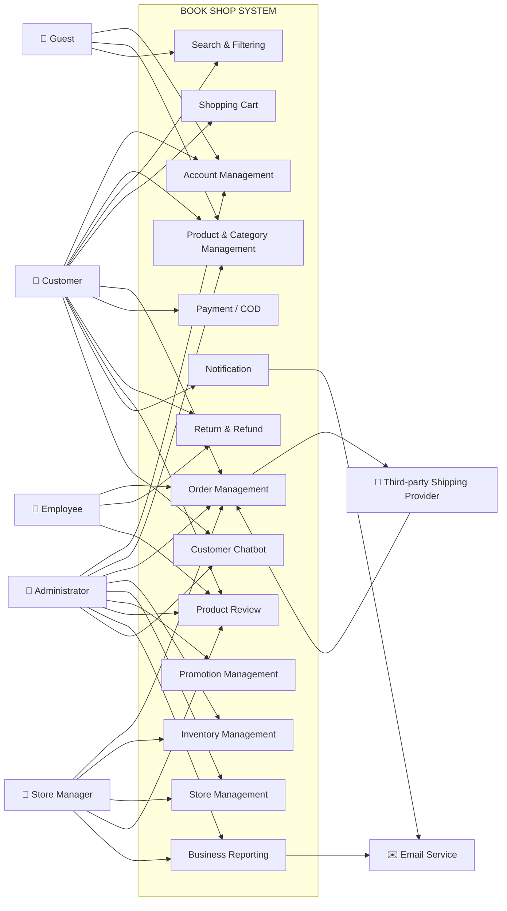

---

# 6. USE CASE CATALOG

## 6.1. Account Management

| ID         | Use Case                    | Primary Actor |
| ---------- | --------------------------- | ------------- |
| UC-ACC-001 | Register Account            | Guest         |
| UC-ACC-002 | Register with Google        | Guest         |
| UC-ACC-003 | Login                       | Customer      |
| UC-ACC-004 | Login with Google           | Customer      |
| UC-ACC-005 | Verify Account              | Customer      |
| UC-ACC-006 | Reset Password              | Customer      |
| UC-ACC-007 | Manage Personal Information | Customer      |
| UC-ACC-008 | Manage Shipping Address     | Customer      |
| UC-ACC-009 | View Purchase History       | Customer      |

The use cases above are mapped from FR-ACC-001 through FR-ACC-007. The SRS also includes registration and login with Google.

---

# 7. UC-ACC-001 — REGISTER ACCOUNT

| Field               | Description                         |
| ------------------- | ----------------------------------- |
| Use Case ID         | UC-ACC-001                          |
| Name                | Register Account                    |
| Primary Actor       | Guest                               |
| Goal                | Create a new Customer account       |
| Related Requirement | FR-ACC-001                          |
| Trigger             | Guest selects the Register function |
| Priority            | Must Have                           |

### Preconditions

- The Guest does not have an account or is on the registration screen.
- The system is operational.

### Main Flow

1. The Guest opens the registration function.
2. The system displays the registration form.
3. The Guest enters the required information.
4. The Guest submits the registration information.
5. The system validates the data.
6. The system creates the account.
7. The system requests account verification if required.
8. The system notifies the Guest that registration was successful.

### Alternative Flow

**A1 — Invalid Data**

1. The system detects invalid data.
2. The system displays an error message.
3. The Guest corrects the information.
4. The use case resumes from Step 4.

**A2 — Account Already Exists**

1. The system detects that the account already exists.
2. The system notifies the Guest.
3. The use case ends.

### Postconditions

- The Customer account is successfully created, or the registration request is rejected.

---

# 8. UC-ACC-002 — REGISTER WITH GOOGLE

| Field               | Description                          |
| ------------------- | ------------------------------------ |
| Use Case ID         | UC-ACC-002                           |
| Name                | Register with Google                 |
| Primary Actor       | Guest                                |
| Goal                | Register for an account using Google |
| Related Requirement | FR-ACC-001                           |
| Priority            | Must Have                            |

### Main Flow

1. The Guest selects Register with Google.
2. The system redirects the Guest to Google's authentication process.
3. The Guest authenticates with Google.
4. Google returns the authentication result.
5. The system checks the account information.
6. The system creates or links a Customer account.
7. The system displays the result.

### Alternative Flow

**A1 — Google authentication failed**

1. Google returns an invalid result.
2. The system rejects the registration.
3. The system displays an error message.

---

# 9. UC-ACC-003 — LOGIN

| Field               | Description        |
| ------------------- | ------------------ |
| Use Case ID         | UC-ACC-003         |
| Name                | Login              |
| Primary Actor       | Customer           |
| Goal                | Access the account |
| Related Requirement | FR-ACC-002         |
| Priority            | Must Have          |

### Main Flow

1. The Customer opens the Login screen.
2. The Customer enters their login credentials.
3. The Customer submits the request.
4. The system authenticates the information.
5. The system grants access to the account.
6. The system creates a login session.

### Alternative Flow

**A1 — Invalid credentials**

1. The system determines that the login credentials are invalid.
2. The system displays an error message.
3. The Customer may try again.

---

# 10. UC-ACC-004 — LOGIN WITH GOOGLE

| Field               | Description        |
| ------------------- | ------------------ |
| Use Case ID         | UC-ACC-004         |
| Name                | Login with Google  |
| Primary Actor       | Customer           |
| Goal                | Log in with Google |
| Related Requirement | FR-ACC-002         |
| Priority            | Must Have          |

### Main Flow

1. The Customer selects Login with Google.
2. The system requests authentication from Google.
3. The Customer authenticates.
4. Google returns the result.
5. The system authenticates the account.
6. The system grants the Customer access to the system.

---

# 11. UC-ACC-005 — VERIFY ACCOUNT

| Field               | Description        |
| ------------------- | ------------------ |
| Use Case ID         | UC-ACC-005         |
| Name                | Verify Account     |
| Primary Actor       | Customer           |
| Goal                | Verify the account |
| Related Requirement | FR-ACC-003         |
| Method              | OTP                |

### Main Flow

1. The system requests account verification.
2. The system sends an OTP.
3. The Customer enters the OTP.
4. The system validates the OTP.
5. If the OTP is valid, the system verifies the account.
6. The system displays the result.

### Alternative Flow

- The OTP is invalid.
- The OTP has expired.
- The Customer enters the OTP again.

---

# 12. UC-ACC-006 — RESET PASSWORD

| Field               | Description                   |
| ------------------- | ----------------------------- |
| Use Case ID         | UC-ACC-006                    |
| Name                | Reset Password                |
| Primary Actor       | Customer                      |
| Goal                | Recover access to the account |
| Related Requirement | FR-ACC-004                    |

### Main Flow

1. The Customer selects Forgot Password.
2. The Customer provides their email address.
3. The system sends an OTP.
4. The Customer enters the OTP.
5. The system verifies the OTP.
6. The Customer provides a new password.
7. The system updates the password.
8. The system displays a success message.

---

# 13. UC-ACC-007 — MANAGE PERSONAL INFORMATION

| Field               | Description |
| ------------------- | ----------- |
| Use Case ID         | UC-ACC-007  |
| Primary Actor       | Customer    |
| Related Requirement | FR-ACC-005  |

### Main Flow

1. The Customer opens Profile.
2. The system displays the current information.
3. The Customer edits their information.
4. The Customer saves the changes.
5. The system validates the data.
6. The system updates the information.
7. The system displays the result.

---

# 14. UC-ACC-008 — MANAGE SHIPPING ADDRESS

| Field               | Description |
| ------------------- | ----------- |
| Use Case ID         | UC-ACC-008  |
| Primary Actor       | Customer    |
| Related Requirement | FR-ACC-006  |

### Supported Operations

- Add Address
- View Address
- Edit Address
- Select Address for Order

---

# 15. UC-ACC-009 — VIEW PURCHASE HISTORY

| Field               | Description |
| ------------------- | ----------- |
| Use Case ID         | UC-ACC-009  |
| Primary Actor       | Customer    |
| Related Requirement | FR-ACC-007  |

### Main Flow

1. The Customer opens Purchase History.
2. The system retrieves the Customer's orders.
3. The system displays the list.
4. The Customer selects an order.
5. The system displays the details.

---

# 16. PRODUCT & CATEGORY MANAGEMENT

## 16.1. Use Case Diagram

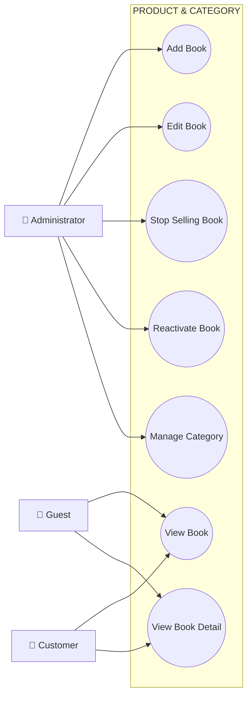

---

# 17. PRODUCT USE CASES

| ID          | Use Case          | Actor                | Requirement |
| ----------- | ----------------- | -------------------- | ----------- |
| UC-PROD-001 | Add Book          | Administrator        | FR-PROD-001 |
| UC-PROD-002 | View Book         | All authorized users | FR-PROD-002 |
| UC-PROD-003 | Edit Book         | Administrator        | FR-PROD-003 |
| UC-PROD-004 | Stop Selling Book | Administrator        | FR-PROD-004 |
| UC-PROD-005 | Reactivate Book   | Administrator        | FR-PROD-005 |
| UC-PROD-006 | View Book Detail  | Guest/Customer       | FR-PROD-006 |
| UC-PROD-007 | Add Book to Cart  | Customer             | FR-PROD-007 |
| UC-PROD-008 | Buy Now           | Customer             | FR-PROD-008 |

---

# 18. UC-PROD-001 — ADD BOOK

### Preconditions

- The Actor is logged in.
- The Actor has Administrator privileges.

### Main Flow

1. The Administrator opens Product Management.
2. The Administrator selects Add Book.
3. The Administrator enters the book information.
4. The system validates the data.
5. The Administrator confirms.
6. The system creates the book.
7. The system displays the result.

### Business Rules

- The Selling Price must not be less than 0.
- All required information must be provided.

Business Rule BR-001 requires the system to reject selling prices below 0.

---

# 19. SEARCH & FILTERING

## 19.1. Use Case Diagram

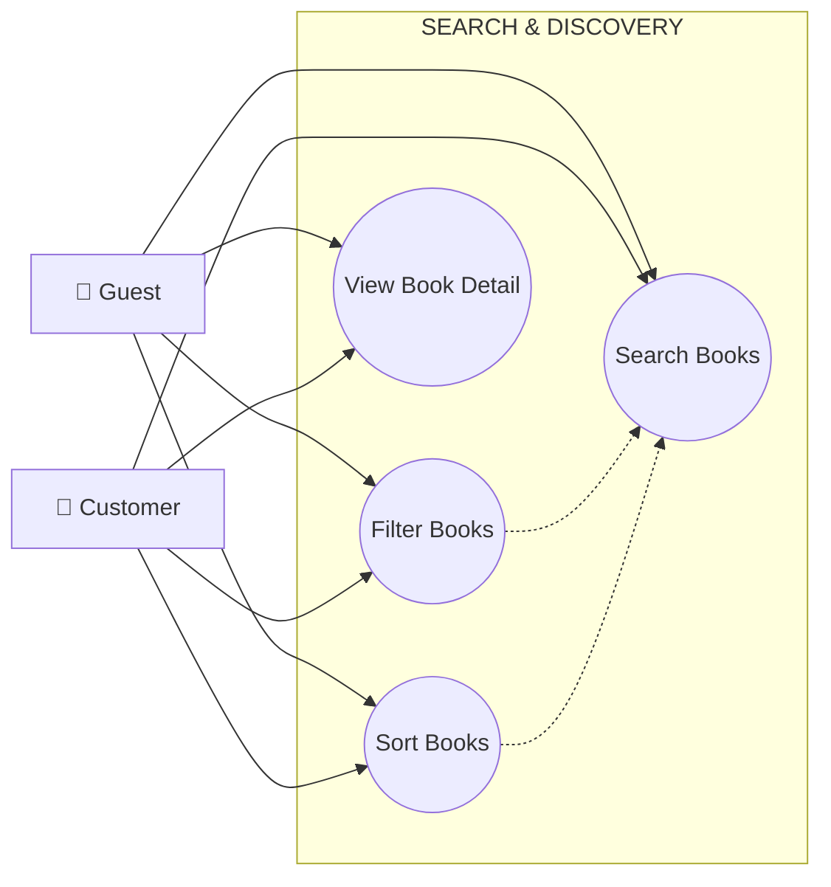

### Use Cases

| ID            | Use Case         | Actor           |
| ------------- | ---------------- | --------------- |
| UC-SEARCH-001 | Search Books     | Guest, Customer |
| UC-SEARCH-002 | Filter Books     | Guest, Customer |
| UC-SEARCH-003 | Sort Books       | Guest, Customer |
| UC-SEARCH-004 | View Book Detail | Guest, Customer |

Search supports book titles, authors, publishers, categories, and related keywords. Filter supports price, category, publisher, rating, and availability.

---

# 20. SHOPPING CART

## 20.1. Use Case Diagram

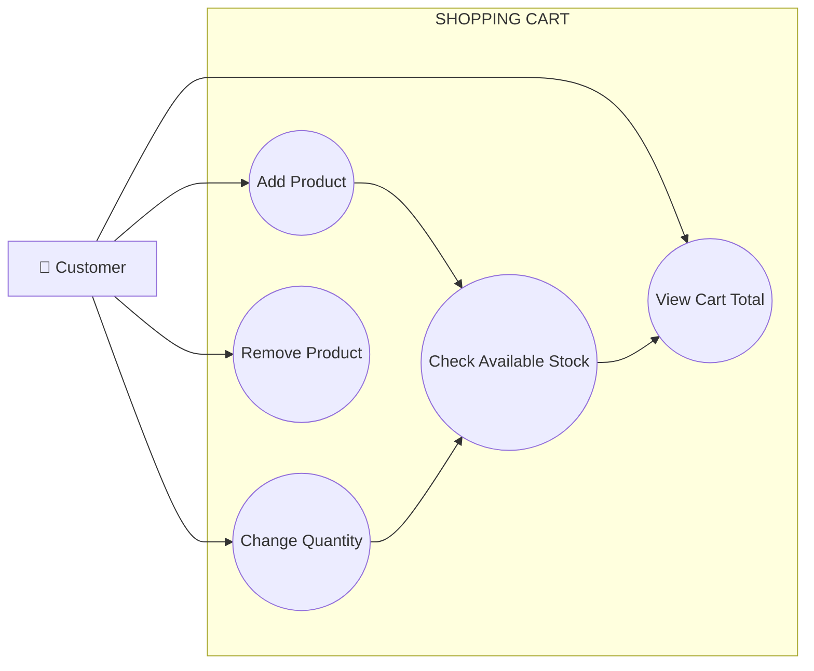

## 20.2. Use Case List

| ID          | Use Case              | Actor           | Requirement |
| ----------- | --------------------- | --------------- | ----------- |
| UC-CART-001 | Add Product           | Customer        | FR-CART-001 |
| UC-CART-002 | Change Quantity       | Customer        | FR-CART-002 |
| UC-CART-003 | Remove Product        | Customer        | FR-CART-003 |
| UC-CART-004 | View Cart Total       | Customer        | FR-CART-004 |
| UC-CART-005 | Check Available Stock | Customer/System | FR-CART-005 |

### Important Business Rule

Customers must not order quantities greater than the available sellable quantity.

```text
Requested Quantity <= Available Quantity
```

This rule is defined in BR-002 and FR-CART-005.

---

# 21. ORDER & CHECKOUT

## 21.1. Use Case Diagram

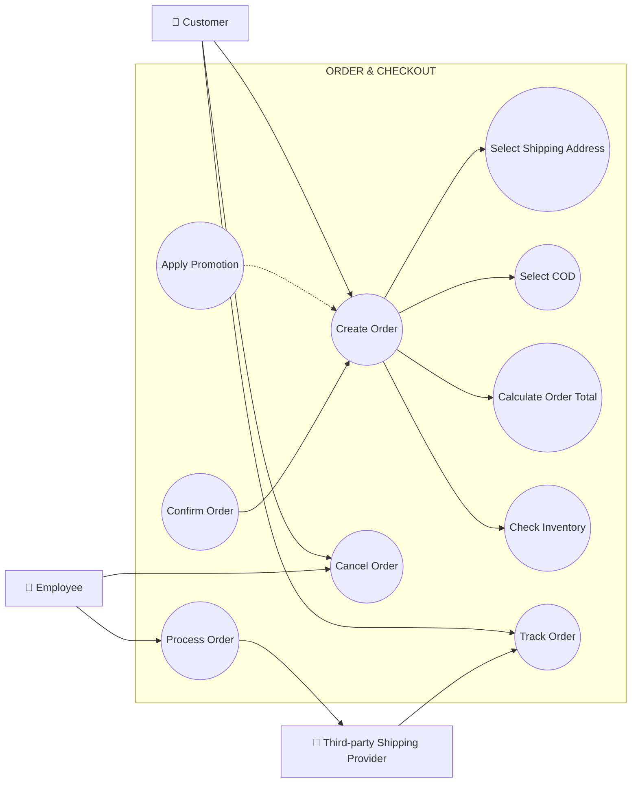

---

# 22. UC-ORDER-001 — CREATE ORDER

| Field                | Description                 |
| -------------------- | --------------------------- |
| Use Case ID          | UC-ORDER-001                |
| Name                 | Create Order                |
| Primary Actor        | Customer                    |
| Related Requirements | FR-ORDER-001 → FR-ORDER-005 |
| Priority             | Must Have                   |

### Preconditions

- The Customer is logged in.
- The selected product exists.
- The product is available for sale.
- The Customer has a valid shipping address.

### Main Flow

1. The Customer selects a product.
2. The Customer adds the product to the Cart or selects Buy Now.
3. The Customer opens Checkout.
4. The system displays the products and quantities.
5. The Customer selects a shipping address.
6. The Customer selects Cash on Delivery (COD) as the payment method.
7. The Customer applies a promotion, if available.
8. The system validates the promotion.
9. The system checks inventory.
10. The system calculates the total amount.
11. The system displays the total amount.
12. The Customer confirms the order.
13. The system creates the Order.
14. The Order is created with the status **Pending Confirmation**.
15. The system displays the result.

### Alternative Flow

**A1 — Insufficient Stock**

1. The system detects that the Available Quantity is insufficient.
2. The system rejects the order creation request.
3. The system notifies the Customer of the quantity available for purchase.

**A2 — Invalid Promotion**

1. The system validates the promotion.
2. The promotion does not meet the required conditions.
3. The system does not apply the promotion.
4. The Customer may continue without the discount.

**A3 — Customer Does Not Confirm**

1. The Customer returns to the Cart.
2. The Order is not created.

---

# 23. UC-ORDER-002 — CALCULATE ORDER TOTAL

### Main Flow

The system determines:

```text
Total
=
Product Price × Quantity
− Promotion Discount
+ Supported Additional Charges
```

The system must clearly display the total amount before the Customer confirms the order.

This requirement corresponds to FR-ORDER-002 and BR-009.

---

# 24. UC-ORDER-003 — CONFIRM ORDER

### Main Flow

1. The Customer reviews the checkout information.
2. The Customer confirms the Order.
3. The system rechecks the required conditions.
4. The system creates the Order.
5. The system sets the status to **Pending Confirmation**.
6. The system updates the related data.
7. The system sends a notification.

---

# 25. ORDER LIFECYCLE

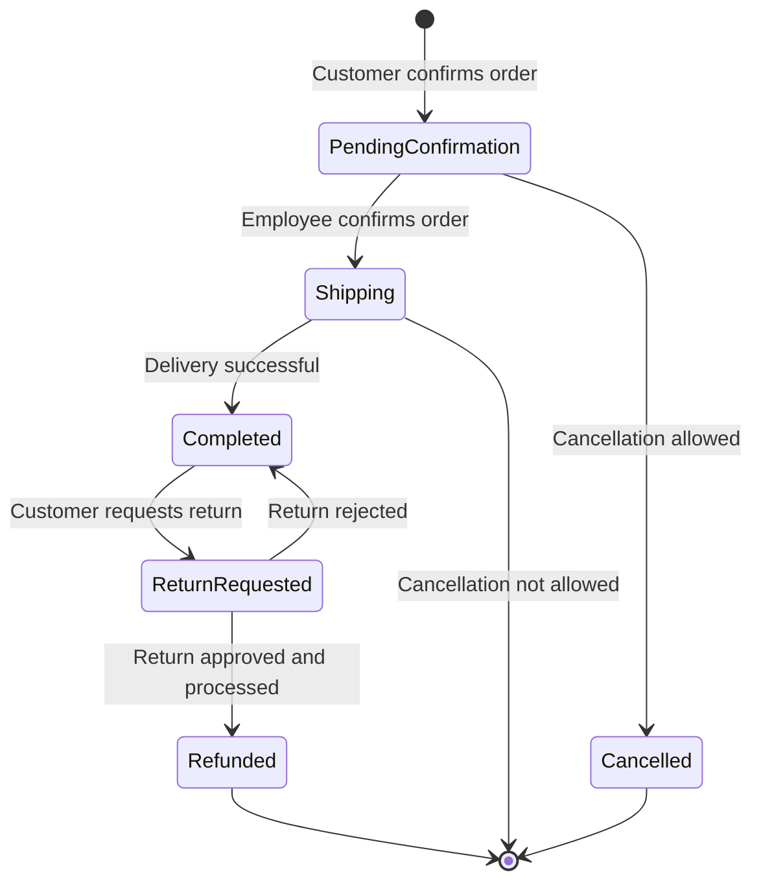

The minimum Order lifecycle defined in the SRS is:

```text
Pending Confirmation
      ↓
Shipping
      ↓
Completed
```

The Order may also transition to the Cancelled status, subject to business conditions.

---

# 26. UC-ORDER-004 — CUSTOMER CANCEL ORDER

| Field               | Description  |
| ------------------- | ------------ |
| Use Case ID         | UC-ORDER-004 |
| Primary Actor       | Customer     |
| Related Requirement | FR-ORDER-007 |

### Preconditions

The Customer has an Order.

### Main Flow

1. The Customer opens Order Details.
2. The Customer selects Cancel Order.
3. The system checks the Order Status.
4. The system checks the Cancellation Policy.
5. If permitted, the system cancels the Order.
6. The system updates the related data.
7. The system sends a notification.

### Exception

If:

```text
Order Status = Shipping
```

the system must reject the cancellation request.

This is explicitly specified in FR-ORDER-007 and BR-010.

---

# 27. ORDER MANAGEMENT — EMPLOYEE

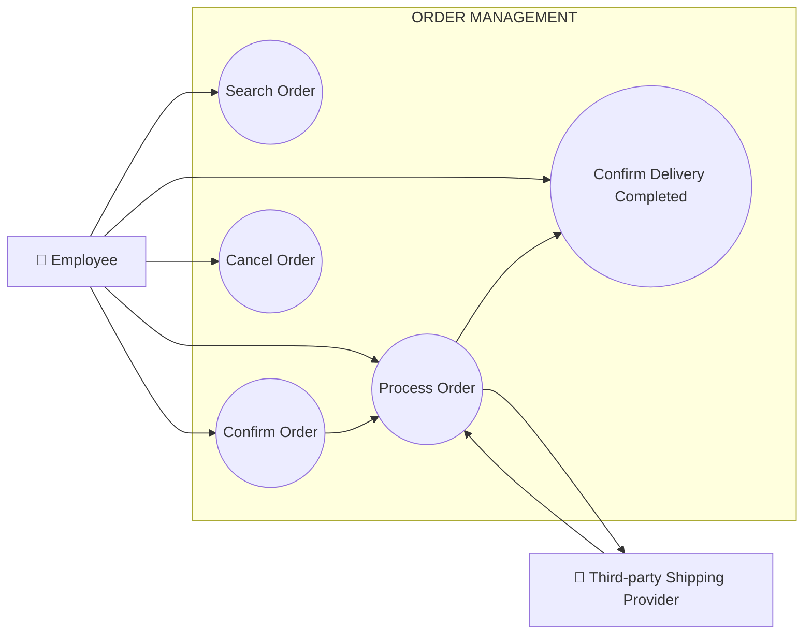

## Use Cases

| ID           | Use Case                   | Actor    |
| ------------ | -------------------------- | -------- |
| UC-ORDER-005 | Search Order               | Employee |
| UC-ORDER-006 | Confirm Order              | Employee |
| UC-ORDER-007 | Process Order              | Employee |
| UC-ORDER-008 | Cancel Order               | Employee |
| UC-ORDER-009 | Confirm Delivery Completed | Employee |

Employees are responsible for searching for, confirming, and processing orders, forwarding orders to the shipping provider, and confirming delivery status.

---

# 28. PAYMENT — COD

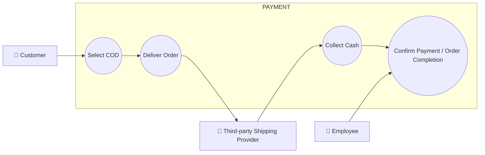

### UC-PAY-001 — PAY BY COD

**Primary Actor:** Customer

### Main Flow

1. The Customer selects COD.
2. The system records COD as the payment method.
3. The Order is confirmed.
4. The Order is handed over to the shipping provider.
5. The shipping provider delivers the order.
6. The Customer pays upon delivery.
7. Book Shop receives the payment information/payment.
8. The Employee confirms that the Order is completed.

Version 1.0 supports COD only and does not support online payment gateways.

---

# 29. RETURN & REFUND

## 29.1. Use Case Diagram

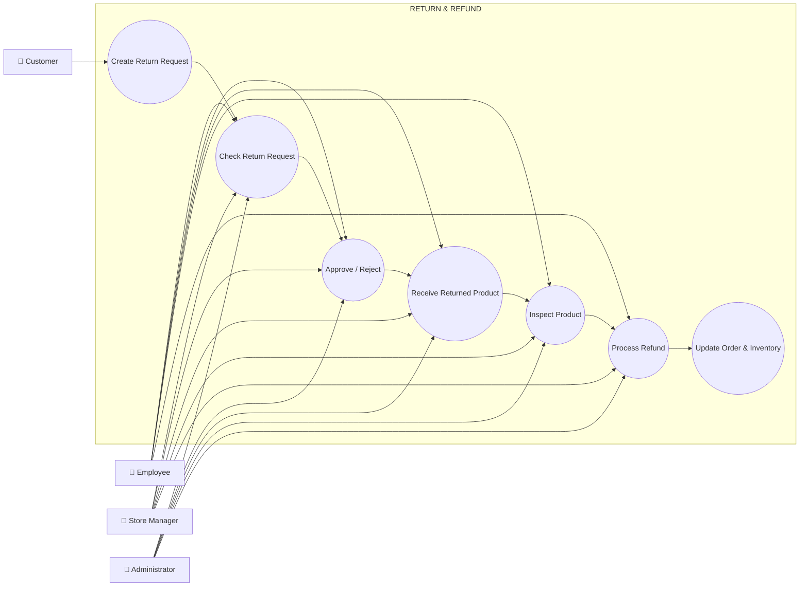

## Use Case List

| ID            | Use Case                 | Actor                            |
| ------------- | ------------------------ | -------------------------------- |
| UC-RETURN-001 | Create Return Request    | Customer                         |
| UC-RETURN-002 | Check Return Request     | Employee / Store Manager / Admin |
| UC-RETURN-003 | Approve Return           | Authorized Staff                 |
| UC-RETURN-004 | Reject Return            | Authorized Staff                 |
| UC-RETURN-005 | Receive Returned Product | Authorized Staff                 |
| UC-RETURN-006 | Inspect Returned Product | Authorized Staff                 |
| UC-RETURN-007 | Process Refund           | Authorized Staff                 |
| UC-RETURN-008 | Update Order & Inventory | System                           |

---

# 30. UC-RETURN-001 — CREATE RETURN REQUEST

### Preconditions

- The Order has the status **Completed**.
- The Customer has received the product.
- No more than 3 days have elapsed since delivery.

### Main Flow

1. The Customer opens Order Details.
2. The Customer selects Return/Refund.
3. The system checks the eligibility conditions.
4. The Customer provides supporting evidence.
5. The Customer provides bank account information.
6. The Customer submits the request.
7. The system creates a Return Request.
8. The system displays the result.

### Exception

If the Order is not completed or the 3-day period has expired:

```text
Return Request = Rejected
```

The SRS specifies that a Customer may request a return only after receiving the product and while the Order is in the Completed status, within 3 days of receipt.

---

# 31. RETURN & REFUND LIFECYCLE

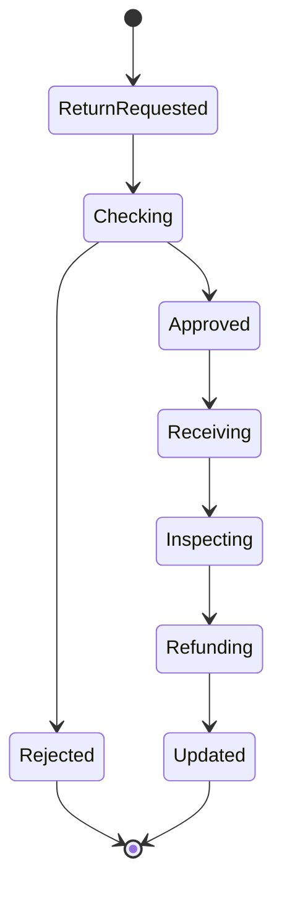

---

# 32. INVENTORY MANAGEMENT

## 32.1. Use Case Diagram

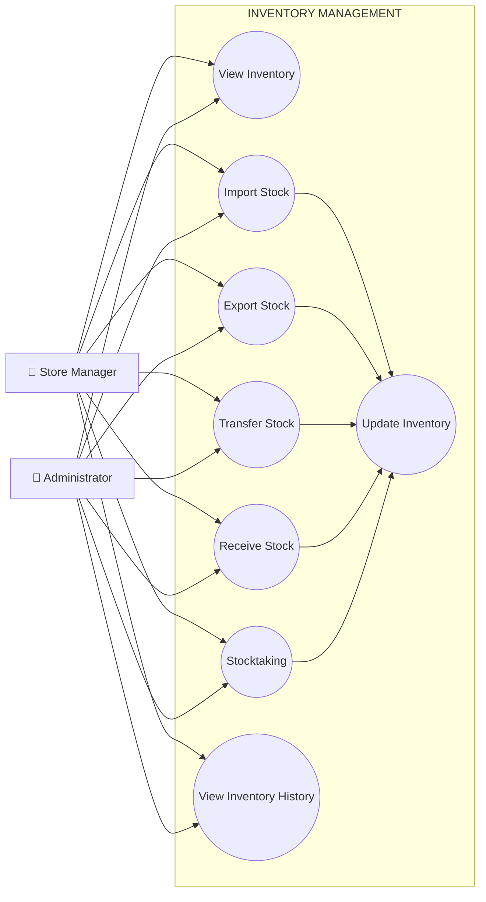

## Inventory Use Cases

| ID         | Use Case               | Actor                |
| ---------- | ---------------------- | -------------------- |
| UC-INV-001 | View Inventory         | Store Manager, Admin |
| UC-INV-002 | Stocktaking            | Store Manager, Admin |
| UC-INV-003 | Import Stock           | Store Manager, Admin |
| UC-INV-004 | Export Stock           | Store Manager, Admin |
| UC-INV-005 | Transfer Stock         | Store Manager, Admin |
| UC-INV-006 | Receive Stock          | Store Manager, Admin |
| UC-INV-007 | View Inventory History | Store Manager, Admin |
| UC-INV-008 | Update Inventory       | System               |

Inventory must track Current Quantity, Reserved Quantity, Available Quantity, Damaged Quantity, and Pending Incoming Quantity.

---

# 33. STORE MANAGEMENT

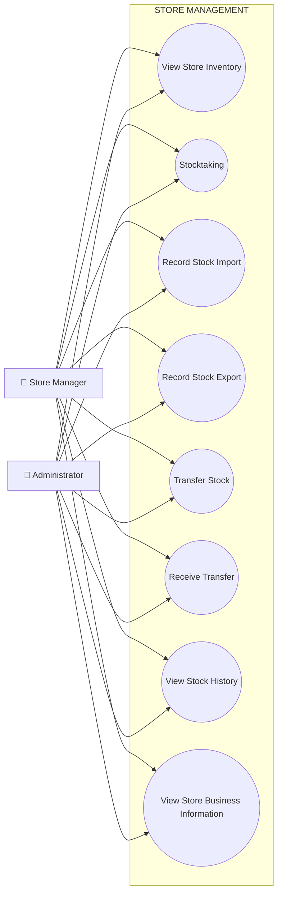

A Store Manager may perform operations only within their assigned store.

---

# 34. PROMOTION MANAGEMENT

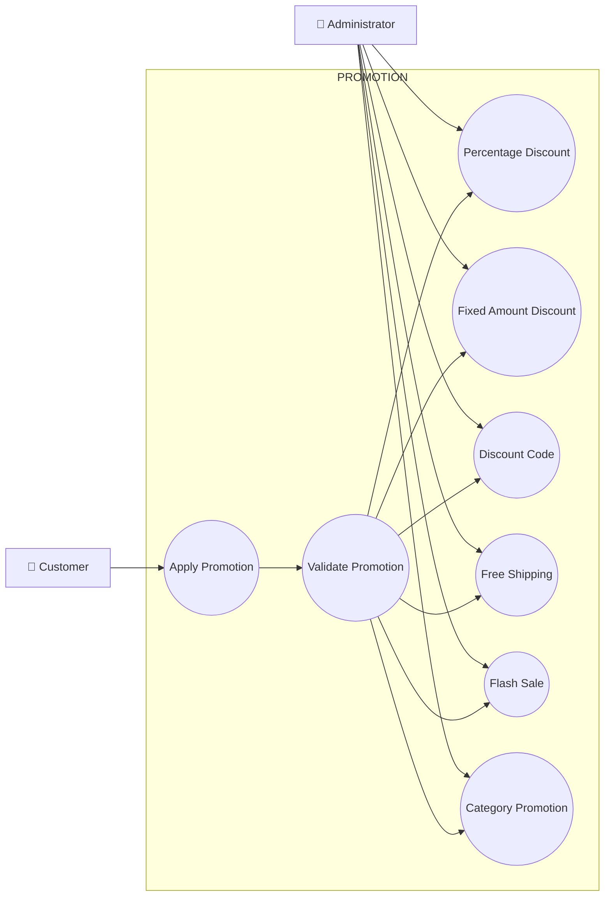

### Promotion Validation

Promotions must be validated based on:

- Product.
- Order value.
- Effective time.
- Usage count.

Expired promotions must not be applied.

---

# 35. PRODUCT REVIEW

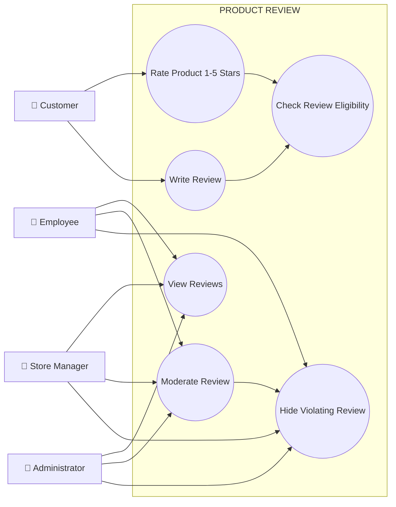

### Business Rule

Customers can rate products from **1 to 5 stars**.

Book Shop may require Customers to have purchased a product before submitting a review.

---

# 36. NOTIFICATION

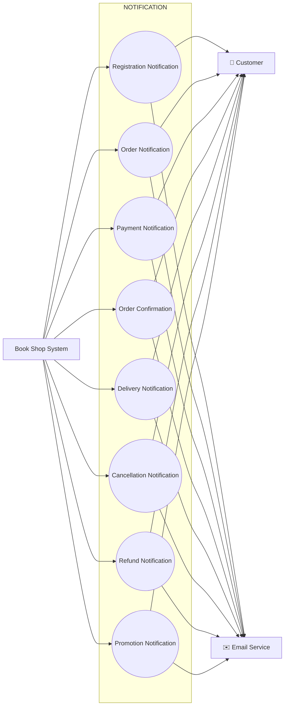

The SRS requires notifications for registration, order placement, payment, order confirmation, delivery, cancellation, refunds, and promotions. The supported channels are in-app notifications and email.

---

# 37. CUSTOMER CHATBOT

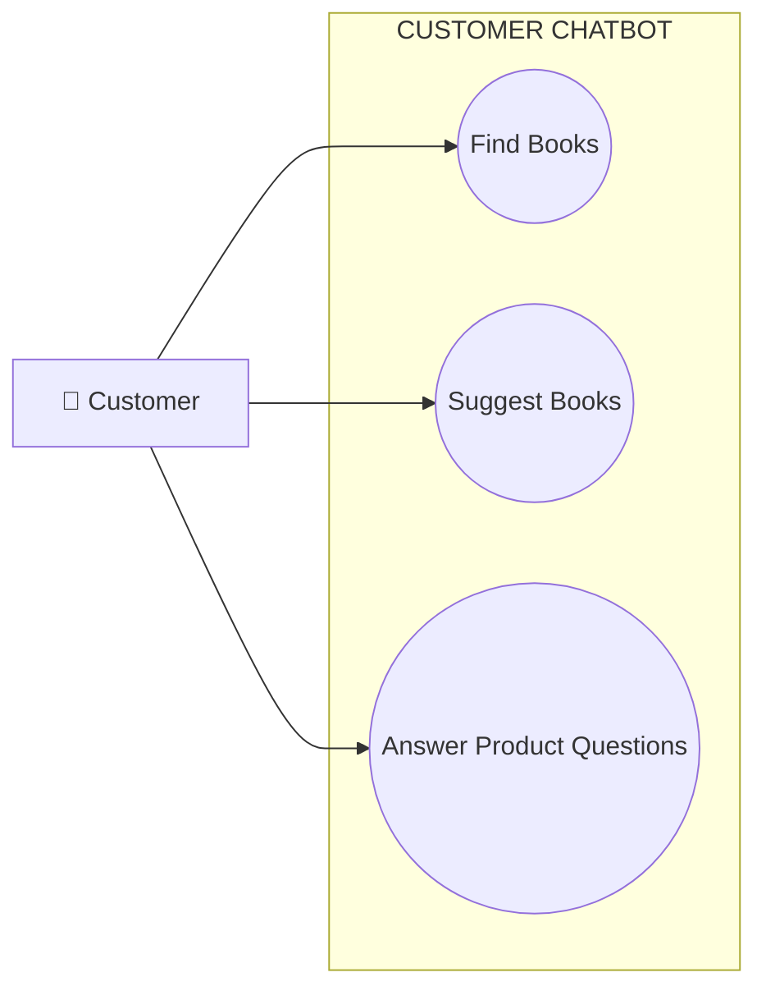

## Use Cases

| ID          | Use Case                 | Actor    |
| ----------- | ------------------------ | -------- |
| UC-CHAT-001 | Find Books               | Customer |
| UC-CHAT-002 | Suggest Books            | Customer |
| UC-CHAT-003 | Answer Product Questions | Customer |

Personalized recommendation is **not mandatory for version 1.0**.

---

# 38. BUSINESS REPORTING

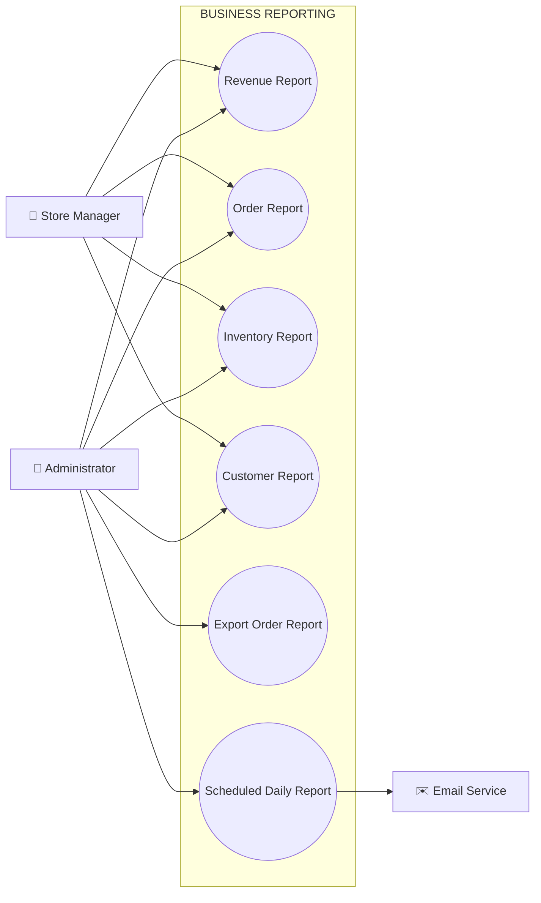

## Reports

### Revenue Report

Reports can be viewed by:

- Day
- Week
- Month
- Quarter
- Year
- Store
- Product
- Category

### Order Report

- New Orders
- Processing Orders
- Completed Orders
- Cancelled Orders

### Inventory Report

- Low Stock Books
- Out-of-stock Books
- Best-selling Books
- Slow-moving Books

### Customer Report

- New Customers
- Returning Customers
- Purchase Frequency

These report types are defined in FR-REPORT-001 through FR-REPORT-004.

---

# 39. CROSS-MODULE USE CASE RELATIONSHIPS

## 39.1. Order Relationship

An Order has the following mandatory behaviors:

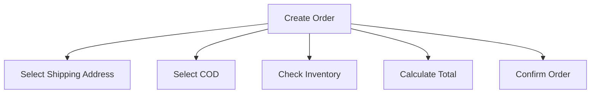

In the Use Case Document, mandatory functions can be represented using:

```text
Create Order
    <<include>> Select Shipping Address
    <<include>> Select Payment Method
    <<include>> Check Inventory
    <<include>> Calculate Order Total
    <<include>> Confirm Order
```

---

## 39.2. Promotion Relationship

Promotion is an optional function during checkout:

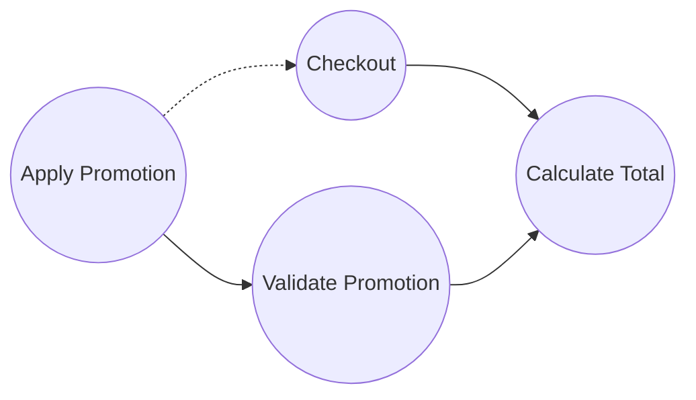

Because the Customer **may or may not** apply a promotion, `Apply Promotion` is considered an optional behavior of Checkout.

---

## 39.3. Return & Refund Relationship

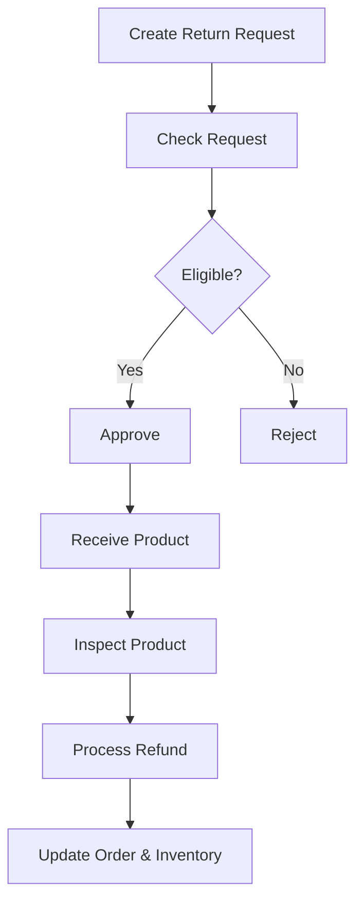

---

# 40. AUTHORIZATION MODEL

Authorization is not an independent Use Case; it is a **cross-cutting business behavior** that applies to Use Cases requiring permission.

```mermaid
flowchart LR

    Actor["Actor"]

    Authorization(("Check Authorization"))

    UC1(("Manage Product"))
    UC2(("Process Order"))
    UC3(("Manage Inventory"))
    UC4(("Manage Promotion"))
    UC5(("View Report"))

    Actor --> Authorization

    Authorization --> UC1
    Authorization --> UC2
    Authorization --> UC3
    Authorization --> UC4
    Authorization --> UC5
```

For example:

```text
Administrator
    → Manage Product
    → Manage Promotion
    → Manage Inventory
    → View Reports

Store Manager
    → Manage Inventory
    → Store Management
    → Assigned Order Management
    → Assigned Store Reports

Employee
    → Order Management
    → Return/Refund according to permission
```

This permission matrix is based on the authorization matrix in the SRS.

---

# 41. COMPLETE CUSTOMER JOURNEY

The most important Customer Use Case flow:

```mermaid
flowchart TD

    Start([Start])

    Register["Register Account"]
    Verify["Verify Account"]
    Login["Login"]

    Search["Search Books"]
    Detail["View Book Detail"]

    Decision1{"Add to Cart or Buy Now?"}

    Cart["Manage Shopping Cart"]
    Checkout["Checkout"]

    Address["Select Address"]
    COD["Select COD"]
    Promotion["Apply Promotion"]
    Stock["Check Inventory"]
    Total["Calculate Total"]

    Confirm["Confirm Order"]

    Pending["Order: Pending Confirmation"]
    Shipping["Order: Shipping"]
    Completed["Order: Completed"]

    Track["Track Order"]

    Review["Review Product"]

    Return["Request Return"]
    Refund["Refund"]

    End([End])

    Start --> Register
    Register --> Verify
    Verify --> Login

    Login --> Search
    Search --> Detail

    Detail --> Decision1

    Decision1 -->|Add to Cart| Cart
    Cart --> Checkout

    Decision1 -->|Buy Now| Checkout

    Checkout --> Address
    Checkout --> COD
    Checkout --> Promotion
    Checkout --> Stock
    Checkout --> Total

    Address --> Confirm
    COD --> Confirm
    Promotion --> Confirm
    Stock --> Confirm
    Total --> Confirm

    Confirm --> Pending
    Pending --> Shipping
    Shipping --> Completed

    Pending --> Track
    Shipping --> Track
    Completed --> Track

    Completed --> Review
    Completed --> Return
    Return --> Refund

    Review --> End
    Refund --> End
    Track --> End
```

---

# 42. COMPLETE ADMIN JOURNEY

```mermaid
flowchart TD

    Start([Administrator Login])

    Product["Manage Products"]
    Category["Manage Categories"]
    Promotion["Manage Promotions"]
    User["Manage Users"]
    Inventory["Manage Inventory"]
    Store["Manage Stores"]
    Order["Manage Orders"]
    Review["Moderate Reviews"]
    Report["View Business Reports"]

    Export["Export Order Report"]
    Email["Receive Daily Report Email"]

    Start --> Product
    Start --> Category
    Start --> Promotion
    Start --> User
    Start --> Inventory
    Start --> Store
    Start --> Order
    Start --> Review
    Start --> Report

    Report --> Export
    Report --> Email
```

The Administrator can manage all activities permitted by Book Shop, including users, products, categories, orders, inventory, stores, promotions, reviews, and reports.

---

# 43. COMPLETE EMPLOYEE JOURNEY

```mermaid
flowchart TD

    Start([Employee Login])

    Search["Search Order"]
    Confirm["Confirm Order"]
    Process["Process Order"]
    Shipping["Third-party Shipping"]
    Delivery["Receive Delivery Status"]
    Complete["Confirm Completed"]
    Cancel["Cancel Order"]
    Return["Process Return / Refund"]

    Start --> Search
    Search --> Confirm
    Confirm --> Process
    Process --> Shipping
    Shipping --> Delivery
    Delivery --> Complete

    Search --> Cancel
    Search --> Return
```

---

# 44. COMPLETE STORE MANAGER JOURNEY

```mermaid
flowchart TD

    Start([Store Manager Login])

    Inventory["View Inventory"]
    Count["Stocktaking"]
    Import["Import Stock"]
    Export["Export Stock"]
    Transfer["Transfer Stock"]
    Receive["Receive Stock"]
    History["View Inventory History"]

    Order["Manage Assigned Orders"]
    Business["View Store Business Information"]

    Start --> Inventory
    Start --> Order
    Start --> Business

    Inventory --> Count
    Inventory --> Import
    Inventory --> Export
    Inventory --> Transfer

    Transfer --> Receive

    Count --> History
    Import --> History
    Export --> History
    Receive --> History
```

---

# 45. USE CASE TRACEABILITY MATRIX

| Use Case                                  | SRS Requirement |
| ----------------------------------------- | --------------- |
| UC-ACC-001 Register Account               | FR-ACC-001      |
| UC-ACC-002 Register with Google           | FR-ACC-001      |
| UC-ACC-003 Login                          | FR-ACC-002      |
| UC-ACC-004 Login with Google              | FR-ACC-002      |
| UC-ACC-005 Verify Account                 | FR-ACC-003      |
| UC-ACC-006 Reset Password                 | FR-ACC-004      |
| UC-ACC-007 Manage Personal Information    | FR-ACC-005      |
| UC-ACC-008 Manage Shipping Address        | FR-ACC-006      |
| UC-ACC-009 View Purchase History          | FR-ACC-007      |
| UC-PROD-001 Add Book                      | FR-PROD-001     |
| UC-PROD-002 View Book                     | FR-PROD-002     |
| UC-PROD-003 Edit Book                     | FR-PROD-003     |
| UC-PROD-004 Stop Selling Book             | FR-PROD-004     |
| UC-PROD-005 Reactivate Book               | FR-PROD-005     |
| UC-SEARCH-001 Search Books                | FR-SEARCH-001   |
| UC-SEARCH-002 Filter Books                | FR-SEARCH-002   |
| UC-SEARCH-003 Sort Books                  | FR-SEARCH-003   |
| UC-PROD-006 View Book Detail              | FR-PROD-006     |
| UC-PROD-007 Add Book to Cart              | FR-PROD-007     |
| UC-PROD-008 Buy Now                       | FR-PROD-008     |
| UC-CART-001 Add Product                   | FR-CART-001     |
| UC-CART-002 Change Quantity               | FR-CART-002     |
| UC-CART-003 Remove Product                | FR-CART-003     |
| UC-CART-004 View Cart Total               | FR-CART-004     |
| UC-CART-005 Check Available Stock         | FR-CART-005     |
| UC-ORDER-001 Create Order                 | FR-ORDER-001    |
| UC-ORDER-002 Calculate Order Total        | FR-ORDER-002    |
| UC-ORDER-003 Check Inventory Before Order | FR-ORDER-003    |
| UC-ORDER-004 Apply Promotion              | FR-ORDER-004    |
| UC-ORDER-005 Confirm Order                | FR-ORDER-005    |
| UC-PAY-001 Pay by COD                     | FR-PAY-001      |
| UC-PAY-002 Confirm Payment                | FR-PAY-002      |
| UC-ORDER-006 View Customer Order          | FR-ORDER-006    |
| UC-ORDER-007 Customer Cancel Order        | FR-ORDER-007    |
| UC-ORDER-008 Search Order                 | FR-ORDER-008    |
| UC-ORDER-009 Confirm Order                | FR-ORDER-009    |
| UC-ORDER-010 Process Order                | FR-ORDER-010    |
| UC-ORDER-011 Employee Cancel Order        | FR-ORDER-011    |
| UC-RETURN-001 Create Return Request       | FR-RETURN-001   |
| UC-RETURN-002 Check Return Request        | FR-RETURN-002   |
| UC-RETURN-003 Approve/Reject Return       | FR-RETURN-003   |
| UC-RETURN-004 Receive Returned Product    | FR-RETURN-004   |
| UC-RETURN-005 Process Refund              | FR-RETURN-005   |
| UC-RETURN-006 Update Order & Inventory    | FR-RETURN-006   |
| UC-INV-001 View Inventory                 | FR-INV-001      |
| UC-INV-002 Update Inventory               | FR-INV-002      |
| UC-INV-003 Validate Available Stock       | FR-INV-003      |
| UC-STORE-001 View Store Inventory         | FR-STORE-001    |
| UC-STORE-002 Stocktaking                  | FR-STORE-002    |
| UC-STORE-003 Import Stock                 | FR-STORE-003    |
| UC-STORE-004 Export Stock                 | FR-STORE-004    |
| UC-STORE-005 Transfer Stock               | FR-STORE-005    |
| UC-STORE-006 Receive Stock                | FR-STORE-006    |
| UC-STORE-007 View Inventory History       | FR-STORE-007    |
| UC-PROMO-001 Percentage Promotion         | FR-PROMO-001    |
| UC-PROMO-002 Fixed Amount Promotion       | FR-PROMO-002    |
| UC-PROMO-003 Discount Code                | FR-PROMO-003    |
| UC-PROMO-004 Free Shipping                | FR-PROMO-004    |
| UC-PROMO-005 Flash Sale                   | FR-PROMO-005    |
| UC-PROMO-006 Category Promotion           | FR-PROMO-006    |
| UC-PROMO-007 Validate Promotion           | FR-PROMO-007    |
| UC-REVIEW-001 Rate Product                | FR-REVIEW-001   |
| UC-REVIEW-002 Write Review                | FR-REVIEW-002   |
| UC-REVIEW-003 Check Review Eligibility    | FR-REVIEW-003   |
| UC-REVIEW-004 Moderate Review             | FR-REVIEW-004   |
| UC-NOTI-001 Send Notification             | FR-NOTI-001     |
| UC-CHAT-001 Find Books                    | FR-CHAT-001     |
| UC-CHAT-002 Suggest Books                 | FR-CHAT-002     |
| UC-CHAT-003 Answer Product Questions      | FR-CHAT-003     |
| UC-REPORT-001 Revenue Report              | FR-REPORT-001   |
| UC-REPORT-002 Order Report                | FR-REPORT-002   |
| UC-REPORT-003 Inventory Report            | FR-REPORT-003   |
| UC-REPORT-004 Customer Report             | FR-REPORT-004   |

These requirement groups are consistent with the Traceability Matrix in the SRS.

---

# 46. BUSINESS RULE TRACEABILITY

| Rule                                           | Affected Use Cases            |
| ---------------------------------------------- | ----------------------------- |
| BR-001 — Selling Price >= 0                    | UC-PROD-001                   |
| BR-002 — Cannot order beyond available stock   | UC-CART-005, UC-ORDER-003     |
| BR-003 — Expired promotion cannot be applied   | UC-PROMO-007, UC-ORDER-004    |
| BR-004 — Cannot use points beyond balance      | TBD — Loyalty not defined     |
| BR-005 — Review must comply with policy        | UC-REVIEW-003, UC-REVIEW-004  |
| BR-006 — Cancellation requires valid condition | UC-ORDER-007, UC-ORDER-011    |
| BR-007 — Refund follows return policy          | UC-RETURN-001 → UC-RETURN-006 |
| BR-008 — Authorization by responsibility       | All protected Use Cases       |
| BR-009 — Total must be shown before order      | UC-ORDER-002, UC-ORDER-005    |
| BR-010 — Cannot cancel during shipping         | UC-ORDER-007                  |

BR-004 concerning loyalty points does not yet have a corresponding module in the SRS and must be clarified before implementation.

---

# 47. OUT OF SCOPE USE CASES

The following Use Cases are **not included in the Version 1.0 Use Case Model**:

```text
Marketplace for Third-party Sellers
Livestream Selling
Book Rental
Advanced Accounting / ERP
Dedicated Mobile Application
Internal Shipping Management
Online Banking Payment
Other undefined BRD features
```

These items are outside the scope of Version 1.0 according to the SRS.

---

# 48. OPEN QUESTIONS

The following issues must be confirmed before proceeding to the Functional Specification / Technical Design.

## OQ-001 — Chatbot

The following points need to be determined:

- Does the chatbot only answer questions about books, or can it also access Orders?
- Can the chatbot place orders?
- Is conversation history stored?
- Can conversations be transferred to customer support staff?

The SRS also marks these issues as requiring clarification.

## OQ-002 — Review Eligibility

The policy needs to be determined:

```text
The Customer has purchased the product
        ↓
Is the Customer allowed to submit a review?
```

or are all Customers allowed to submit reviews?

## OQ-003 — Cancellation Policy

The exact statuses in which Customers/Employees are allowed to cancel orders must be determined.

The SRS only explicitly establishes that Customers **cannot cancel an Order while it is being shipped**.

## OQ-004 — Refund

The following points need to be determined:

- Who is authorized to approve a refund?
- What is the refund SLA?
- Are refunds to bank accounts processed manually or through the system?
- Does the system only record the refund, or does it execute the transaction directly?

## OQ-005 — Reporting Permission

Some Employee reporting permissions in the SRS are currently marked as TBD. Therefore, the specific report types that Employees may view must be determined.

## OQ-006 — Loyalty / Points

The BRD mentions reward points, but the SRS does not yet include a Loyalty module.

A decision is required:

```text
Loyalty / Point
    ├── Implement in V1.0
    └── Move to future version
```

---

# 49. USE CASE MODEL — SUMMARY

The Book Shop Use Case Model can be viewed through five main Actor groups:

```mermaid
flowchart TB

    Guest["👤 Guest"]
    Customer["👤 Customer"]
    Employee["👤 Employee"]
    Manager["👤 Store Manager"]
    Admin["👤 Administrator"]

    Account["Account"]
    Product["Product"]
    Search["Search"]
    Cart["Cart"]
    Order["Order"]
    Payment["Payment"]
    Return["Return / Refund"]
    Inventory["Inventory"]
    Store["Store"]
    Promotion["Promotion"]
    Review["Review"]
    Notification["Notification"]
    Chatbot["Chatbot"]
    Report["Reporting"]

    Guest --> Account
    Guest --> Product
    Guest --> Search

    Customer --> Account
    Customer --> Product
    Customer --> Search
    Customer --> Cart
    Customer --> Order
    Customer --> Payment
    Customer --> Return
    Customer --> Review
    Customer --> Notification
    Customer --> Chatbot

    Employee --> Order
    Employee --> Return
    Employee --> Review

    Manager --> Order
    Manager --> Inventory
    Manager --> Store
    Manager --> Review
    Manager --> Report

    Admin --> Account
    Admin --> Product
    Admin --> Order
    Admin --> Inventory
    Admin --> Store
    Admin --> Promotion
    Admin --> Review
    Admin --> Report
    Admin --> Chatbot
```

---

# 50. CONCLUSION

The Use Case Document translates the Functional Requirements in the SRS into a model of interactions between Actors and the system.

The most important business flows in Book Shop are:

```text
Guest
  ↓
Search / View Book
  ↓
Register / Login
  ↓
Customer
  ↓
Cart / Buy Now
  ↓
Checkout
  ↓
Check Inventory
  ↓
Apply Promotion (Optional)
  ↓
COD
  ↓
Confirm Order
  ↓
Employee Processing
  ↓
Third-party Shipping
  ↓
Completed
  ↓
Review
  ↓
Return / Refund (if eligible)
```

This Use Case Model follows the requirements, business rules, authorization matrix, Order lifecycle, and return/refund lifecycle defined in SRS Version 1.0.

The Use Case Document **does not introduce technical functions that have not been defined in the SRS**, particularly online payment gateways, internal shipping management, mobile applications, or functions outside the scope of Version 1.0.

**End of Document**
